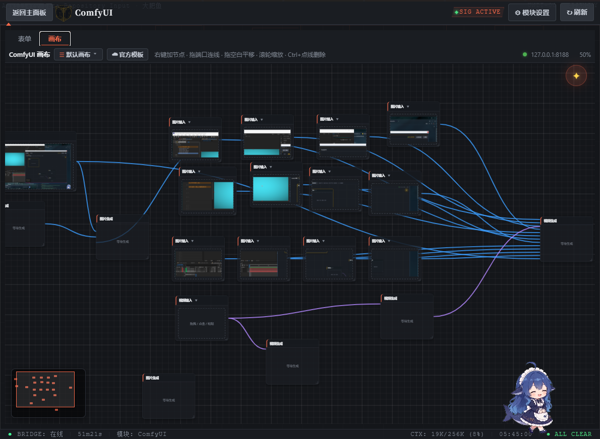

# AS_ExtP – KI-Erweiterungsplattform für After Effects

[简体中文](README.md) | [English](README.en.md) | [日本語](README.ja.md) | **Deutsch** | [한국어](README.ko.md) | [Français](README.fr.md) | [Русский](README.ru.md)

> Eine modulare Erweiterungsplattform (CEP), die KI in After Effects integriert.
>
> Version: v1.0.4

AS_ExtP ist eine KI-Erweiterungsplattform für After Effects — ein CEP-Panel plus zwei native AE-Plug-ins (der GLSL-Effekt-Host und die AE-Hotbox). Das Panel besteht aus mehreren Modulen: **Agent** (dialogbasierte Bedienung über große Sprachmodelle), **ComfyUI** (KI-Bild- und -Videogenerierung), **Asset-Bibliothek** (Verwaltung von Projekt-Assets und Vorgaben) sowie **MCP / Skill / Gedächtnis / Modellverwaltung** (Erweiterung und Konfiguration der Fähigkeiten).

Das **Agent-Modul** ist der Kern: Beschreiben Sie den Bedarf in einem Satz auf Chinesisch, und die KI ruft die eingebauten AE-Automatisierungstools selbstständig auf und führt die Operation aus – Komposition anlegen, Ebene hinzufügen, Keyframes setzen, Effekte anwenden, Ausgabe rendern – ganz ohne handgeschriebenen Code; ebenso kann die KI ExtendScript direkt erzeugen, prüfen und ausführen, ja sogar GLSL- / lineare JS-Pixeleffekte erzeugen, die in AE in Echtzeit laufen.

Darüber hinaus stellt der **Extern-Modus** des Agent-Moduls den gesamten Funktionsumfang für AE-Operationen als standardmäßigen **MCP-Server** bereit, den externe Agent-Software aufrufen kann – in Claude Code / Cursor einfach sagen „lege mir in AE eine Komposition an“, ohne zum Erweiterungsbedienfeld zu wechseln. Die Einrichtung steht im Abschnitt [Extern-Modus anbinden](#extern-modus-anbinden).

---

## Inhalt

- [Kernfunktionen](#kernfunktionen)
- [Die fünf Agent-Modi](#die-fünf-agent-modi)
- [Extern-Modus anbinden](#extern-modus-anbinden)
- [Native Komponenten](#native-komponenten)
- [Installationsanleitung](#installationsanleitung)
- [KI-Plattformen konfigurieren](#ki-plattformen-konfigurieren)
- [Entwicklerdokumentation (DEVELOPMENT.md)](docs/DEVELOPMENT.de.md)
- [Sicherheitshinweise](#sicherheitshinweise)
- [Haftungsausschluss](#haftungsausschluss)

---

## Kernfunktionen

AS_ExtP besteht aus 8 Funktionsmodulen, die über die Modulkarten im Hauptbedienfeld oder die 3D-Würfel-Navigation erreichbar sind.


### 1. Agent-Modul

Das Kernmodul: Dialog mit der KI in natürlicher Sprache, die AE steuert. Es enthält fünf Arbeitsmodi – **Skript / Agent / Shader / Extern / Team** (siehe [Die fünf Agent-Modi](#die-fünf-agent-modi)): die ersten vier sind Einzel-Agent-Modi, die fünfte Stufe „Team“ steuert vier dauerhafte Agenten gleichzeitig zur Zusammenarbeit; der Modus „Extern“ stellt den Toolsatz als MCP-Server für externe Agent-Software bereit. Unterstützt werden Mehrfach-Sitzungen (der Sitzungsumschalter sucht nach Titel), drei Stufen der Tool-Berechtigung (Auto / Ausgewogen / Vorsichtig), die Verfolgung von Aufgabenplänen, Erfahrungsreflexion, die Einstellung der Denkstufe und eine eigene Agent-Personenbeschreibung; Ziele werden automatisch über Runden fortgesetzt (Zielzeile in der oberen Leiste, Befehl `/goal`, Standard-Rundenlimit 25, einstellbar 1–500); die Tool-Oberfläche lässt sich je Ansicht einschränken (Agent-Moduleinstellungen → „Tool-Sichtbarkeit“). Bilder und Videos können hineingezogen und dem Vision-Modell zur Bildanalyse übergeben werden; auch docx / xlsx / pdf und andere Dokumente werden zu Text geparst und danach bearbeitet (Word-Tabellen werden zu Markdown-Tabellen, eingebettete Bilder in den Datenordner extrahiert und ihr Pfad im Text angegeben, Duplikate / Icons / übergroße Bilder automatisch übersprungen und bei Bedarf mit `read_image` angesehen; jedes Excel-Sheet wird zu CSV); Videoanhänge bieten eine stumme Vorschau beim Überfahren und eine Vollbildvorschau.

### 2. AE-Tools

Verwaltet die Definitionen der AE-Automatisierungstools. Die Tools sind nach **Projekt / Komposition / Ebene / Animation / Effekt / Rendering / Tools** gegliedert (dazu benutzerdefinierte Kategorien). 11 AE-Tools sind mitgeliefert: Projektbedienfeld und Ebenendurchsicht, Details zu Komposition / Ebene / Filmmaterial, Renderliste und kompositionsübergreifende Suche, Umgebungs- und Effektdiagnose, ExtendScript-Ausführung, Filmmaterial-Import und -Ersetzung, Projekt speichern, Komposition rendern, Ordnerauflistung, Vorschauframe-Screenshot, Bildanalyse; dazu kommen das im Bedienfeld eingebaute Rückgängig (`undoLastOperation`) und die Abfrage der AE-API-Dokumentation (`queryAeApi`). Alle weiteren AE-Operationen schreibt die KI mit `executeExtendScript` direkt als Skript. Tools unterstützen Hot Reload und wirken nach dem Bearbeiten im Bedienfeld sofort; die KI kann außerdem mit `createAETool` selbst neue Tools anlegen – nicht schreibgeschützte selbst erstellte Tools sind standardmäßig nur für den Agenten sichtbar, schreibgeschützte Tools sind standardmäßig global (in den Modi Skript / Shader und im Extern-Modus sichtbar, siehe [Extern-Modus anbinden](#extern-modus-anbinden)); damit ein nicht schreibgeschütztes Tool auch aus dem Extern-Modus aufrufbar ist, muss beim Anlegen ausdrücklich ein Scope mit `external-mcp` angegeben werden; für die Effektliste gibt es einen Cache, der bei vielen installierten Effekt-Plug-ins vorab erzeugt werden kann, um Abfragen zu beschleunigen.


### 3. ComfyUI

Verbindet einen lokalen oder Cloud-ComfyUI-Dienst, um KI-Bilder und -Videos zu erzeugen; die Ergebnisse lassen sich direkt in eine AE-Komposition importieren. Unterstützt den **Formularmodus** zur Bilderzeugung und den **Canvas-Modus** zur knotenbasierten visuellen Bearbeitung von Workflows, kann das aktuelle AE-Frame als Eingabe erfassen und bietet Stapelerzeugung mit Echtzeit-Fortschritt über WebSocket.



Bei den Vorlagen sind **13 handabgestimmte Workflows** eingebaut (Text zu Bild, Bild zu Bild, GPT Image, Nano Banana, Seedream, Hailuo, Kling, HappyHorse, Seedance und weitere, mit vielfältigen Videofähigkeiten wie Bild zu Video / Referenzbild zu Video / Erzeugung aus Start- und Endframe / All-in-One-Referenz). Zusätzlich ist die **offizielle ComfyUI-Vorlagenbibliothek (600+)** angebunden: Die KI kann offizielle Vorlagen bei Bedarf durchsuchen, Untergraphen automatisch aufklappen und in ausführbare Workflows umwandeln; die Modellauswahl wird je nach den Knoten des Servers dynamisch neu befüllt, und der Vorlagenindex wird lokal auf der Festplatte zwischengespeichert (bei Netzausfall nutzbar). Eigene Workflows importieren sowohl das **UI-Format** als auch das **API-Format**, die der ComfyUI-Editor speichert (das UI-Format wird automatisch konvertiert; verweist eine Vorlage auf einen lokal nicht installierten **Interface-Control-Knoten** – etwa den Fast Groups Bypasser von rgthree –, wird nur dieser Schaltknoten übersprungen und ein Hinweis gezeigt, statt den ganzen Workflow abzulehnen). Das Workflow-Verzeichnis ist fest `<Datenordner>\comfyui\workflows` – eine `.json` dort ablegen und das Bedienfeld neu öffnen, dann wird sie automatisch geladen. Aus Sicherheitsgründen sind als Dienstadresse nur der lokale Rechner / das Intranet erlaubt.

### 4. Asset-Bibliothek

Verwaltet die in AE-Projekten häufig verwendeten Assets zentral und zeigt sie als Kartenstapel in drei Bereichen:

- **Filmmaterial**: virtuelle Referenzen auf gewöhnliches Filmmaterial (Bilder / Videos usw.); die Dateien selbst werden nicht kopiert
- **Projekt-Assets**: `.aep`-Projektdateien, die direkt in das aktuelle Projekt importiert werden können
- **Vorgaben**: `.ffx`-Vorgabendateien, die auf die ausgewählte oder eine benannte Ebene angewendet werden können

Der Stapelimport reproduziert die Ordnerhierarchie automatisch; für Videomaterial gibt es wahlweise Transcode-Caches in 480p / 720p / 1080p / Originalgröße, und in den Moduleinstellungen der Asset-Bibliothek lässt sich die automatische Transkodierung abschalten (steuert nur die Vorschau der Asset-Bibliothek). Rastervorschaubilder spielen beim Überfahren stumm ab; nach einem Klick auf einen Eintrag läuft im Vorschaubereich rechts eine stumme Schleife (Videos als Schleife, Bildsequenzen Frame für Frame), ein Klick auf die Vorschau öffnet das Vollbild; der Bestätigungsdialog „Cache leeren“ zeigt Zahl und Gesamtgröße der löschbaren Dateien (die Einstellungsseite zeigt die aktuelle Belegung). Einzelne Materialreferenzen, Projekt-Assets und Vorgaben lassen sich auch direkt aus der Schnellleiste aufrufen.


### 5. MCP-Verwaltung

Verwaltet externe MCP-(Model Context Protocol-)Server und erweitert die Tools der KI: unterstützt die drei Transporte stdio, HTTP und SSE, kann Server starten / stoppen / überwachen, Tools automatisch entdecken und für Aufrufe der KI registrieren. (Achtung, die Richtung ist umgekehrt: Dieses Modul holt externe MCP-Server **herein**, damit die KI im Bedienfeld sie nutzt; der Extern-Modus gibt die Tools des Bedienfelds **nach außen** an externe Agenten, siehe [Extern-Modus anbinden](#extern-modus-anbinden).)

### 6. Skill-Verwaltung

Verwaltet Skill-Pakete mit Fachwissen, die die KI bei Bedarf lädt und daraus fachliche Anleitung bezieht. Eigene Skills lassen sich anlegen, damit die KI Ihre Arbeitskonventionen befolgt.

### 7. Gedächtnisverwaltung

Das persistente Gedächtnissystem der KI, das Erfahrungen über Unterhaltungen hinweg erhält: Die Gedächtnistypen sind auf drei beschränkt – **Lehren / Projektnotizen / Präferenzen** –, jeweils mit wählbarem Geltungsbereich (Modus Agent / Skript / Shader); unterstützt `[[Wiki-Links]]` untereinander, Volltextsuche und Stapellöschung mehrerer Einträge; die je Modus gepflegten Benutzerregeln (je eine für Agent / Skript / Shader) werden automatisch in den System-Prompt der KI eingefügt, die übrigen Gedächtniseinträge ruft die KI bei Bedarf ab (`memory_search`).

### 8. Modellverwaltung

Verwaltet alle KI-Plattformen und Modellkonfigurationen: Plattformen und Modelle ansehen / hinzufügen / bearbeiten / löschen, die Standardauswahl festlegen, Modelle automatisch entdecken, Verbindungen testen und Fähigkeiten wie Vision, Tool-Aufrufe und JSON-Modus kennzeichnen. Der Plattform-Editor unterstützt **eigene Header** (je Zeile `Name: Wert`); eingebaute Vorgaben können für eine Plattform einen **Session-Header** deklarieren (etwa `x-opencode-session` von OpenCode Go), der bei jeder Anfrage die aktuelle Sitzungs-ID injiziert – passend für Drittanbieter-Gateways, die zusätzliche Authentifizierungs- oder Routing-Header brauchen; die Vorgaben der Reihe `opencode-go` sind eingebaut.

### Weitere Funktionen

- **Indikator für die externe Freigabe**: Solange die Freigabe im Extern-Modus aktiv ist, zeigt das Bedienfeld an allen vier Rändern ein atmendes Randlicht und dauerhaft einen oben eingeblendeten Hinweisbalken mit der aktuellen Stufe und der Zahl der nach außen freigegebenen Tools; jeder genehmigte Tool-Aufruf eines externen Agenten blendet den Toolnamen laufend ein, sodass jederzeit erkennbar ist, ob gerade nach außen freigegeben ist
- **Schnellleiste**: eine globale Schnellleiste am oberen Rand des Bedienfelds (festes Overlay), mit der sich Skripte ausführen, Vorgaben anwenden, Projekt-Assets importieren und Material referenzieren lassen, ohne ein Modul zu öffnen; unterstützt Suchfilter und Stapelverarbeitung
- **Mehrsprachige Oberfläche**: folgt der Oberflächensprache von After Effects oder lässt sich manuell auf 简体中文 / English / 日本語 / Deutsch / 한국어 / Français / Русский umstellen
- **Desktop-Pet „Big Fat Fish“**: optional ein KI-Desktop-Pet (anthropomorphe Wal-Figur, KI-generiert) mit Leerlauf-Umherwandern, Hüpfen beim Klick, Mitziehen beim Ziehen, Dösen und Schlafreden; unterstützt Chat, zeitgesteuerte Ansagen, proaktive Antworten und Websuche
- **Diagnoseprotokoll**: In den globalen Einstellungen lässt sich ein **Diagnosepaket exportieren** (Protokolle der Prozesse Bedienfeld / Bridge / Host / native Komponenten plus Umgebungsinformationen, einheitlich anonymisiert, nur die letzten 5 werden behalten) – bei Problemmeldungen einfach diese Datei beilegen
- **Design und Personalisierung**: mehrere Designvorgaben und eine eigene **Farbschema-Bibliothek** (Schemata lassen sich speichern / anwenden / umbenennen / löschen, 26 bearbeitbare Farben (20 Kernfarben + 6 semantische Statusfarben; das Tool `panel_theme` liest und schreibt alle 26), abgeleitete Farben werden automatisch berechnet); der Agent im Bedienfeld kann Designfarben direkt lesen und ändern sowie Schemata verwalten (Tool `panel_theme`, nur im Agent-Modus verfügbar, nicht im Extern-Modus); Hintergrund-Overlay, Klangsystem
- **3D-Würfel-Navigation**: drehbares Ziehen, Trägheits-Scrollen, Übergang mit Fokus auf eine Würfelfläche
- **Statusleiste unten**: zeigt in Echtzeit den Bridge-Status, den Kontextverbrauch der KI, das aktive Modul und die Uhrzeit

---

## Die fünf Agent-Modi

Der Modusschalter des Agent-Moduls hat 5 Stufen: die ersten vier sind Einzel-Agent-Modi – **Skript / Agent / Shader / Extern** – und decken das gesamte Spektrum von „reinem Code“ über „reine Unterhaltung“ bis „Fähigkeiten nach außen“ ab; die fünfte Stufe **Team** lässt vier dauerhafte Agenten parallel zusammenarbeiten. Umgeschaltet wird über den Modusschalter in der oberen Leiste:

### Skriptmodus

Für Fälle, die präzise Kontrolle oder wiederverwendbares Teilen verlangen. Die KI erzeugt ExtendScript-Code, der nach Syntaxprüfung und Sicherheitsprüfung im Vorschaubereich bearbeitet und dann ausgeführt werden kann; erzeugte Skripte lassen sich lokal speichern, der Skriptbaum unterstützt Laden und Projektverwaltung. Der Vorschaubereich bietet die Zweispaltenansicht „Bearbeiten / Ausgabe“; bei einer Blockade oder einem Laufzeitfehler wird die betreffende Zeile hervorgehoben und eine strukturierte Fehlerkarte angezeigt.

### Agent-Modus

Die KI ruft selbstständig alle AE-Automatisierungstools auf und führt die Operation aus. Beispiel: „Erstelle eine Komposition mit 1920×1080, füge eine rote Farbflächenebene hinzu und setze einen Deckkraft-Keyframe über 2 Sekunden.“ Jede ändernde Operation hinterlässt eine Rückgängig-Gruppe im Rückgängig-Stapel von AE, `Ctrl+Z` macht sie rückgängig; mehrrundige Unterhaltungen behalten den Kontext, Bilder und Dokumente lassen sich hineinziehen; mehrstufige Aufgabenpläne werden verfolgt, und gefährliche Operationen werden im Dialog gemäß der Berechtigungsstrategie bestätigt; lange Aufgaben lassen sich als **sitzungsweites Ziel** (`/goal`) festlegen, das innerhalb des Rundenlimits automatisch fortgesetzt wird und auch nach kurzzeitigen Streaming-Fehlern wieder anläuft.

### Shader-Effektmodus

**GLSL- / lineare JS-Pixeleffekte laufen in AE in Echtzeit**. Von der KI erzeugtes GLSL durchläuft zuerst eine Kompilierprüfung und wird dann in den Vorschaubereich geschrieben; JS-Effekte durchlaufen eine statische Vorprüfung auf gefährlichen Code, standardmäßig zusätzlich eine zweite Prüfung durch das LLM, und führen danach ihre `buildShader(params)`-Orchestrierung in einer Sandbox auf der Bedienfeldseite aus, deren GLSL wiederum der Host rendert. Nach der Fertigstellung lässt sich das Ergebnis in der Effektbibliothek speichern, wo der native GLSL-Effekt-Host es kompiliert, ausführt und per Hot Reload das Bild in Echtzeit aktualisiert (siehe [Native Komponenten](#native-komponenten)). Eingebaute Parameter (Uniforms) erzeugen automatisch Schieberegler / Farbwähler, Kompilierfehler gehen zur Selbstreparatur an das LLM zurück, und die Effektbibliothek unterstützt Speichern / Laden / Anwenden.


### Extern-Modus

Stellt den Toolsatz des Bedienfelds als standardmäßigen **MCP-Server** nach außen bereit, sodass externe Agent-Software (Claude Code / Claude Desktop / Cursor / Trae / VS Code Copilot usw.) Ihr AE direkt bedient. Nach dem Umschalten auf die Stufe „Extern“ gibt erst der Hauptschalter „Externe Zugriffsrechte“ auf der Statuskarte der Verwaltungskonsole den Zugriff nach außen frei; der Schalter unterliegt der ausdrücklichen Kontrolle des Benutzers, ein Moduswechsel schaltet ihn weder ein noch aus.

In diesem Modus zeigt das Bedienfeld sechs Funktionsbereiche gleichzeitig: linke Spalte Skriptbaum + Effektbibliothek, mittlere Spalte GLSL-Vorschaubild + Verwaltungskonsole, rechte Spalte Codevorschau für Skripte und GLSL; die Konsole hat drei Registerkarten – **Aufrufprotokoll / Prüfliste / Einstellungen** –, die Statuskarte bleibt in der oberen Zeile (Hauptschalter, Bridge-Status, Zahl der nach außen freigegebenen Tools, rechts das Berechtigungsrad – dasselbe Rad wie „Berechtigungen“ in den anderen Modi, ein Klick schaltet zyklisch weiter). Jeder Aufruf eines externen Agenten landet im Aufrufprotokoll; eingereichte Skripte und Effekte hinterlassen zusätzlich einen Eintrag in der Prüfliste; Dateien, die von außen in die Skript- bzw. Effektbibliothek geschrieben wurden, tragen in der jeweiligen Liste das Kennzeichen „Ext“.


Die Konfiguration der Anbindung steht im nächsten Abschnitt.

### Team-Modus

Die fünfte Stufe des Modusschalters. Wenn aktiv, sind vier dauerhafte Agenten gleichzeitig online: **Regie** (Kreativkonzept und Exposé), **AE-Ausführung** (setzt AE-Operationen um und liefert das Ergebnis), **Shader-Ausführung** (GLSL- / JS-Effekte), **Grafik-Ausführung** (Erzeugung von Bild- / Videomaterial). Jeder der vier Agenten hat eine eigene Unterhaltungsansicht und einen eigenen Aufgabenplan; Modell (samt zugehöriger Plattform) und Denkstufe werden im Abschnitt „Team-Modus“ der Agent-Moduleinstellungen Zeile für Zeile konfiguriert – ein leeres Modell folgt dem globalen Standard, die Denkstufe ist eine Pflichtstufe (Standard high); auch die Obergrenze für parallele Sub-Agenten (Standard 3) und das Keep-alive-Fenster (Standard 10 Minuten) werden dort eingestellt. Die linke Schublade bietet zwei Registerkarten, „Plan / Team-Aufgaben“: der Plan enthält die eigenen To-dos jedes Agenten, die Team-Aufgaben sind die von allen vier geteilte Zusammenarbeitsliste. Jeder Agent kann bei Bedarf Sub-Agenten erzeugen (ein Sub-Agent kann keine weiteren erzeugen); die Agenten senden sich über das Nachrichten-Tool gegenseitig Nachrichten und übergeben Ergebnisse über Dateien im Team-Arbeitsbereich (Exposé `brief.md`, Text-Storyboard `storyboard.md` usw.).


---

## Extern-Modus anbinden

### Voraussetzungen (alle unverzichtbar)

1. **After Effects läuft** und das AS_ExtP-Erweiterungsbedienfeld ist geöffnet (der lokale Bridge-Prozess startet mit dem Bedienfeld und lauscht auf `127.0.0.1:9877`; ist der Port belegt, weicht er bis 9886 aus)
2. **Der externe Zugriff ist im Bedienfeld freigegeben**: Agent-Modul → Modusschalter auf die vierte Stufe „Extern“ stellen, dann auf der Statuskarte der Konsole den Hauptschalter „**Externe Zugriffsrechte**“ **von Hand einschalten** (**das Umschalten in den Modus erteilt keine Freigabe**; zum Widerrufen denselben Schalter ausschalten – danach liefern alle **Tool-Ausführungen** `EXTERNAL_MODE_OFF`, die Tool-Liste bleibt weiter abrufbar)
3. **Eine Node-Laufzeit ist vorhanden** (nur für den stdio-Transport nötig): Die Erweiterung bringt `vendor\node\node.exe` (v22) mit, **eine separate Node.js-Installation ist nicht erforderlich** – das vollständige Release-Paket enthält sie bereits, ein Quellcode-Klon holt sie mit einem Lauf von `tools\check-env.bat` automatisch nach

Ohne Freigabe liefert jede **Tool-Ausführung** `EXTERNAL_MODE_OFF` (die Tool-Liste bleibt abrufbar); ist das Bedienfeld nicht geöffnet, die Bridge aber noch aktiv, kommt `PANEL_OFFLINE`, und wenn die Bridge selbst nicht läuft (AE nicht gestartet / Bedienfeld nie geöffnet), `BRIDGE_OFFLINE`.

### Wahl des Transports

| Transport | Anbindung | Geeignet für | Hinweis |
| --- | --- | --- | --- |
| **stdio** (empfohlen) | Der Client startet `ext-mcp-server.js` gemäß Konfiguration | Alle Clients | Der Client verwaltet den Prozesslebenszyklus vollständig; Bestätigungsdialoge werden unterstützt |
| **Streamable HTTP** | Der Client verbindet sich mit `http://127.0.0.1:<Port>/mcp` | Claude Code / Cursor und andere Clients mit Remote-Anbindung | Kein zusätzlicher Prozess, der Endpunkt ist in die Bridge eingebettet |

Der HTTP-Port wird über `/health` ermittelt (9877–9886, aufsteigend). Zuerst mit `curl http://127.0.0.1:9877/health` (bei Fehlschlag Port +1 und erneut) den Port bestätigen, dann die URL eintragen.

### Client-Konfiguration

Der Installationspfad von AS_ExtP ist fest (`tools\install.bat` und `tools\deploy.bat` installieren beide dorthin):

```
C:\Program Files (x86)\Common Files\Adobe\CEP\extensions\AS_ExtP
```

Jeder MCP-fähige Client braucht nur einen Eintrag für einen **stdio-Server** mit genau zwei Angaben:

- `command`: das mitgelieferte Node der Erweiterung `<Erweiterungspfad>\vendor\node\node.exe` (ist ein System-Node ≥ 20.18 im PATH vorhanden, geht auch `node`)
- `args`: `<Erweiterungspfad>\client\shared\ext-mcp-server.js`; am Ende optional `--name <Kennung>` zur Bezeichnung der Quelle im Bestätigungsdialog und im Bridge-Protokoll, darf entfallen (Standard `unknown`) – im Aufrufprotokoll des Bedienfelds erscheint die automatisch erzeugte Client-ID (Form `ext-<pid>-<ts>`)

Pfade müssen absolut angegeben werden – das Arbeitsverzeichnis des MCP-Clients ist nicht das Erweiterungsverzeichnis. Die Clients unterscheiden sich nur in Speicherort der Konfigurationsdatei und Name des Containerschlüssels (etwa `mcpServers` / `servers` / `mcp_servers`); die Felder sind die beiden oben genannten.

### Berechtigungsstufen und Bestätigungssemantik

Das „Berechtigungen“-Rad rechts auf der Statuskarte des Extern-Modus hat zwei Stufen (dasselbe Steuerelement wie das Berechtigungsrad in der Symbolleiste der Modi Agent / Shader, im Extern-Modus bleiben jedoch nur zwei Stufen: ein Klick schaltet zyklisch weiter, beim Überfahren mit der Maus erscheint die Erläuterung):

| Stufe | Verhalten |
| --- | --- |
| **Ausgewogen** (Standard) | Sieben Gruppen risikoreicher Operationen fragen **in der Oberfläche Ihrer Agent-Software** nach Bestätigung (über MCP elicitation), alles andere wird direkt ausgeführt |
| **Auto** | Alle externen Aufrufe werden direkt ausgeführt und nur im Aufrufprotokoll festgehalten |

Die sieben Gruppen, die eine Bestätigung verlangen: AE-Tool anlegen / überschreiben, Gedächtnis schreiben (vier Operationen), Materialordner löschen, Effektbibliothek löschen, Skill-Schreibfläche, Schreiben in die Skriptbibliothek, Änderung der MCP-Server-Konfiguration und Laufzeitsteuerung (Leseoperationen fragen nicht nach).

Unterstützt ein Client **keine Bestätigungsdialoge** (etwa Claude Desktop, Cline oder der HTTP-Endpunkt), werden diese risikoreichen Operationen **direkt abgelehnt** und liefern `CONFIRM_REQUIRED`; sie laufen nicht unbestätigt. Zum Freigeben wechseln Sie zu einem Client mit Bestätigungsunterstützung oder stellen im Bedienfeld die Stufe auf „Auto“ (das entspricht einer ausdrücklichen Freigabe von allem).

| Client | Bestätigungsdialog |
| --- | --- |
| Claude Code / Cursor / VS Code Copilot | ✅ Bestätigung in der Agent-Software (ohne Antwort nach 60 Sekunden gilt sie als abgelehnt) |
| Claude Desktop / Cline | ❌ Risikoreiche Operationen werden abgelehnt (`CONFIRM_REQUIRED`) |
| HTTP-Endpunkt | ❌ Wie oben (kein SSE-Kanal, Bestätigung kann nicht übermittelt werden) |

### Tool-Liste und dynamische Änderungen

Standardmäßig werden 42 Tools nach außen freigegeben (die feste Tool-Liste umfasst 46 Einträge, davon sind die 4 Gedächtnis-Schreiboperationen standardmäßig aus; Gateway- und eigene Tools zählen nicht mit, einzelne nicht registrierte eingebaute Tools werden stillschweigend übersprungen). Auf der Einstellungsseite lassen sich **12 Modulgruppen** einzeln schalten (AE-Projektdaten / AE-Meta-Tools / eigene AE-Tools / Agent-Engine / Skriptmodus / Shader-Modus / Gedächtnis / ComfyUI-Generierung / Asset-Bibliothek / Skill / externe Aufgaben / Gateway), innerhalb einer Gruppe zusätzlich jedes Tool einzeln. Die Gruppe „Gateway“ ist standardmäßig aus – sie gibt die bereits angebundenen MCP-Server Dritter mit nach außen, was die größte Risikofläche darstellt; nur bei Bedarf einschalten. Clients mit Unterstützung für `tools/list_changed` (Claude Code / VS Code) aktualisieren die Liste nach einer Änderung automatisch, Claude Desktop / Cursor benötigen eine neue Verbindung.

### Fehlerbehebung

| Symptom / Fehlercode | Ursache und Abhilfe |
| --- | --- |
| `PANEL_OFFLINE` | Die Bridge läuft, aber die Bedienfeldverbindung ist getrennt – das AS_ExtP-Bedienfeld öffnen |
| `BRIDGE_OFFLINE` | Die Bridge läuft nicht (AE nicht gestartet / Bedienfeld nie geöffnet) – zuerst das Bedienfeld öffnen, damit der Host die Bridge startet, oder manuell `node client/shared/ae-bridge.js` |
| `EXTERNAL_MODE_OFF` | Der Hauptschalter „Externe Zugriffsrechte“ ist aus (die Stufe Extern bedeutet keine Freigabe; auf der Statuskarte von Hand einschalten); blockiert nur Tool-Ausführungen, die Tool-Liste bleibt abrufbar |
| `CONFIRM_REQUIRED` | Die Operation verlangt eine Bestätigung, der aktuelle Client unterstützt aber keine – Client wechseln oder Stufe „Auto“ wählen |
| `CONFIRM_TIMEOUT` | Keine Antwort auf den Bestätigungsdialog innerhalb von 60 Sekunden; diesmal wurde nichts ausgeführt |
| `ACCESS_DENIED` | Das Tool ist durch einen Modulgruppen- / Einzelschalter abgeschaltet, steht nicht auf der Whitelist für außen, im Tool-Fach ist „Extern“ nicht angehakt, oder die Gateway-Server sind nicht einzeln aktiviert |
| AE-Tool: Zeitüberschreitung beim Warten in der Warteschlange (… s), dieser Aufruf wurde nicht übergeben | Die AE-Engine des Bedienfelds ist belegt (Agent im Bedienfeld / Team-Lane / ein weiterer externer Aufruf / ein laufendes Rendern oder langes Skript). AE-Aufrufe im Bedienfeld teilen eine FIFO-Warteschlange (das Warteschlangen-Bedienfeld ist immer verfügbar); eine Zeitüberschreitung garantiert, dass dieser Aufruf nicht ausgeführt wurde – nach Ende der Belegung erneut versuchen |
| `QUEUE_FULL` | Warteschlangenlimit 32 – später erneut versuchen |
| `RELAY_TIMEOUT` / `EXT_TIMEOUT` | Das Bedienfeld hat nicht rechtzeitig geantwortet – relatives Gate 90 Sekunden (auf der stdio-Seite 100 Sekunden); der `ext_progress`-Heartbeat des Bedienfelds verlängert es fortlaufend. Der Aufruf läuft möglicherweise noch: zuerst das Aufrufprotokoll prüfen, dann über einen erneuten Versuch entscheiden |
| `EXT_TASK_PENDING` | Das Bedienfeld führt seit mehr als 30 Minuten aus (feste Obergrenze, der Heartbeat verlängert sie nicht) – der Fehlertext enthält `taskId`, der zugrunde liegende Aufruf läuft weiter; das Ergebnis mit `ext_task_get` über `taskId` abfragen (nach einem Neuladen des Bedienfelds ist die Aufgabentabelle leer) |
| Der HTTP-Endpunkt liefert 503 | Die Bridge hat diesen Endpunkt nicht eingebunden – prüfen, dass die Bridge vom Bedienfeld (oder per `node client/shared/ae-bridge.js`) gestartet wurde |
| Keine Verbindung zu 9877 | Der Port war belegt, die Bridge ist ausgewichen – `http://127.0.0.1:9877-9886/health` einzeln abfragen |

---

## Native Komponenten

Neben dem CEP-Bedienfeld enthält das Projekt zwei native AE-Komponenten (C++, unter `native/`):

### GLSL-Effekt-Host (AS_Effect Host, `native/glsl-host/`)

Ein universelles `.aex`-Host-Plug-in für Pixeleffekte. Die Effektlogik liegt in externen `.glsl`-Dateien oder in GLSL, das eine JS-Orchestrierung erzeugt; eine Dateiänderung wird per Hot Reload sofort wirksam, ohne das Plug-in für jeden Effekt neu zu kompilieren. Unterstützt 8-Bit- / 16-Bit- / 32-Bit-Tiefe (Gleitkomma), GPU-Rendering und bedarfsweise Uniform-Registrierung (Gleitkomma- / Vektorparameter werden automatisch auf Steuerelemente des Bedienfelds abgebildet: Schieberegler oder Farbwähler); ein Kompilierfehler bringt nichts zum Absturz, sondern wird protokolliert und zurückgemeldet. Das ist die Laufzeitgrundlage des Shader-Effektmodus.


Fähigkeiten für 3D- und Bildeingänge:

- **3D-Kamera-Kopplung**: Liest die Kompositionskamera und injiziert Kameramatrix, Position und Bildfeld (`uCamFov`) in eingebaute Uniforms; die Perspektive in GLSL stimmt dann mit der AE-Kamera überein, echte räumliche Ausrichtung ist möglich
- **AE-Licht-Kopplung**: Zählt die Lichter der Komposition auf (Typ / Position / Ausrichtung / Farbe × Intensität / Kegelabfall, höchstens 8) und injiziert sie in die Uniform-Reihe `uLight*`, sodass Effekte live auf AE-Lichter reagieren
- **Eingänge für Mapping-Ebenen**: Werden `iChannel1/2/3` deklariert, wird die zugehörige Ebenenzeile aktiviert (ohne Deklaration bleiben diese drei Zeilen sichtbar, sind aber ausgegraut – die LAYER-Zeile des Hosts lässt sich nicht ausblenden); andere Ebenen dienen dann als Textureingang (`iChannel0` ist die eingebaute „diese Ebene“)
- **Parameterplätze**: In den Effektsteuerungen gibt es nur eine selbst gezeichnete Canvas; die Gruppe „Parameter“ zeichnet im aktuellen Shader pro Uniform eine Zeile — ein Schieberegler für Skalare, ein Punkt-Steuerelement mit einer Zeile je Komponente für vec2 / vec3, Farbwähler für vec4 und farbsemantische Vektoren. Zeilennamen und Werte werden in jedem Frame aus der aktuellen Datei gelesen, daher stimmen Kopien, Shader-Wechsel und das Wiederherstellen von Projekten schon beim ersten Aufbau. Skripte und die KI adressieren Slots über die vom Host gespeicherte Parameterzuordnung (`propertyIndex`) oder den Parameter-matchName; der Index der gewählten Datei ist der versteckte Parameter 141 (früher 140). Anzeigebereich und gültiger Eingabebereich werden getrennt eingestellt
- **Index der Effektbibliothek**: Der Host exportiert die maßgebliche Reihenfolge, Bedienfeld und Host bleiben automatisch gleichauf; verschwindet die gewählte Datei, wird das durchgereicht, statt stillschweigend einen anderen Shader zu verwenden


### AE Hotbox (AS_Hotbox, `native/hotbox/`)

Ein natives globales AEGP-Hotbox-Plug-in, das unabhängig vom CEP-Bedienfeld läuft. Wird an beliebiger Stelle in AE die Tastenkombination gedrückt (Standard `Alt+Q`, in den globalen Einstellungen des Bedienfelds aufnehmbar), erscheint am Mauszeiger ein schwebendes Fenster: Tastenkombination halten = **Ringgestenmodus** (in ein Bogensegment ziehen und ausführen), auf den Mittelkreis klicken = **Suchmodus** (breite Suchleiste + lineare Ergebnisliste + Typfilter). Die Suche unterstützt **Pinyin-Initialen und vollständiges Pinyin** (etwa `gsmh` → Gaußscher Weichzeichner). Im Gestenmodus schließt ein erneutes Drücken der Tastenkombination bei bereits offenem Fenster dieses (Umschalt-Semantik); im Suchmodus wird die Taste als Zeichen in das Suchfeld eingegeben. Nach dem Loslassen der Tastenkombination öffnet ein beliebiger Buchstabe direkt die Suche und trägt dieses Zeichen vorab ein.

Die Daten stammen aus allen AE-Effekten, den Skripten in `agent/scripts` und Vorgaben (Vorgaben der Asset-Bibliothek, AE-Benutzervorgaben und AE-Werksvorgaben, drei Quellen zusammengeführt und entdoppelt); das Plug-in läuft als AEGP im selben Prozess wie AE, liest lokale Dateien direkt, geht nicht über die Bridge und setzt kein geöffnetes Erweiterungsbedienfeld voraus. Das kompositionsbezogene Blütenmenü bietet **drei Screenshot-Aktionen** (in die Zwischenablage kopieren als PNG mit Alphakanal / PNG speichern / JPG speichern).

#### Schnellstart

1. `Alt+Q` drücken (oder Ihre aufgenommene Tastenkombination) → das Ringfenster erscheint am Mauszeiger
2. Die Maus in ein Bogensegment ziehen → das Segment wird hervorgehoben (goldene Kontur)
3. Über einem Bogensegment die Maus loslassen → die dort gebundene Funktion wird ausgeführt
4. Oder: auf den Mittelkreis klicken → in den Suchmodus wechseln → einen Suchbegriff eingeben → mit `↑`/`↓` auswählen → `Enter` ausführen

#### Gestenmodus (Tastenkombination halten)

| Richtung | Segment | Beschreibung |
| --- | --- | --- |
| Oben | Screenshot | Beim Überfahren klappt ein dreiblättriges Untermenü auf (PNG / Zwischenablage / JPG); trägt keine Platzbindung |
| Oben rechts / unten rechts / unten links / oben links | 4 bindbare Plätze | Binden eine feste Funktion (Effekt / Skript / Vorgabe); ohne Bindung ist der Platz dynamisch (Rückfall auf zuletzt Verwendetes); ist das Suchfeld leer, werden die zuletzt verwendeten Einträge direkt aufgelistet; die 4 Platzzeilen im Einstellungsbedienfeld sind oben links / unten links / oben rechts / unten rechts angeordnet (siehe nächster Abschnitt) |
| Unten | Einstellungen | Klick öffnet das Einstellungsbedienfeld; **Loslassen führt hier nichts aus**, es braucht einen Mausklick zur Bestätigung |

- Loslass-Auswertung: Über einem Bogensegment (einschließlich des transparenten Rings außerhalb in dieser Winkelrichtung) wird ausgeführt; über dem Mittelkreis nicht (Schutz vor Fehlbedienung – die Suche erfordert einen Klick); im inneren Loch und in den Lücken zwischen den Segmenten wird das Fenster geschlossen und nichts ausgeführt.
- Bei offenem Fenster bedeutet **erneutes Drücken der Tastenkombination = Schließen** (Umschalt-Semantik, außer im Suchmodus); nach dem Loslassen öffnet ein beliebiger Buchstabe direkt die Suche und trägt dieses Zeichen vorab ein.
- **Loslassen bleibt** (im Einstellungsbedienfeld umschaltbar, standardmäßig aus): Ist es aktiv, führt Loslassen weder aus noch schließt es; stattdessen wählt ein Mausklick das Segment – Klick auf ein Segment führt aus, Klick auf den Mittelkreis öffnet die Suche; Auswege: `Esc`, erneutes Drücken der Tastenkombination, Klick außerhalb des Fensters, Klick auf die leere Fläche im Ring. Die Einstellung wird als `releaseStay` in `<Datenordner>\hotbox\config.json` geschrieben und bleibt nach einem AE-Neustart erhalten.

#### Suchmodus (auf die Mitte klicken)

| Taste / Aktion | Verhalten |
| --- | --- |
| Suchfeld leer | Listet direkt die zuletzt verwendeten Einträge (nach aktuellem Typ gefiltert, neueste zuerst), die erste Zeile ist vorausgewählt; ohne Einträge erscheint ein Eingabehinweis |
| Texteingabe | Live-Fuzzy-Filter (Teilfolgen-Treffer, Groß- / Kleinschreibung egal) |
| Klick auf `[全部 ▾]` | Filter: alle / Effekte / Skripte / Vorgaben |
| `↑` / `↓`, Mausrad | Auswahl Zeile für Zeile bewegen (mit Umlauf am Anfang / Ende; Mausrad und `↑`/`↓` verhalten sich gleich) |
| `Enter` / Klick auf einen Listeneintrag | Führt den ausgewählten Eintrag aus (FXConsole-Stil: ein einziger Klick wendet an) |
| `Esc` | Schließt die Hotbox (im Bindungsablauf, der aus dem Einstellungsbedienfeld gestartet wurde, zurück zum Einstellungsbedienfeld) |

Der Suchmodus **bleibt dauerhaft offen** (die Tastenkombination darf losgelassen werden, um beidhändig zu tippen), bis etwas ausgeführt wird, `Esc` gedrückt wird oder ein Klick nach außen erfolgt.

**Sortierung: zuletzt verwendet zuerst** – bereits verwendete Treffer stehen vorn: Einträge in der Liste „Zuletzt verwendet“ (`recent.json`) rücken nach ganz vorn, innerhalb der Gruppe nach Aktualität (neueste zuerst), die übrigen behalten ihre ursprüngliche Reihenfolge. Ändert sich die Eingabe, springt die Auswahl zurück in die erste Zeile; „tippen und Enter drücken“ führt also den zuletzt verwendeten Treffer aus. Ist das Suchfeld leer, zeigt die Ergebnisliste direkt die zuletzt verwendeten Einträge (nach Typ gefiltert, neueste zuerst, erste Zeile vorausgewählt, direkt per `Enter` / Klick ausführen oder binden); auch der aus dem Einstellungsbedienfeld gestartete Bindungsablauf listet die zuletzt verwendeten Einträge (nur binden, nicht ausführen). Beim Anwenden einer Vorgabe werden weniger als 20 Ebenen in einem Durchgang erledigt und in einer Rückgängig-Gruppe zurückgenommen, ab 20 Ebenen blockweise angewendet und blockweise rückgängig gemacht. „Verwendet“ wird über denselben Typ plus denselben `key` bestimmt (Effekte = matchName, Skripte / Vorgaben = absoluter Dateipfad); passt der `key` nicht, gilt der gleiche Name als Rückfall. Die Liste fasst 100 Einträge (Quellkonstante `kRecentMax`); ältere Einträge rücken nicht mehr nach vorn und erscheinen weder in der Liste bei leerer Abfrage noch im Gestenring; veraltete Einträge werden weiterhin gelistet, melden beim Ausführen einen Fehler, und eine Bindung wird abgelehnt.

#### Einstellungen

Die 4 Platzzeilen folgen den Richtungen des Gestenrings (oben links / unten links / oben rechts / unten rechts) und binden Platz für Platz einen Effekt / ein Skript / eine Vorgabe; die Tastenkombination lässt sich aufnehmen und ändern; zwei Schalter: „Ausführen beim Loslassen“ und „Loslassen bleibt“. Die Konfiguration liegt in `<Datenordner>\hotbox\config.json` (der Datenordner ist standardmäßig `%APPDATA%\Adobe\CEP\extensions\AS_ExtP`), die Liste der zuletzt verwendeten Einträge in `<Datenordner>\hotbox\recent.json`.

> Build, Deployment, Fehlersuche und Implementierungsdetails stehen in [DEVELOPMENT.md](docs/DEVELOPMENT.de.md).

---

## Installationsanleitung

### Systemanforderungen

- **After Effects**: erforderlich ist **AE 2023 (AEFT 23.0) oder neuer** (CEP 11 / CSXS.11, CEF ist Chrome 88); der GLSL-Effekt-Host und die native Hotbox-Komponente verlangen ebenfalls AE 2023+. Versionen älter als AE 2023 werden nicht unterstützt; `tools\install.bat` überspringt sie und weist in der Zusammenfassung darauf hin.
- Betriebssystem **Windows**
- **Node.js ≥ 20.18** (nur beim Quellcode-Klon relevant): die Laufzeit für die lokale Bridge und den stdio-MCP-Server. Das vollständige Release-Paket enthält `vendor\node` bereits; ein Quellcode-Klon lädt es mit einem Lauf von `tools\check-env.bat` automatisch nach

### Dateien beziehen (eine von zwei Varianten)

| Variante | Geeignet für | Enthält | Vorgehen |
| --- | --- | --- | --- |
| **Vollständiges Release-Paket** (empfohlen, **sofort einsatzbereit**) | Normale Benutzer | Quellcode + vorkompilierte `.aex` + mitgelieferte Node-Laufzeit und Abhängigkeiten | Das zip von [Releases](../../releases/latest) herunterladen und entpacken (**keine Node-Installation, kein `npm ci`, kein Kompilieren nötig**), dann im Paket `tools\install.bat` doppelklicken |
| **Quellcode-Klon** | Wer den Code lesen / selbst kompilieren will | Nur Quellcode | `git clone` → `npm ci` → `tools\check-env.bat` doppelklicken (ergänzt `vendor\node`, ffmpeg und PlayerDebugMode) → `tools\deploy.bat` doppelklicken, um die Dateien ins Erweiterungsverzeichnis zu kopieren |

> Arbeitsteilung der beiden Skripte: `install.bat` ist der Installer (in einem Zug: AE erkennen, Node und ffmpeg herunterladen, PlayerDebugMode schreiben, ins Erweiterungsverzeichnis installieren); `deploy.bat` ist das Update-Deployment-Skript für die Entwicklungsphase (nach Änderungen an `host` / `client` / `CSXS` oder am Inhalt von `vendor` die neuesten Dateien erneut ins installierte Erweiterungsverzeichnis kopieren; die nativen `.aex` liegen nicht im Erweiterungsverzeichnis und werden weiterhin von `install.bat` oder manuell in die `Plug-ins` von AE kopiert), lädt nichts herunter und setzt keine Registrierung, und braucht vor dem ersten Einsatz `check-env.bat` oder `install.bat`, um `vendor\` bereitzustellen.

> Der Unterschied der beiden Wege: **Das vollständige Release-Paket ist sofort einsatzbereit** (Quellcode + vorkompilierte `.aex` + mitgeliefertes Node und Abhängigkeiten; entpacken, `install.bat` doppelklicken, fertig – keine Node-Installation, kein `npm ci`, kein Kompilieren); das **Quellcode-Repository enthält** diese vorkompilierten Dateien und Abhängigkeiten **nicht** (Größe und Vertriebsgrenzen, siehe [Assets und vorkompilierte Dateien](#assets-und-vorkompilierte-dateien)) und muss sie über `npm ci` / `check-env.bat` ergänzen. Das eigene Kompilieren der nativen Komponenten erfordert Visual Studio und das Adobe AE SDK – das SDK wird laut seiner Lizenz nicht mit dem Repository verteilt. Läuft `install.bat` im Quellcode-Verzeichnis, installiert es vorhandene `deploy\Plug-ins\*.aex` automatisch und überspringt sie sonst mit einem Hinweis. `deploy.bat` setzt ein vorhandenes `vendor\`-Verzeichnis voraus (von `check-env.bat` / `install.bat` angelegt) und weist bei Fehlen darauf hin, zuerst `check-env.bat` auszuführen; das `node_modules` im Wurzelverzeichnis wird beim Deployment automatisch nach `vendor\node_modules` kopiert.

### CEP-Erweiterung installieren

1. Den gesamten Projektordner in das AE-Erweiterungsverzeichnis legen; **der Ordnername muss `AS_ExtP` sein** (alle folgenden Konfigurationsbeispiele verwenden diesen Namen):
   ```
   C:\Program Files (x86)\Common Files\Adobe\CEP\extensions
   ```
   Oder `tools\install.bat` verwenden (läuft sowohl im Release-Paket als auch im Quellcode-Verzeichnis) und automatisch installieren.

   > Hinweis: Dieses Verzeichnis liegt **nicht im Installationsverzeichnis von After Effects**. AE hat kein eigenes `CEP`-Verzeichnis (etwa unter `E:\Adobe\Adobe After Effects 2023\`) – AE bringt keine eingebauten Bedienfelder mit, Erweiterungen werden einheitlich aus diesem gemeinsamen Verzeichnis geladen (die `<Anwendung>\CEP\extensions` unter den Installationsverzeichnissen mancher anderer Adobe-Anwendungen enthalten nur deren eigene eingebaute Bedienfelder). Nach der Installation ist das Erweiterungsstammverzeichnis `...\CEP\extensions\AS_ExtP`; genau dieser Pfad steht in der JSON-Konfiguration des Abschnitts [Extern-Modus anbinden](#extern-modus-anbinden).
2. Den Debug-Modus für nicht signierte Erweiterungen aktivieren (erforderlich):
   - `Win+R` → `regedit` eingeben, um den Registrierungseditor zu öffnen
   - Zu `HKEY_CURRENT_USER\SOFTWARE\Adobe\CSXS.11` (AE 2023 / 2024) oder `CSXS.12` (AE 2025+) navigieren – der Installer schreibt beide Schlüssel für AE 23/24
   - Einen Zeichenfolgenwert `PlayerDebugMode` anlegen und als Wert `1` eintragen
3. AE-Skripten das Schreiben von Dateien und den Netzwerkzugriff erlauben: unter `Bearbeiten > Voreinstellungen > Skripting & Ausdrücke` die entsprechenden Optionen ankreuzen
4. After Effects neu starten und das Bedienfeld über das Menü `Fenster > Erweiterungen > AS_ExtP` öffnen

> Die Erweiterung unterstützt nicht mehrere AE-Instanzen gleichzeitig (die Bridge ist ein Einzelinstanzprozess; bei mehreren geöffneten AE das Bedienfeld in den anderen schließen).

### Assets und vorkompilierte Dateien

**Das vollständige Release-Paket ist sofort einsatzbereit, das Quellcode-Repository nicht**: Die folgenden Inhalte sind im vollständigen Release-Paket enthalten (entpacken, `tools\install.bat` doppelklicken, fertig – keine Node-Installation, kein `npm ci`, kein Kompilieren); das **Quellcode-Repository enthält** diese Dateien **nicht**, ein Klon muss sie gemäß der Zeile „Quellcode-Klon“ selbst ergänzen. FFmpeg ist in beiden Varianten nicht enthalten und wird von den Skripten heruntergeladen:

| Inhalt | Größe | Auswirkung bei Fehlen / Alternative |
| --- | --- | --- |
| Vorkompilierte native Komponenten `deploy/Plug-ins/*.aex` | ~2 MB | Im Release-Paket enthalten, `install.bat` installiert sie bei Erkennung automatisch; im Quellcode-Klon fehlen sie, ohne sie sind GLSL-Effekt-Host und Hotbox nicht verfügbar und müssen selbst kompiliert werden |
| Node-Laufzeit `vendor/node/` | ~84 MB | Im Release-Paket enthalten; ein Quellcode-Klon lädt die festgelegte Version über `tools\check-env.bat` von nodejs.org und prüft sie per SHA-256 |
| Abhängigkeiten `vendor/node_modules/` | ~16 MB | Im Release-Paket enthalten; ein Quellcode-Klon führt `npm ci` aus, `deploy.bat` / `install.bat` kopieren sie aus dem `node_modules` im Wurzelverzeichnis nach |
| FFmpeg `vendor/ffmpeg/` | ~200 MB | **Wird von diesem Projekt nicht verteilt**: `tools\check-env.bat` / `tools\install.bat` laden eine festgelegte Upstream-Version und prüfen sie per SHA-256 (Lizenz und Quelle in [THIRD-PARTY-NOTICES.md](docs/THIRD-PARTY-NOTICES.md)) |

> Die Desktop-Pet-Grafiken `client/features/deepseekPet/sprites/` (16 PNG + 1 WebM, etwa 110.5 MB) und die README-Screenshots `assets/readme/` (9 PNG, etwa 3 MB; die Figur ist darauf zu sehen) **werden beide mit dem Quellcodebaum verteilt** und sind die einzigen Nicht-Text-Assets außerhalb dieser Tabelle; Herkunft und Rechtsstatus der Pet-Figur stehen im „Haftungsausschluss“ und in Abschnitt 5 von [THIRD-PARTY-NOTICES.md](docs/THIRD-PARTY-NOTICES.md).

### Native Komponenten bereitstellen

Bei der Installation mit `install.bat` werden die `.aex` automatisch in die `Support Files\Plug-ins\` jeder AE-Installation kopiert; bei manueller Installation die `.aex` aus `deploy\Plug-ins\` dorthin kopieren und **AE vollständig beenden und neu starten**, damit sie wirken.

---

## KI-Plattformen konfigurieren

Nach dem Öffnen des Bedienfelds das Modul „Modellverwaltung“ aufrufen und einen API-Key einer beliebigen unterstützten Plattform eintragen, dann kann es losgehen. 10 Plattformvorgaben sind eingebaut – die 8 folgenden gängigen Plattformen sowie zwei Gateway-Vorgaben, OpenCode Go / OpenCode Go (Anthropic); die je Plattform verfügbaren Modelle erscheinen dynamisch im Dropdown-Menü, Modelle mit Bildverständnis tragen ein Kennzeichen und können Bildeingaben annehmen:

- **DeepSeek** – platform.deepseek.com
- **OpenAI** – platform.openai.com/api-keys
- **OpenRouter** (Gateway für mehrere Modelle) – openrouter.ai/keys
- **SiliconFlow** – cloud.siliconflow.cn
- **Kimi** (Moonshot) – platform.moonshot.cn
- **Zhipu GLM** – open.bigmodel.cn/usercenter/apikeys
- **Volcengine Ark** (Doubao-Serie) – console.volcengine.com/ark/region:cn-beijing/apikey
- **Anthropic** – console.anthropic.com

Neben den eingebauten Plattformen lassen sich **eigene LLM-Plattformen** hinzufügen: jeder Endpunkt, der das OpenAI-kompatible Protokoll oder das Anthropic-Protokoll spricht, mit automatischem Abruf der verfügbaren Modellliste von der Plattform und Unterstützung lokal betriebener Modelle (etwa Ollama). Der Plattform-Editor konfiguriert außerdem **eigene Header** (je Zeile `Name: Wert`, für Gateways mit zusätzlichen Authentifizierungs-Headern); Session-Header werden von den eingebauten Vorgaben deklariert (die aktuelle Sitzungs-ID wird automatisch als Request-Header injiziert, etwa `x-opencode-session` bei OpenCode Go). Zum Schutz der API-Keys ist die `http://`-Basis-URL einer **eigenen Plattform** auf den lokalen Rechner / das LAN beschränkt (`https://` ist unbeschränkt, öffentliche Plattformen wie OpenRouter funktionieren weiterhin).

---

## Technische Architektur

Siehe [DEVELOPMENT.md](docs/DEVELOPMENT.de.md): Architekturbild Bedienfeld (CEP) + lokale Node-Bridge, AEFS-Mehrkanal-Rückfall und Pfadprüfung, AST-Kompiliergate, Datenordner, Prompt-Bus, Diagnoseprotokoll.

---

## Entwicklung

Siehe [DEVELOPMENT.md](docs/DEVELOPMENT.de.md): Vorbereitung der Umgebung (Node ≥ 20.18, `npm ci` oder `tools\check-env.bat`), `lint` und die beiden Audits, Deployment mit `tools\deploy.bat`, Kompilieren der nativen Komponenten.

---

## Sicherheitshinweise

AS_ExtP lässt die KI AE selbstständig bedienen und Skripte ausführen – eine Automatisierungsfähigkeit mit hohen Rechten. Beachten Sie bei der Nutzung:

- **Gefährliche Fähigkeiten sind standardmäßig aus**: Die vier Skriptfähigkeiten „Systembefehle ausführen / Netzwerkzugriff / Dateien lesen und schreiben / Menüs anklicken“ sind standardmäßig alle abgeschaltet (einschalten unter „Agent-Moduleinstellungen → AST-Gate-Fähigkeitskonfiguration“), auch „Skripte ohne Bestätigung ausführen“ ist standardmäßig aus
- **Skript-Ausführungssandbox**: Von der KI erzeugte Skripte laufen standardmäßig in einer Sicherheitssandbox, in der Dateizugriffe, Systembefehlsaufrufe und andere gefährliche Operationen blockiert werden; vor der Ausführung läuft zusätzlich eine statische Sicherheitsprüfung (AST-Kompiliergate), die bekannte Ausbruchstechniken abfängt
- **Vorprüfung von Shader- / JS-Effekten**: JS-Effektcode (`submit_js_effect` und `.js`-Schreibvorgänge in die Effektbibliothek) durchläuft vor dem Schreiben / Ausführen zwingend eine statische Prüfung auf gefährlichen Code und standardmäßig eine zweite Prüfung durch das LLM; eingereichte GLSL-Shader durchlaufen zuerst eine Kompilierprüfung
- **Freigabe des Extern-Modus**: Die Freigabe wird ausdrücklich über den Hauptschalter „Externe Zugriffsrechte“ der Konsole gesteuert, ein Moduswechsel schaltet ihn nicht automatisch; während der Freigabe zeigt das Bedienfeld ein dauerhaftes Randlicht und einen Hinweisbalken, und der Hauptschalter beendet den externen Zugriff jederzeit. Risikoreiche Operationen werden nach Stufe bestätigt; unterstützt ein Client keine Bestätigung, wird **standardmäßig abgelehnt** statt freigegeben; alle externen Aufrufe werden im Aufrufprotokoll festgehalten
- **Pfadschutz für Dateioperationen**: Alle Dateioperationen bleiben auf sichere Verzeichnisse beschränkt, Systemverzeichnisse werden automatisch abgelehnt, um versehentliches Löschen von Systemdateien zu verhindern
- **Empfehlungen**: Vor dem Ausführen von Skripten sichern; unbekannte Skills und MCP-Server vorsichtig installieren (ihre Inhalte gelangen in den Kontext der KI); nur vertrauenswürdige ComfyUI-Dienste verbinden

---

## Haftungsausschluss

Diese Erweiterung und ihr gesamter Code wurden mit KI-Unterstützung erzeugt und können unbekannte Fehler oder instabiles Verhalten aufweisen:

- Von der KI erzeugte Operationen können **Projektdatenverlust oder Beschädigung des Projekts** verursachen – vor der Ausführung sichern
- Von der KI erzeugte Skripte können Dateizugriffe, Systemaufrufe und Ähnliches enthalten – den Inhalt prüfen, bevor Sie sie ausführen
- Es wird keine ausdrückliche oder stillschweigende Gewährleistung übernommen; für Schäden aus der Nutzung dieser Erweiterung **haftet der Benutzer selbst**
- Nicht in unbeaufsichtigten Produktionsabläufen einsetzen
- Von der KI erzeugte Skripte nicht direkt in kommerziellen Projekten ohne Sicherung verwenden

Darüber hinaus: Die Figur des Desktop-Pets „Big Fat Fish“ ist KI-generierter Inhalt im Stil einer Community-Ableitung auf Basis des DeepSeek-Markenbildes (die Easter-Egg-Vollbildanimation `appear.webm` enthält zusätzlich KI-generierte chinesische Sprachausgabe); sie ist ein **inoffizielles Werk**, das in keiner Verbindung zu DeepSeek steht und von DeepSeek nicht autorisiert ist; erhebt ein Rechteinhaber Einspruch, wird die Figur umgehend entfernt oder ersetzt.

Dieses Projekt ist eine eigenständig entwickelte Erweiterung eines Drittanbieters und steht in keiner Zugehörigkeits-, Sponsoring- oder Lizenzbeziehung zu Adobe Inc.; Adobe, After Effects und andere Namen sind Marken ihrer jeweiligen Inhaber und werden hier nur beschreibend verwendet.

---

## Lizenz

MIT License

Lizenzhinweise zu Komponenten Dritter (Bibliotheken Dritter und der Originaltext der Adobe-CEP-Vereinbarung im Quellcodebaum, die mit dem vollständigen Release-Paket verteilte Node.js-Laufzeit und npm-Abhängigkeiten, das von diesem Projekt nicht verteilte FFmpeg, das zur Buildzeit benötigte AE SDK sowie Adobe-Inhalte in den kompilierten `.aex`-Artefakten) stehen in [THIRD-PARTY-NOTICES.md](docs/THIRD-PARTY-NOTICES.md).

Die Desktop-Pet-Assets (`client/features/deepseekPet/sprites/`) werden zusammen mit dem Quellcode unter MIT bereitgestellt; die Teile, die das DeepSeek-Markenbild betreffen, liegen jedoch außerhalb dessen, was dieses Projekt lizenzieren kann – der Benutzer trägt das damit verbundene Risiko.
