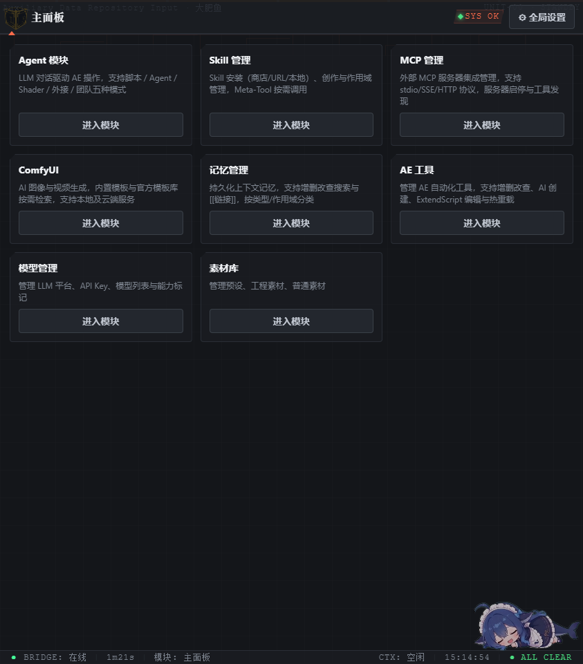
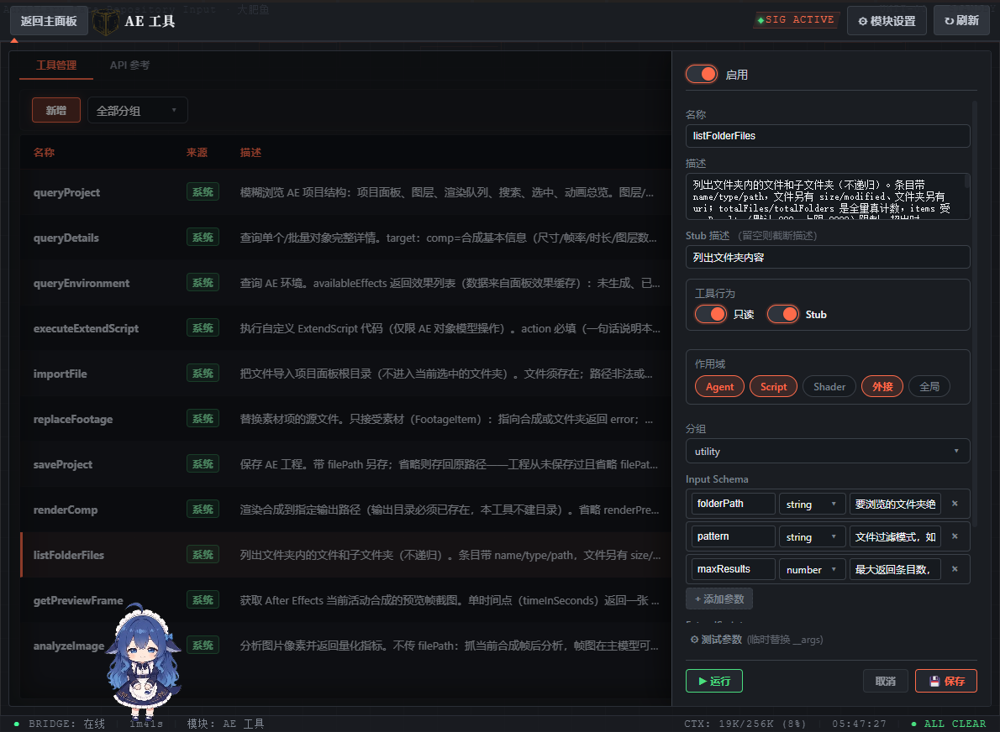

# AS_ExtP — AI Extension Platform for After Effects

[简体中文](README.md) | **English** | [日本語](README.ja.md) | [Deutsch](README.de.md) | [한국어](README.ko.md) | [Français](README.fr.md) | [Русский](README.ru.md)

> A multi-module extension platform (CEP) that brings AI into After Effects.
>
> Version: v1.0.3

AS_ExtP is an AI extension platform for After Effects — a CEP panel plus two native AE plug-ins (a GLSL effect host and the AE Hotbox). The panel consists of several modules: **Agent** (conversational control through large language models), **ComfyUI** (AI image / video generation), **Asset Library** (project assets and presets), and **MCP / Skill / Memory / Model management** (capability extension and configuration).

The **Agent** module is the core: describe what you want in a single Chinese sentence and the AI calls built-in AE automation tools on its own — create comps, add layers, set keyframes, apply effects, render output — with no hand-written code. It also generates and validates ExtendScript for execution, and can generate GLSL / linear JS pixel effects that run live in After Effects.

The Agent module's **external access** mode serves the same AE operations to external agent software as a standard **MCP Server** — ask "create a comp in AE for me" from Claude Code / Cursor without switching to the extension panel. See [External access](#external-access).

---

## Table of contents

- [Core features](#core-features)
- [Agent modes](#agent-modes)
- [External access](#external-access)
- [Native components](#native-components)
- [Installation](#installation)
- [Configuring AI platforms](#configuring-ai-platforms)
- [Developer documentation (DEVELOPMENT.md)](docs/DEVELOPMENT.en.md)
- [Security notes](#security-notes)
- [Disclaimer](#disclaimer)

---

## Core features

AS_ExtP is made of 8 functional modules, reachable from the module cards on the main panel or the 3D cube navigation.



### 1. Agent module

The core module: chat with the AI in natural language and drive After Effects. It provides five working modes — **Script / Agent / Shader / External / Team** (see [Agent modes](#agent-modes)): the first four are single-agent modes; the fifth, Team, runs four persistent agents in cooperation, and External serves the tool set to external agent software as an MCP Server. It supports multiple sessions (the session switcher searches by title), three tool permission tiers (Auto / Balanced / Cautious), task plan tracking, experience reflection, reasoning-effort control and a custom agent persona; goals can auto-continue across rounds (goal bar in the top bar, `/goal` command, default round cap 25, configurable 1–500), and the tool surface can be narrowed per view (Agent module settings → Tool visibility). Images and videos can be dragged in for the vision model to analyze, and docx / xlsx / pdf and other documents are parsed into text before you operate on them (Word tables become Markdown tables; embedded images are extracted to the data directory with their paths given in the text, with duplicates / icons / oversized images skipped, and can be opened with `read_image` on demand; each Excel sheet becomes CSV); video attachments have hover preview (muted) and full-screen playback.

### 2. AE tools

Manages the definitions of AE automation tools, organized by category: **Project / Composition / Layer / Animation / Effects / Render / Tools** (plus user-defined categories). 11 AE tools are bundled: project panel and layer browsing, comp / layer / footage details, render queue and cross-comp search, environment and effects diagnostics, ExtendScript execution, footage import and replace, project save, comp rendering, folder listing, preview frame capture, image analysis; the panel also ships built-in undo (`undoLastOperation`) and AE API documentation lookup (`queryAeApi`). Every other AE operation is written on the spot by the AI with `executeExtendScript`. Tools hot-reload: edits in the panel take effect immediately. The AI can create new tools itself with `createAETool` — a non-read-only self-created tool is visible to the Agent only by default, while read-only tools are global (visible in Script / Shader modes and from [external access](#external-access)); to make a non-read-only tool callable from external access, the creation call must explicitly declare a scope that includes `external-mcp`. An effects list cache can be pre-generated for machines with many effect plug-ins to speed up queries.



### 3. ComfyUI

Connects to a local or cloud ComfyUI service to generate AI images and videos, and imports results straight into an AE comp. Supports **form mode** for image generation and **canvas mode** for node-graph workflow editing, can capture the current AE frame as input, and handles batch generation with real-time progress over WebSocket.


Templates: **13 hand-tuned workflows** are built in (text-to-image, image-to-image, GPT Image, Nano Banana, Seedream, Hailuo, Kling, HappyHorse, Seedance, etc., covering image-to-video / reference-image-to-video / start-end frame / all-in-one reference video generation). The **official ComfyUI template library (600+)** is also wired in: the AI can search official templates on demand, expand subgraphs and convert them into runnable workflows. The model dropdown is enumerated dynamically as the nodes on the server change, and the template index is cached on disk (with an offline fallback). Custom workflows import both the **UI format** and the **API format** saved by the ComfyUI editor (the UI format is converted automatically; when a template references an interface-control node that is not installed — such as rgthree's Fast Groups Bypasser — only that switch node is skipped, with a notice, instead of rejecting the whole workflow). The workflow directory is `<data dir>\comfyui\workflows`: drop a `.json` there and reopen the panel to load it. For security, service addresses are limited to the local machine / LAN.

### 4. Asset Library

A unified library of assets commonly used in AE projects, shown as three card-stack sections:

- **Assets**: virtual references to ordinary assets (images / videos etc.); the files themselves are not copied
- **Project assets**: `.aep` project files that can be imported into the current project
- **Presets**: `.ffx` preset files that can be applied to the selected layer or a named layer

Batch import recreates the source folder hierarchy. Video assets offer optional transcode caches at 480p / 720p / 1080p / original size; auto-transcode can be disabled in the module settings (preview only). Grid thumbnails preview muted on hover; clicking an entry starts a muted loop in the preview pane (videos loop, image sequences loop frame by frame) and clicking the preview goes full screen; "Clear cache" shows the number of files and the total size it will remove (the settings page shows current usage). Individual assets, project assets and presets can also be invoked from the Quick Action Bar.


### 5. MCP management

Manages external MCP (Model Context Protocol) servers to extend the AI's tools: stdio, HTTP and SSE transports, start / stop / monitor server state, automatic tool discovery and registration for the AI. (Note the direction: this module brings external MCP servers **in** for the panel's AI; [external access](#external-access) sends the panel's tools **out** to external agents.)

### 6. Skill management

Manages domain-knowledge skill packs, loaded on demand so the AI gets specialized guidance. Custom skills let the AI follow your own working conventions.

### 7. Memory management

The AI's persistent memory system, keeping experience across conversations: memory types are reduced to three — **lessons learned / project notes / preferences** — each with a scope (Agent / Script / Shader mode), with `[[wiki links]]` between memories, full-text search and multi-select batch delete. The per-mode user rules (one each for Agent / Script / Shader) are injected into the AI's system prompt automatically; other memories are retrieved by the AI on demand (`memory_search`).

### 8. Model management

Manages every AI platform and model configuration: view / add / edit / delete platforms and models, set defaults, discover models automatically, test connections, and flag capabilities such as vision, tool calling and JSON mode. The platform editor supports **custom request headers** (one `Name: value` per line); built-in presets can declare a **session header** for a platform (e.g. OpenCode Go's `x-opencode-session`), which injects the current session ID on each request — handy for third-party gateways that need extra auth or routing headers; `opencode-go` presets are built in.

### Other features

- **External authorization indicator**: while external access is authorized, the panel shows a breathing edge light on all four sides and a pinned banner with the current permission tier and the number of exposed tools; each external tool call that is allowed to run scrolls its tool name, so you can always tell whether tools are currently exposed
- **Quick Action Bar**: a global shortcut bar at the top of the panel (fixed overlay) for running scripts, applying presets, importing project assets and referencing assets without opening a module; supports search filtering and batch operations
- **Multilingual UI**: follow the After Effects UI language, or pick 简体中文 / English / 日本語 / Deutsch / 한국어 / Français / Русский manually
- **Big Fat Fish desktop pet**: an optional AI desktop pet (an anthropomorphic whale character, AI-generated) with idle roaming, click bounce, drag follow, dozing and sleep talking, plus chat, scheduled announcements, proactive replies and web search
- **Diagnostic log**: **export a diagnostic package** from the global settings (panel / Bridge / host / native component logs plus environment info, uniformly redacted, latest 5 kept) — attach it when reporting a problem
- **Themes and personalization**: preset themes plus a custom color **scheme library** (save / apply / rename / delete, 26 editable colors — 20 core colors plus 6 semantic status colors, and the `panel_theme` tool reads and writes all 26 — with derived colors computed automatically); the Agent can read and change theme colors and manage schemes from the panel (tool `panel_theme`, Agent mode only, not exposed externally); background overlay layer and sound system
- **3D cube navigation**: draggable rotation, inertial scrolling, face-focus transitions
- **Status bar**: live Bridge state, AI context usage, active module and clock

---

## Agent modes

The mode toggle in the top bar has five positions: the first four are single-agent modes — **Script / Agent / Shader / External** — spanning "pure code" to "pure conversation" to "capability out"; the fifth, **Team**, runs four persistent agents in parallel.

### Script mode

For precise control and reusable sharing. The AI generates ExtendScript, which after syntax validation and a security review can be edited in the preview pane and then executed; generated scripts can be saved locally and the script tree supports loading and project management. The preview pane offers an "editor / artifact" two-column view, and blocked or failing runs highlight the line and show a structured error card.

### Agent mode

The AI calls the full set of AE automation tools on its own. For example: "create a 1920×1080 comp, add a red solid layer, and keyframe opacity for 2 seconds." Every modifying operation leaves an undo group in the AE undo stack, so `Ctrl+Z` rolls back; multi-turn conversations keep context; images and documents can be dragged in; multi-step task plans are tracked and dangerous operations are confirmed in the conversation according to the permission policy; long tasks can be set as a **session goal** (`/goal`) that auto-continues within the round cap and resumes after transient streaming failures.

### Shader mode

Runs **GLSL / linear JS pixel effects live in AE**. AI-generated GLSL passes a compile check and is written to the preview pane; JS effects pass a static dangerous-code pre-check (plus a second LLM review by default) and then run their `buildShader(params)` orchestration in a panel-side sandbox, reusing the host for rendering. Once finalized the result can be saved to the effect library, where the native [GLSL effect host](#native-components) compiles and hot-reloads it so the picture updates in real time. Built-in uniforms produce slider / color-picker controls automatically, compile errors are fed back to the LLM for self-repair, and the effect library supports save / load / apply.


### External mode

Serves the panel's tool set out as a standard **MCP Server** so external agent software (Claude Code / Claude Desktop / Cursor / Trae / VS Code Copilot, etc.) can drive your AE directly. After switching to the External tier, turn on the **external access authorization** master switch on the management console status card; the switch is controlled by the user explicitly and mode switching never flips it.

In this mode the panel shows six areas at once: script tree + effect library on the left, GLSL preview + management console in the middle, script and GLSL code preview on the right. The console has **call log / review queue / settings** tabs and the status card stays on the top row (master switch, Bridge state, number of exposed tools, and the permission tier wheel on the right — same wheel as in other modes, click to cycle). Every external call lands in the call log; submitted scripts and effects additionally leave a record in the review queue, and files written into the script library / effect library from outside carry an "Ext" badge on their entries in those lists.


Connection setup is in the next section.

### Team mode

The fifth position of the mode toggle. When on, four persistent agents are online at once: **Director** (creative plan and brief), **AE Execution** (lands AE operations and renders), **Shader Execution** (GLSL / JS effects) and **Art Execution** (image / video asset generation). Each agent has its own conversation view and task plan; the model (with its platform) and thinking level are configured per agent in the "Team mode" section of the Agent module settings — leaving the model empty follows the global default, and the thinking level is a required tier (defaults to high) — along with the sub-agent concurrency cap (default 3) and keep-alive window (default 10 minutes). The left drawer has two tabs, "Plan / Team tasks": Plan holds each agent's own todo list, Team tasks is the shared collaboration list. Any agent can spawn sub-agents on demand (a sub-agent cannot spawn further); agents message each other and hand off artifacts through files in the team workspace (brief `brief.md`, text storyboard `storyboard.md`, etc.).


---

## External access

### Prerequisites (all required)

1. **After Effects is running** and the AS_ExtP panel is open (the local Bridge process starts with the panel and listens on `127.0.0.1:9877`, moving to 9886 if the port is taken)
2. **External access is authorized inside the panel**: Agent module → mode toggle to the fourth tier "External", then **manually turn on** the **external access authorization** switch on the console status card (**entering the mode does not authorize anything**; revoke with the same switch, after which every tool execution returns `EXTERNAL_MODE_OFF` while `tools/list` still works)
3. **A Node runtime** (stdio transport only): the extension ships `vendor\node\node.exe` (v22), so **no separate Node.js install is needed** — the Release package bundles it, and a source clone gets it by running `tools\check-env.bat` once

While unauthorized every tool execution returns `EXTERNAL_MODE_OFF` (the tool list is still served); when the panel is not open but the Bridge is alive the reply is `PANEL_OFFLINE`, and when the Bridge itself is down (AE not started / panel never opened) it is `BRIDGE_OFFLINE`.

### Transport options

| Transport | How to connect | Clients | Notes |
| --- | --- | --- | --- |
| **stdio** (recommended) | Client spawns `ext-mcp-server.js` as configured | All clients | Client owns the process lifecycle; confirmation prompts supported |
| **Streamable HTTP** | Client connects to `http://127.0.0.1:<port>/mcp` | Claude Code / Cursor and other remote-capable clients | No extra process; endpoint embedded in the Bridge |

Probe `/health` for the HTTP port (9877–9886, incrementing). Run `curl http://127.0.0.1:9877/health` (retry with port +1 on failure) to confirm the port before filling in the URL.

### Client configuration

The AS_ExtP install path is fixed (`tools\install.bat` and `tools\deploy.bat` both deploy there):

```
C:\Program Files (x86)\Common Files\Adobe\CEP\extensions\AS_ExtP
```

Any MCP-capable client needs just one **stdio server** entry, with two fields:

- `command`: the bundled Node, `<extension path>\vendor\node\node.exe` (a system Node ≥ 20.18 on PATH also works as `node`)
- `args`: `<extension path>\client\shared\ext-mcp-server.js`; an optional trailing `--name <label>` labels the source in the confirmation prompt and the Bridge log and may be omitted (default `unknown`) — the panel call log shows the auto-generated client ID (`ext-<pid>-<ts>`)

Paths must be absolute — the MCP client's working directory is not the extension directory. Clients differ only in the config file location and the container key (`mcpServers` / `servers` / `mcp_servers`); the two fields above stay the same.

### Permission tiers and confirmation semantics

The permission wheel on the right of the external status card has two tiers (the same control as the Agent / Shader mode wheel, but external keeps only two tiers: click to cycle, hover for the semantics):

| Tier | Behavior |
| --- | --- |
| **Balanced** (default) | Seven groups of high-risk operations ask for confirmation **inside your agent software's UI** (through MCP elicitation); everything else runs directly |
| **Auto** | Every external call runs directly and is only recorded in the call log |

The seven groups requiring confirmation: AE tool creation / overwrite, memory writes (four operations), asset folder deletion, effect library deletion, skill write-back, script library write-back, MCP server configuration changes and run control (read operations never prompt).

If a client does **not support confirmation** (Claude Desktop, Cline, or the HTTP endpoint), those high-risk operations are **rejected** with `CONFIRM_REQUIRED` rather than run unconfirmed. Use a confirming client or switch the tier to "Auto" (an explicit authorization to run everything).

| Client | Confirmation |
| --- | --- |
| Claude Code / Cursor / VS Code Copilot | ✅ Prompted in the agent software (60 s without a reply counts as rejection) |
| Claude Desktop / Cline | ❌ High-risk operations rejected (`CONFIRM_REQUIRED`) |
| HTTP endpoint | ❌ Same (no SSE channel to deliver the prompt) |

### Tool list and dynamic changes

42 tools are exposed by default (the fixed list holds 46 tools, 4 of them — the memory-write tools — are off by default; gateway and custom tools are not counted, and fixed tools not registered at runtime are skipped silently). They can be switched on or off per **module group** on the settings page (12 groups: AE project data / AE meta tools / custom AE tools / Agent engine / Script mode / Shader mode / memory / ComfyUI generation / assets / Skill / external tasks / gateway), and per tool inside each group. The "gateway" group is off by default: it forwards the third-party MCP servers the panel has connected, which is the largest risk surface. Clients supporting `tools/list_changed` (Claude Code / VS Code) refresh automatically after a change; Claude Desktop / Cursor need a reconnect.

### Troubleshooting

| Symptom / error code | Cause and action |
| --- | --- |
| `PANEL_OFFLINE` | The Bridge is running but the panel connection dropped — open the AS_ExtP panel |
| `BRIDGE_OFFLINE` | The Bridge is down (AE not started / panel never opened) — open the panel so the host starts the Bridge, or run `node client/shared/ae-bridge.js` manually |
| `EXTERNAL_MODE_OFF` | The external access authorization switch is off (switching to the External tier is not an authorization; flip the switch on the status card); it blocks tool execution only — `tools/list` still works |
| `CONFIRM_REQUIRED` | The operation needs confirmation but the client cannot prompt — change client or switch to the "Auto" tier |
| `CONFIRM_TIMEOUT` | No answer to the confirmation prompt within 60 seconds; nothing ran |
| `ACCESS_DENIED` | The tool is disabled by a module-group / per-tool switch, is not in the external whitelist, its "External" drawer checkbox is off, or its gateway server is not enabled |
| AE tool queue timed out (… s), this call was not dispatched | The panel's AE engine is busy (in-panel Agent / team lanes / another external call / a running render or long script). AE calls in the panel share one FIFO queue (queue panel always available); a timeout guarantees the call did not run — retry once the queue frees up |
| `QUEUE_FULL` | Queue limit is 32 — retry later |
| `RELAY_TIMEOUT` / `EXT_TIMEOUT` | The panel did not reply in time — relative gate 90 s (100 s on the stdio side); the panel's `ext_progress` heartbeat keeps renewing it. The call may still be running: check the call log before retrying |
| `EXT_TASK_PENDING` | The panel has been executing for more than 30 minutes (hard limit, heartbeat does not extend it) — the error text carries `taskId`; the underlying call keeps running, query it with `ext_task_get` (the task table is cleared when the panel reloads) |
| HTTP endpoint returns 503 | The Bridge has not mounted the endpoint — make sure the Bridge was started by the panel (or `node client/shared/ae-bridge.js`) |
| Cannot connect to 9877 | The port was taken and the Bridge moved on — probe `http://127.0.0.1:9877-9886/health` one by one |

---

## Native components

Besides the CEP panel, the project contains two native AE components (C++, under `native/`).

### GLSL effect host (AS_Effect Host, `native/glsl-host/`)

A generic pixel-effect `.aex` host plug-in. Effect logic lives in external `.glsl` files or in GLSL produced by JS orchestration; editing the file hot-reloads it live, with no need to recompile the plug-in per effect. Supports 8-bit / 16-bit / 32-bit (float) depths, GPU rendering, and on-demand uniform registration (float / vector parameters map to panel controls — a slider or a color picker); a compile failure does not crash — it is logged and reported back. This is the runtime foundation of Shader mode.


3D and image input:

- **3D camera coupling**: reads the comp camera and injects its matrix, position and field of view (`uCamFov`) into built-in uniforms, so perspective in GLSL matches the AE camera, enabling true spatial alignment
- **AE light coupling**: enumerates comp lights (type / position / orientation / color × intensity / cone falloff, up to 8) into `uLight*` uniforms, so effects can react to AE lights live
- **Layer map inputs**: declaring `iChannel1/2/3` enables the corresponding layer rows (undeclared, the three rows stay visible but disabled — the host's LAYER row cannot be hidden), letting other layers act as textures (`iChannel0` is the built-in "this layer")
- **Parameter slots**: one slider per scalar, each component of a vec2 / vec3 on its own row, and vec4 / color-semantic vectors rendered as a color picker; component 0 is addressed by the uniform name itself and the rest by `.y/.z/.w` (color semantics use `.g/.b/.a`; there is no `.r`); display range and valid input range are set separately
- **Effect library index**: the host exports the authoritative index, so the panel and the host stay in sync; a selected file that disappears is passed through instead of silently swapping in another shader


### AE Hotbox (AS_Hotbox, `native/hotbox/`)

A native AEGP global hotbox plug-in that runs independently of the CEP panel. Press the hotkey anywhere in AE (default `Alt+Q`, recordable in the panel's global settings) and a floating window appears at the mouse: hold the hotkey for the **ring gesture mode** (drag toward an arc segment to run it), or click the center circle for **search mode** (a wide search bar with a linear result list and type filter). Search results match on pinyin initials and full pinyin (e.g. `gsmh` → Gaussian Blur). In gesture mode, pressing the hotkey again while the window is open closes it (toggle semantics); in search mode that key is typed into the search box. After releasing the hotkey, pressing any letter opens search prefilled with that character.

Data comes from all AE effects, scripts under `agent/scripts`, and presets (library presets plus AE user presets and AE factory presets, merged and de-duplicated); as an AEGP the plug-in runs in the AE process, reads local files directly, does not go through the Bridge, and does not require the panel to be open. The comp-related petal menu provides **three screenshot actions** (copy to clipboard as PNG with alpha, save PNG, save JPG).

#### Quick start

1. Press `Alt+Q` (or your recorded hotkey) → the ring window appears at the mouse
2. Move the mouse toward an arc segment → the segment highlights (gold outline)
3. Release over a segment → its bound action runs
4. Or: click the center circle → search mode → type a keyword → `↑`/`↓` to select → `Enter` to run

#### Gesture mode (hold the hotkey)

| Position | Segment | Description |
| --- | --- | --- |
| Top | Screenshot | Hovering expands a three-lobe submenu (PNG / clipboard / JPG); it carries no slot binding |
| Top-right / bottom-right / bottom-left / top-left | 4 bindable slots | Bind a fixed action (effect / script / preset); unbound slots are dynamic (fall back to recent items); when the search box is empty they list recent items; the settings panel arranges its 4 slot rows as top-left / bottom-left / top-right / bottom-right (see the next section) |
| Bottom | Settings | Click to open the settings panel; **releasing here does not run it** — a click is required |

- Release rules: releasing over a segment (including the transparent area outside the ring band in that direction) runs it; releasing over the center circle does not (to avoid accidents — searching requires a click); releasing in the inner hole or between segments closes the window and runs nothing.
- Pressing the hotkey again while the window is open **closes** it (toggle semantics; except in search mode); after releasing the hotkey, pressing any letter opens search prefilled with that character.
- **Release-stay** (toggle in the settings panel, off by default): when on, releasing neither runs nor closes; instead a mouse click selects a segment — click a segment to run it, click the center circle to search. Exit with `Esc`, the hotkey again, a click outside the window, or a click on the blank ring area. The setting is stored as `releaseStay` in `<data dir>\hotbox\config.json` and survives an AE restart.

#### Search mode (click the center)

| Input / action | Behavior |
| --- | --- |
| Empty search box | Lists recent items (filtered by the current type, newest first), first row selected; shows an input hint when there are no records |
| Typing | Live fuzzy filtering (subsequence match, case-insensitive) |
| Clicking `[全部 ▾]` | Filter: all / effects / scripts / presets |
| `↑` / `↓`, wheel | Move the selection line by line (wraps at both ends; wheel and arrow keys behave the same) |
| `Enter` / click an item | Runs the selected item (FXConsole style: a single click applies) |
| `Esc` | Close the hotbox (returns to the settings panel when in a binding flow started there) |

Search mode **stays open** (you can release the hotkey to type with both hands) until an action runs, `Esc` is pressed, or you click outside.

**Sorting: recent first** — items already in the "recent" list (`recent.json`) move to the front, ordered newest first within their group, and the rest keep their original order. Changing the input returns the selection to the first row, so "type then press Enter" runs the most recently used match. When the search box is empty the list shows recent items (filtered by type, newest first, first row selected, run or bind directly with `Enter` / a click); entering the binding flow from the settings panel also lists recent items (bind only, no run). Applying a preset to fewer than 20 layers completes in one pass and undoes in one undo group; 20 layers or more are applied in blocks with block-wise undo. "Used" is keyed by type plus the same `key` (effects = matchName, scripts / presets = absolute file path), falling back to the same name when the key does not match. The list holds 100 entries (`kRecentMax`); older items no longer move to the front and no longer appear in the empty-query list or the gesture ring. Stale records are still listed, report failure on run, and are rejected when binding.

#### Settings panel

The 4 slot rows follow the gesture ring positions (top-left / bottom-left / top-right / bottom-right), each binding an effect / script / preset; the hotkey is recordable; two toggles: "execute on release" and "release-stay". Configuration is stored in `<data dir>\hotbox\config.json` (the data dir defaults to `%APPDATA%\Adobe\CEP\extensions\AS_ExtP`), and the recent list in `<data dir>\hotbox\recent.json`.

> Build, deployment, troubleshooting and implementation details are in [DEVELOPMENT.md](docs/DEVELOPMENT.en.md).

---

## Installation

### Requirements

- **After Effects**: **AE 2023 (AEFT 23.0) or newer** (CEP 11 / CSXS.11, CEF is Chrome 88); the GLSL effect host / Hotbox native components also require AE 2023+. Versions older than AE 2023 are not supported — `tools\install.bat` skips them and says so in the summary.
- **Windows**
- **Node.js ≥ 20.18** (source clone only): the runtime for the local Bridge and the stdio MCP server. The Release package bundles `vendor\node`; a source clone gets it by running `tools\check-env.bat` once.

### Getting the files (either way)

| Way | For | Contains | How |
| --- | --- | --- | --- |
| **Release package** (recommended, **ready to run**) | End users | Source + prebuilt `.aex` + bundled Node runtime and dependencies | Download the zip from [Releases](../../releases/latest) and extract it (**no Node install, no `npm ci`, no build**), then double-click `tools\install.bat` |
| **Source clone** | Reading the code / building yourself | Source only | `git clone` → `npm ci` → double-click `tools\check-env.bat` (fetches `vendor\node`, ffmpeg and sets PlayerDebugMode) → double-click `tools\deploy.bat` to copy files into the extensions directory |

> Division of labour: `install.bat` is the installer (detect AE, download Node and ffmpeg, write PlayerDebugMode, deploy to the extensions directory); `deploy.bat` is the development-time updater (after changing `host` / `client` / `CSXS` or the contents of `vendor`, it copies the latest files into the installed extension directory; the native `.aex` files live outside the extension directory and are still deployed by `install.bat` or copied into AE's `Plug-ins` manually). It downloads nothing and touches no registry keys, and it needs `vendor\` to exist — prepare it with `check-env.bat` or `install.bat` first.

> The two ways differ: the **Release package is ready to run** (source + prebuilt `.aex` + bundled Node and dependencies; extract and double-click `install.bat`, no Node install, `npm ci` or build needed), while the **source repository does not include** those prebuilt binaries and dependencies (size and distribution limits — see [Assets and prebuilt binaries](#assets-and-prebuilt-binaries)), so `npm ci` / `check-env.bat` must fill them in. Building the native components yourself needs Visual Studio and the Adobe AE SDK — the SDK is not distributed with the repository under its license. When `install.bat` runs inside the source directory it deploys `deploy\Plug-ins\*.aex` if present and skips with a notice otherwise. `deploy.bat` requires `vendor\` to exist (created by `check-env.bat` / `install.bat`) and suggests running `check-env.bat` when it is missing; the root `node_modules` is copied to `vendor\node_modules` during deployment.

### Installing the CEP extension

1. Put the whole project folder into the AE extensions directory. **The folder must be named `AS_ExtP`** (all configuration examples below assume that name):
   ```
   C:\Program Files (x86)\Common Files\Adobe\CEP\extensions
   ```
   Or run `tools\install.bat` (from the Release package or the source directory) to deploy automatically.

   > Note: this directory is **not** inside the After Effects install directory. AE's own install directory (e.g. `E:\Adobe\Adobe After Effects 2023\`) has no `CEP` folder — AE ships no built-in panels; extensions load from this shared directory (the `<app>\CEP\extensions` folders under some other Adobe applications only hold their own built-in panels). Once installed, the extension root is `...\CEP\extensions\AS_ExtP`, which is the path used in the [external access](#external-access) JSON snippets.
2. Enable the unsigned-extension debug mode (required):
   - `Win+R` → type `regedit` to open the registry editor
   - Navigate to `HKEY_CURRENT_USER\SOFTWARE\Adobe\CSXS.11` (AE 2023 / 2024) or `CSXS.12` (AE 2025+); the installer writes both keys for AE 23/24
   - Create the string value `PlayerDebugMode` and set its data to `1`
3. Allow scripts to write files and access the network: `Edit > Preferences > Scripting & Expressions` and tick the option
4. Restart After Effects and open the panel from `Window > Extensions > AS_ExtP`

> Multiple AE instances are not supported simultaneously (the Bridge is single-instance; close the panel in the other AE).

### Assets and prebuilt binaries

**The Release package is ready to run; the source repository is not.** The following items are bundled in the Release package (extract, double-click `tools\install.bat`, no Node install, `npm ci` or build); the **source repository does not contain them**, so a clone must fill them in as described in the "source clone" row. Neither form includes FFmpeg — the scripts download it.

| Item | Size | Impact when missing / alternative |
| --- | --- | --- |
| Prebuilt native components `deploy/Plug-ins/*.aex` | ~2 MB | Bundled in the Release package; `install.bat` deploys them when found. Absent from a source clone — the GLSL effect host and Hotbox are unavailable until you build them |
| Node runtime `vendor/node/` | ~84 MB | Bundled in the Release package; a source clone downloads the pinned version from nodejs.org via `tools\check-env.bat` with SHA-256 verification |
| Dependencies `vendor/node_modules/` | ~16 MB | Bundled in the Release package; a source clone runs `npm ci`, and `deploy.bat` / `install.bat` copy from the root `node_modules` |
| FFmpeg `vendor/ffmpeg/` | ~200 MB | **Not distributed by this project**: `tools\check-env.bat` / `tools\install.bat` download a pinned upstream version with SHA-256 verification (license and source in [THIRD-PARTY-NOTICES.md](docs/THIRD-PARTY-NOTICES.md)) |

> The desktop pet artwork `client/features/deepseekPet/sprites/` (16 PNGs + 1 WebM, ~110.5 MB) and the README screenshots `assets/readme/` (9 PNGs, ~3 MB; the character appears in them) **both ship with the source tree** and are the only non-text assets outside the table above; the origin and rights status of the pet character are covered in the disclaimer and in section 5 of [THIRD-PARTY-NOTICES.md](docs/THIRD-PARTY-NOTICES.md).

### Deploying the native components

Installing with `install.bat` copies the `.aex` files into each AE's `Support Files\Plug-ins\`; for a manual install copy the `.aex` files from `deploy\Plug-ins\` there yourself and **fully quit and restart AE**.

---

## Configuring AI platforms

Open the panel and go to the "Model management" module; enter an API key for any supported platform to start. 10 platform presets are built in — the 8 mainstream platforms below plus two gateway presets, OpenCode Go and OpenCode Go (Anthropic) (available models appear in the dropdown dynamically, with a badge for vision capability and image input):

- **DeepSeek** — platform.deepseek.com
- **OpenAI** — platform.openai.com/api-keys
- **OpenRouter** (multi-model gateway) — openrouter.ai/keys
- **SiliconFlow** — cloud.siliconflow.cn
- **Kimi** (Moonshot) — platform.moonshot.cn
- **Zhipu GLM** — open.bigmodel.cn/usercenter/apikeys
- **Volcengine Ark** (Doubao series) — console.volcengine.com/ark/region:cn-beijing/apikey
- **Anthropic** — console.anthropic.com

Beyond the built-in platforms you can add **custom LLM platforms**: any endpoint speaking the OpenAI-compatible or Anthropic protocol, with automatic model discovery and support for locally deployed models (e.g. Ollama). The platform editor also configures **custom request headers** (one `Name: value` per line, for gateways needing extra auth headers); session headers are declared by built-in presets (injecting the current session ID as a request header, e.g. OpenCode Go's `x-opencode-session`). To protect API keys, the `http://` base URL of a **custom platform** is restricted to localhost / LAN; `https://` is unrestricted, so public platforms such as OpenRouter keep working.

---

## Technical architecture

See [DEVELOPMENT.md](docs/DEVELOPMENT.en.md): the CEP panel + local Node Bridge architecture, the AEFS multi-channel fallback and path validation, the AST compile gate, the data directory, the prompt bus and diagnostic logs.

---

## Development

See [DEVELOPMENT.md](docs/DEVELOPMENT.en.md): environment setup (Node ≥ 20.18, `npm ci` or `tools\check-env.bat`), `lint` and the two audits, deployment with `tools\deploy.bat`, and building the native components.

---

## Security notes

AS_ExtP lets the AI operate AE and execute scripts on its own — a high-privilege automation capability. When using it:

- **Dangerous capabilities are off by default**: the four script capabilities "run system commands / network access / read-write files / click menus" are all disabled (enable them in "Agent module settings → AST gate capability configuration"), and "run scripts without confirmation" is off as well
- **Script execution sandbox**: AI-generated scripts run in a safety sandbox by default, where file I/O and system commands are blocked; a static security check (AST compile gate) runs before execution and blocks known escape techniques
- **Shader / JS effect pre-check**: JS effect code (`submit_js_effect` and `.js` writes into the effect library) passes a mandatory static dangerous-code pre-check before being written or executed, plus a second LLM review by default; submitted GLSL shaders go through a compile check
- **External access authorization**: controlled explicitly by the "external access authorization" master switch on the console; mode switching never flips it. While authorized, the panel shows a permanent edge light and banner, and the master switch stops external access at any time. High-risk operations follow the permission tier, and when a client cannot confirm they are **rejected by default** rather than allowed; every external call is recorded in the call log
- **Path protection for file operations**: all file operations are confined to safe directories; system directories are rejected automatically, preventing accidental deletion of system files
- **Recommendations**: back up before running scripts; be careful with unknown Skill packs and MCP servers (their content enters the AI context); connect only to trusted ComfyUI services

---

## Disclaimer

This extension and all of its code were produced with AI assistance and may contain unknown defects or unstable behavior:

- Operations generated by the AI may cause **project data loss or corruption** — back up before running them
- AI-generated scripts may read and write files or invoke system calls — review the content before executing it
- No warranty, express or implied, is provided; **you bear the consequences** of any loss caused by using this extension
- Do not use it in unattended production pipelines
- Do not use AI-generated scripts directly in commercial projects that have not been backed up

Additionally: the character artwork of the "Big Fat Fish" desktop pet is AI-generated content in a community-derivative style based on the DeepSeek brand image (the easter-egg full-screen animation `appear.webm` also contains AI-generated Chinese speech). It is an **unofficial work** with no affiliation with or authorization from DeepSeek; if a rights holder objects, it will be removed or replaced promptly.

This project is an independently developed third-party extension with no affiliation, sponsorship or authorization from Adobe Inc.; Adobe, After Effects and other names are trademarks of their respective owners and are used here only descriptively.

---

## License

MIT License

License details for third-party components (third-party libraries and the Adobe CEP agreement text in the source tree, the Node.js runtime and npm dependencies distributed with the Release package, FFmpeg which this project does not distribute, the AE SDK used at build time, and Adobe content inside the compiled `.aex` binaries) are in [THIRD-PARTY-NOTICES.md](docs/THIRD-PARTY-NOTICES.md).

Desktop pet assets (`client/features/deepseekPet/sprites/`) are provided under MIT along with the source, but the parts involving the DeepSeek brand image are outside what this project can license; users assume the related risk.
