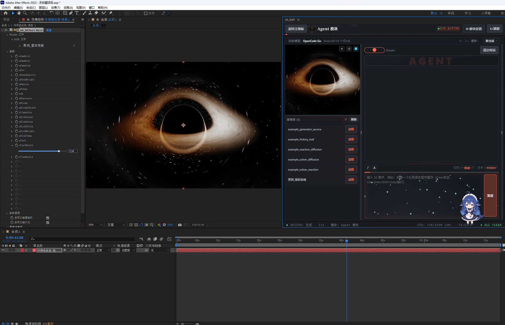
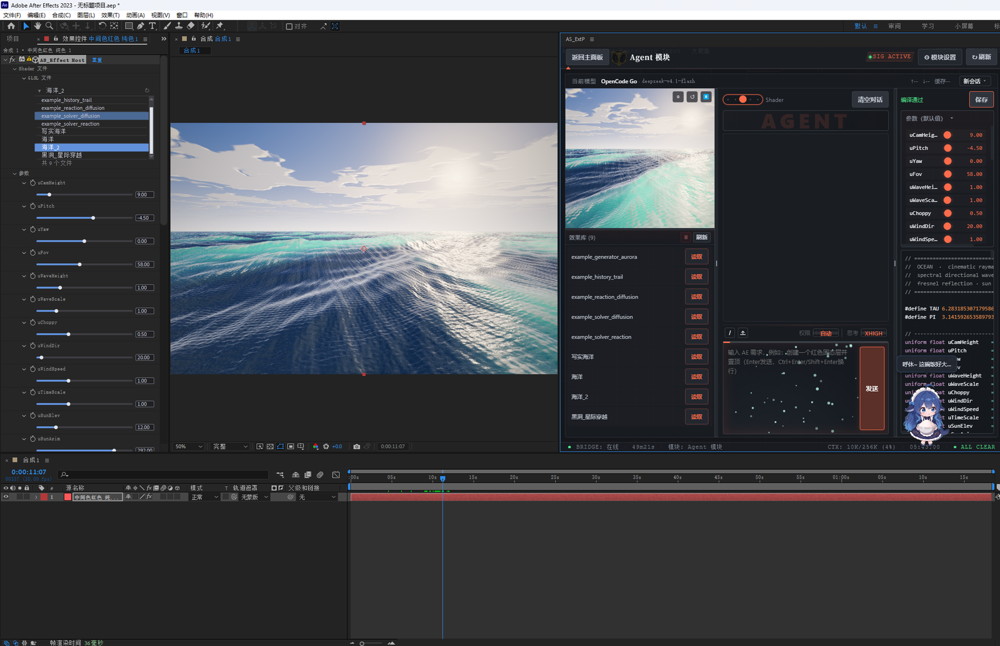

# AS_ExtP — plateforme d’extension IA pour After Effects

[简体中文](README.md) | [English](README.en.md) | [日本語](README.ja.md) | [Deutsch](README.de.md) | [한국어](README.ko.md) | **Français** | [Русский](README.ru.md)

> Une plateforme d’extension multi-modules (CEP) qui intègre l’IA à After Effects.
>
> Version : v1.0.4

AS_ExtP est une plateforme d’extension IA pour After Effects — un panneau CEP et deux greffons natifs AE (l’hôte d’effets GLSL et le Hotbox AE). Le panneau se compose de plusieurs modules : **Agent** (pilotage conversationnel par grand modèle de langage), **ComfyUI** (génération d’images / de vidéos par IA), **Bibliothèque d’actifs** (gestion des actifs de projet et des préréglages), ainsi que **MCP / Skill / Mémoire / Gestion des modèles** (extension et configuration des capacités).

Le module **Agent** en est le cœur : décrivez votre besoin en une phrase en chinois et l’IA appelle d’elle-même les outils d’automatisation AE intégrés pour mener l’opération à bien — créer une composition, ajouter des calques, poser des images clés, appliquer des effets, lancer un rendu — sans écrire une ligne de code ; elle peut aussi générer et valider des scripts ExtendScript avant de les exécuter, et même produire des effets de pixels GLSL / JS linéaire qui tournent en temps réel dans AE.

En outre, le **mode externe** du module Agent expose l’ensemble des capacités d’opération AE sous la forme d’un **serveur MCP** standard, appelable par des logiciels Agent externes — dites directement dans Claude Code / Cursor « crée-moi une composition dans AE », sans basculer sur le panneau de l’extension. Configuration : voir [Accès en mode externe](#accès-en-mode-externe).

---

## Sommaire

- [Fonctionnalités principales](#fonctionnalités-principales)
- [Les cinq modes de l’Agent](#les-cinq-modes-de-lagent)
- [Accès en mode externe](#accès-en-mode-externe)
- [Composants natifs](#composants-natifs)
- [Guide d’installation](#guide-dinstallation)
- [Configuration des plateformes d’IA](#configuration-des-plateformes-dia)
- [Documentation développeur (DEVELOPMENT.md)](docs/DEVELOPMENT.fr.md)
- [Notes de sécurité](#notes-de-sécurité)
- [Avertissement](#avertissement)

---

## Fonctionnalités principales

AS_ExtP se compose de 8 modules fonctionnels, accessibles par les cartes de modules du panneau principal ou par la navigation en cube 3D.


### 1. Module Agent

Le module central : dialoguez avec l’IA en langage naturel et pilotez AE. Il intègre cinq modes de travail — **Script / Agent / Shader / Externe / Équipe** (voir [Les cinq modes de l’Agent](#les-cinq-modes-de-lagent)) : les quatre premières positions sont des modes mono-Agent, la cinquième, « Équipe », fait collaborer quatre Agents permanents, tandis que le mode « Externe » sert le jeu d’outils à des logiciels Agent externes sous forme de serveur MCP. Il gère plusieurs sessions (le sélecteur de session permet une recherche par titre), trois niveaux d’autorisation des outils (Auto / Équilibré / Prudent), le suivi du plan de tâches, la réflexion sur l’expérience, le réglage de l’effort de raisonnement et une description de personnalité de l’Agent personnalisable ; les objectifs peuvent se poursuivre automatiquement sur plusieurs tours (bandeau d’objectif dans la barre supérieure, commande `/goal`, limite de 25 tours par défaut, réglable de 1 à 500) et la surface d’outils peut être restreinte par vue (Paramètres du module Agent → « Visibilité des outils »). Il accepte le glisser-déposer d’images et de vidéos pour que le modèle de vision analyse l’image, ainsi que l’analyse de documents docx / xlsx / pdf convertis en texte avant traitement (les tableaux Word deviennent des tableaux Markdown, les images intégrées sont extraites vers le dossier de données avec leur chemin indiqué dans le texte, les doublons / icônes / images surdimensionnées sont ignorés et consultables au besoin avec `read_image` ; chaque feuille Excel devient un CSV) ; les pièces jointes vidéo disposent d’un aperçu muet au survol et d’un affichage plein écran.

### 2. Outils AE

Gère les définitions des outils d’automatisation AE, organisés par catégorie : **Projet / Composition / Calque / Animation / Effets / Rendu / Outils** (plus les catégories définies par l’utilisateur). 11 outils AE sont fournis : navigation du panneau Projet et des calques, détails de composition / calque / métrage, file d’attente de rendu et recherche inter-compositions, diagnostics d’environnement et d’effets, exécution d’ExtendScript, importation et remplacement de métrage, enregistrement du projet, rendu de composition, listage de dossiers, capture d’image d’aperçu, analyse d’images ; le panneau intègre en outre l’annulation (`undoLastOperation`) et la consultation de la documentation de l’API AE (`queryAeApi`). Toutes les autres opérations AE sont écrites sur place par l’IA avec `executeExtendScript`. Les outils se rechargent à chaud : une modification faite dans le panneau prend effet immédiatement ; l’IA peut aussi créer elle-même de nouveaux outils avec `createAETool` — un outil auto-créé non en lecture seule n’est, par défaut, visible que de l’Agent, les outils en lecture seule étant globaux (visibles en mode Script / Shader et depuis le [mode externe](#accès-en-mode-externe)) ; pour rendre un outil non en lecture seule appelable depuis le mode externe, l’appel de création doit déclarer explicitement un scope contenant `external-mcp`. Un cache de la liste des effets peut être pré-généré pour accélérer les requêtes sur les machines équipées de nombreux plug-ins d’effets.


### 3. ComfyUI

Se connecte à un service ComfyUI local ou dans le cloud pour générer des images et des vidéos par IA, avec import direct du résultat dans une composition AE. Prend en charge le **mode formulaire** pour la génération d’images et le **mode canevas** pour l’édition visuelle de workflows par nœuds, capture l’image courante d’AE comme entrée, et gère la génération par lot avec une progression en temps réel via WebSocket.


Côté templates, **13 workflows réglés à la main** sont intégrés (texte→image, image→image, GPT Image, Nano Banana, Seedream, Hailuo, Kling, HappyHorse, Seedance, etc., couvrant la vidéo depuis image / la vidéo depuis image de référence / la génération à partir d’images de début et de fin / la référence tout-en-un). La **bibliothèque de templates officielle de ComfyUI (600+)** est également branchée : l’IA peut rechercher les templates officiels à la demande, déplier les sous-graphes et les convertir en workflows exécutables ; la liste déroulante des modèles énumère dynamiquement les nœuds exposés par le serveur, et l’index des templates est mis en cache sur le disque local (repli possible hors ligne). Les workflows personnalisés acceptent le **format UI** et le **format API** enregistrés par l’éditeur ComfyUI (le format UI est converti automatiquement ; lorsqu’un template référence un **nœud de contrôle d’interface** absent de la machine — par exemple Fast Groups Bypasser de rgthree — seul ce nœud de commutation est ignoré, avec un message, au lieu de rejeter tout le workflow) ; le dossier des workflows est fixe, `<dossier de données>\comfyui\workflows` — déposez-y un fichier .json et rouvrez le panneau pour qu’il soit chargé. Pour des raisons de sécurité, les adresses de service sont limitées à la machine locale / au réseau local.

### 4. Bibliothèque d’actifs

Gère de façon unifiée les actifs couramment utilisés dans un projet AE, présentés sous forme de piles de cartes réparties en trois sections :

- **Actifs** : références virtuelles à des actifs ordinaires (images / vidéos, etc.), sans copie des fichiers
- **Actifs de projet** : fichiers de projet `.aep`, importables directement dans le projet courant
- **Préréglages** : fichiers de préréglage `.ffx`, applicables au calque sélectionné ou à un calque nommé

L’import par lot recrée automatiquement la hiérarchie des dossiers ; les actifs vidéo proposent un cache de transcodage à résolution choisie (480p / 720p / 1080p / taille d’origine), le transcodage automatique pouvant être désactivé dans les paramètres du module (il ne concerne que l’aperçu de la bibliothèque). Les vignettes de la grille donnent un aperçu muet au survol ; après un clic sur une entrée, la zone d’aperçu de droite lance une lecture en boucle muette automatique (vidéos en boucle, séquences d’images image par image en boucle), et un clic sur l’aperçu passe en plein écran ; la boîte de confirmation « Vider le cache » indique le nombre de fichiers et la taille totale à supprimer (la page de paramètres affiche l’occupation actuelle). Une référence d’actif seule, un actif de projet ou un préréglage peuvent aussi être appelés directement depuis la barre d’accès rapide.


### 5. Gestion MCP

Gère les serveurs MCP (Model Context Protocol) externes pour étendre les outils disponibles de l’IA : trois transports (stdio, HTTP, SSE), démarrage / arrêt / surveillance de l’état des serveurs, découverte automatique des outils et enregistrement pour l’IA. (Attention au sens inverse : ce module fait entrer les serveurs MCP externes **dans** le panneau au service de l’IA ; le [mode externe](#accès-en-mode-externe) envoie au contraire les outils du panneau **vers** des Agents externes.)

### 6. Gestion des compétences

Gère des paquets de compétences métier, chargés à la demande pour fournir un guidage expert à l’IA. La création de compétences personnalisées permet à l’IA de suivre vos conventions de travail.

### 7. Gestion de la mémoire

Le système de mémoire persistante de l’IA, qui conserve l’expérience d’une conversation à l’autre : les types de mémoire se réduisent à trois : **leçons apprises / notes de projet / préférences**, chacun avec une portée (mode Agent / Script / Shader) ; liens croisés via `[[liens wiki]]`, recherche plein texte, suppression par lot avec sélection multiple ; les règles utilisateur maintenues par mode (une pour Agent, Script et Shader) sont automatiquement injectées dans l’invite système de l’IA, les autres mémoires étant récupérées à la demande par l’IA (`memory_search`).

### 8. Gestion des modèles

Gère toutes les configurations de plateformes et de modèles d’IA : affichage / ajout / édition / suppression des plateformes et modèles, choix par défaut, découverte automatique des modèles, test des connexions, et marquage des capacités des modèles (vision, appel d’outils, mode JSON, etc.). L’éditeur de plateforme prend en charge les **en-têtes de requête personnalisés** (une ligne `Nom: valeur`) ; les préréglages intégrés peuvent déclarer un **en-tête de session** pour une plateforme (par ex. `x-opencode-session` pour OpenCode Go), l’ID de session courant étant injecté automatiquement à chaque requête, pour les passerelles tierces nécessitant des en-têtes d’authentification ou de routage supplémentaires ; des préréglages de la série `opencode-go` sont intégrés.

### Autres fonctionnalités

- **Indicateur d’autorisation d’accès externe** : tant que l’autorisation du mode externe est active, les quatre bords du panneau portent un halo pulsé permanent et un bandeau épinglé qui affichent le niveau courant et le nombre d’outils exposés ; chaque appel d’outil autorisé venu d’un Agent externe fait défiler le nom de l’outil, ce qui permet de vérifier à tout moment si des outils sont actuellement exposés
- **Barre d’accès rapide** : barre de raccourcis globale en haut du panneau (superposition fixe) pour exécuter des scripts, appliquer des préréglages, importer des actifs de projet et référencer des actifs sans ouvrir de module ; filtrage par recherche et opérations par lot
- **Interface multilingue** : suit la langue de l’interface d’After Effects, ou choix manuel entre 简体中文 / English / 日本語 / Deutsch / 한국어 / Français / Русский
- **Mascotte « Big Fat Fish »** : activez une mascotte de bureau propulsée par l’IA (un personnage de baleine anthropomorphe, généré par l’IA) avec déambulation au repos, rebond au clic, suivi par glisser-déposer, somnolence et paroles dans le sommeil ; elle gère le dialogue, les annonces programmées, les réponses proactives et la recherche web
- **Journal de diagnostic** : les paramètres globaux permettent d’**exporter un paquet de diagnostic** (journaux de chaque processus — panneau / Bridge / hôte / composants natifs — plus les informations d’environnement, expurgés de façon uniforme, seuls les 5 derniers étant conservés) — joignez ce fichier à votre signalement
- **Thèmes et personnalisation** : plusieurs thèmes préréglés et une **bibliothèque de palettes** de couleurs personnalisées (palettes enregistrables / applicables / renommables / supprimables, 26 couleurs modifiables (20 couleurs principales + 6 couleurs d’état sémantiques ; l’outil `panel_theme` lit et écrit les 26), couleurs dérivées calculées automatiquement) ; l’Agent du panneau peut lire et modifier directement les couleurs du thème et gérer les palettes (outil `panel_theme`, disponible en mode Agent uniquement, non relié au mode externe) ; superposition d’arrière-plan, système d’effets sonores
- **Navigation en cube 3D** : rotation par glisser, défilement inertiel, transitions par focalisation d’une face
- **Barre d’état inférieure** : état du service Bridge, contexte utilisé par l’IA, module actif et horloge en temps réel

---

## Les cinq modes de l’Agent

Le sélecteur de mode du module Agent compte 5 positions : les quatre premières sont des modes mono-Agent — **Script / Agent / Shader / Externe** — et couvrent tout le spectre, du « tout code » au « tout dialogue » puis à la « mise à disposition des capacités » ; la 5e position, **Équipe**, fait collaborer en parallèle quatre Agents permanents. La bascule se fait par le sélecteur de mode de la barre supérieure :

### Mode Script

Pour les cas exigeant un contrôle précis ou un partage réutilisable. L’IA génère du code ExtendScript qui, après validation syntaxique et audit de sécurité, peut être édité dans la zone d’aperçu avant exécution ; les scripts générés peuvent être enregistrés localement, et l’arborescence des scripts gère le chargement et les projets. La zone d’aperçu offre une comparaison à deux colonnes « Éditer / Résultat » ; en cas de blocage ou d’erreur d’exécution, la ligne est surlignée et une carte d’erreur structurée s’affiche.

### Mode Agent

L’IA appelle d’elle-même l’ensemble des outils d’automatisation AE. Par exemple, décrivez directement « créez une composition 1920×1080, ajoutez un solide rouge et posez des images clés d’opacité sur 2 secondes ». Chaque opération de modification laisse un groupe d’annulation dans la pile d’annulation d’AE, et `Ctrl+Z` suffit à revenir en arrière ; les conversations multi-tours conservent le contexte, et les images comme les documents peuvent être glissés-déposés avant l’opération ; le plan de tâches multi-étapes est suivi, et les opérations dangereuses sont confirmées dans la conversation selon la politique d’autorisation ; une tâche longue peut devenir un **objectif de session** (`/goal`), repris automatiquement tour après tour dans la limite de tours, y compris après un échec transitoire du flux.

### Mode Shader

**Exécute en temps réel des effets de pixels GLSL / JS linéaire dans AE**. Le GLSL généré par l’IA passe d’abord une validation de compilation et est écrit dans la zone d’aperçu ; les effets JS subissent un pré-contrôle statique du code dangereux, puis par défaut une seconde relecture par le LLM, avant l’exécution dans un bac à sable côté panneau de la logique d’orchestration `buildShader(params)`, qui produit du GLSL réutilisé par l’hôte pour le rendu. Une fois finalisé, le résultat peut être enregistré dans la bibliothèque d’effets, où l’[hôte d’effets GLSL](#composants-natifs) natif le compile, l’exécute et le recharge à chaud pour actualiser l’image en temps réel. Les paramètres intégrés (uniforms) génèrent automatiquement des curseurs / sélecteurs de couleur, les erreurs de compilation sont renvoyées au LLM pour auto-correction, et la bibliothèque d’effets permet l’enregistrement / le chargement / l’application.


### Mode externe

Expose le jeu d’outils du panneau comme **serveur MCP** standard, pour que des logiciels Agent externes (Claude Code / Claude Desktop / Cursor / Trae / VS Code Copilot, etc.) pilotent directement votre AE. Après passage à la position « Externe », l’accès ne s’ouvre qu’une fois activé l’interrupteur principal « Autorisation d’accès externe » sur la carte d’état de la console ; cet interrupteur reste sous contrôle explicite de l’utilisateur, et changer de mode ne l’active ni ne le désactive.

Dans ce mode, le panneau affiche simultanément six zones : à gauche l’arborescence des scripts + la bibliothèque d’effets, au centre l’aperçu GLSL + la console, à droite l’aperçu du code des scripts et du GLSL ; la console comporte trois onglets — **Journal des appels / File de révision / Paramètres** — et la carte d’état occupe en permanence la ligne supérieure (interrupteur principal, état du Bridge, nombre d’outils exposés, et à droite la molette des niveaux d’autorisation — la même molette « Autorisations » que dans les autres modes, un clic fait défiler les niveaux). Chaque appel d’un Agent externe est consigné dans le journal des appels ; les scripts et effets soumis laissent en plus une trace dans la file de révision ; les fichiers écrits de l’extérieur dans la bibliothèque de scripts / d’effets portent un badge « Ext » sur leur entrée dans la liste correspondante.


La configuration de connexion est décrite à la section suivante.

### Mode équipe

La 5e position du sélecteur de mode. Une fois activée, quatre Agents permanents sont en ligne simultanément : **Réalisation** (concept créatif et brief), **Exécution AE** (mise en œuvre des opérations AE et production des rendus), **Exécution Shader** (effets GLSL / JS) et **Exécution artistique** (génération d’actifs image / vidéo). Chaque Agent dispose de sa propre vue de conversation et de son plan de tâches ; le modèle (avec sa plateforme) et le niveau de réflexion se configurent ligne par ligne dans la section « Mode équipe » des paramètres du module Agent — un modèle vide suit la valeur globale par défaut, le niveau de réflexion est obligatoire (high par défaut) — ainsi que le plafond de concurrence des sous-Agents (3 par défaut) et la fenêtre de maintien en vie (10 minutes par défaut). Le tiroir de gauche propose deux onglets, « Plan / Tâches d’équipe » : Plan regroupe les tâches propres à chaque Agent, Tâches d’équipe la liste de collaboration partagée par les quatre. Chaque Agent peut engendrer des sous-Agents à la demande (un sous-Agent ne peut pas en engendrer à son tour) ; les Agents s’échangent des messages via l’outil d’envoi de messages et se transmettent leurs livrables par des fichiers de l’espace de travail d’équipe (brief `brief.md`, storyboard textuel `storyboard.md`, etc.).


---

## Accès en mode externe

### Prérequis (tous obligatoires)

1. **After Effects est démarré** et le panneau de l’extension AS_ExtP est ouvert (le processus Bridge local démarre avec le panneau et écoute sur `127.0.0.1:9877` ; si le port est occupé, il passe à 9886)
2. **L’accès externe est autorisé dans le panneau** : module Agent → basculez le sélecteur de mode sur la quatrième position, « Externe », puis **activez manuellement** l’interrupteur principal « **Autorisation d’accès externe** » de la carte d’état de la console (**passer en mode externe n’autorise rien automatiquement** ; pour révoquer, désactivez le même interrupteur — une fois désactivé, toute **exécution d’outil** renvoie `EXTERNAL_MODE_OFF`, la liste des outils restant consultable)
3. **Un runtime Node est disponible** (uniquement pour le transport stdio) : l’extension fournit `vendor\node\node.exe` (v22), **aucune installation séparée de Node.js n’est nécessaire** — le paquet Release complet l’intègre déjà, et un clone source le télécharge automatiquement en lançant une fois `tools\check-env.bat`

Sans autorisation, toute **exécution d’outil** renvoie `EXTERNAL_MODE_OFF` (la liste des outils reste consultable) ; si le panneau n’est pas ouvert mais que le Bridge tourne encore, la réponse est `PANEL_OFFLINE` ; si le Bridge lui-même n’est pas démarré (AE non lancé / panneau jamais ouvert), c’est `BRIDGE_OFFLINE`.

### Choix du transport

| Transport | Comment se connecter | Clients | Remarques |
| --- | --- | --- | --- |
| **stdio** (recommandé) | le client lance `ext-mcp-server.js` selon sa configuration | tous les clients | le client gère entièrement le cycle de vie du processus ; confirmation interactive prise en charge |
| **Streamable HTTP** | le client se connecte à `http://127.0.0.1:<port>/mcp` | Claude Code / Cursor et les autres clients compatibles accès distant | aucun processus supplémentaire, point d’accès intégré au Bridge |

Le port HTTP se détermine par une sonde `/health` (9877–9886, par incréments). Vérifiez d’abord le port avec `curl http://127.0.0.1:9877/health` (en cas d’échec, réessayez avec le port +1), puis renseignez l’URL.

### Configuration du client

Le chemin d’installation d’AS_ExtP est fixe (`tools\install.bat` et `tools\deploy.bat` déploient tous deux vers cet emplacement) :

```
C:\Program Files (x86)\Common Files\Adobe\CEP\extensions\AS_ExtP
```

Tout client compatible MCP n’a besoin que d’une entrée de **serveur stdio**, avec deux champs :

- `command` : le Node fourni avec l’extension, `<chemin de l’extension>\vendor\node\node.exe` (un Node système ≥ 20.18 présent dans le PATH fonctionne aussi, en écrivant `node`)
- `args` : `<chemin de l’extension>\client\shared\ext-mcp-server.js` ; un `--name <libellé>` facultatif en fin de ligne identifie la source dans la boîte de confirmation et dans le journal du Bridge, et peut être omis (par défaut `unknown`) — le journal des appels du panneau affiche, lui, l’ID client généré automatiquement (`ext-<pid>-<ts>`)

Les chemins doivent être absolus — le répertoire de travail du client MCP n’est pas celui de l’extension. Les clients ne diffèrent que par l’emplacement du fichier de configuration et par le nom de la clé conteneur (par ex. `mcpServers` / `servers` / `mcp_servers`) ; les champs restent les deux ci-dessus.

### Niveaux d’autorisation et sémantique de confirmation

La molette « Autorisations » à droite de la carte d’état du mode externe compte deux niveaux (même contrôle que la molette d’autorisations des barres d’outils des modes Agent / Shader, mais le mode externe n’en garde que deux : un clic fait défiler les niveaux, le survol de la souris affiche leur sémantique) :

| Niveau | Comportement |
| --- | --- |
| **Équilibré** (par défaut) | sept groupes d’opérations à risque demandent confirmation **dans l’interface de votre logiciel Agent** (via MCP elicitation), le reste s’exécute directement |
| **Auto** | tous les appels externes s’exécutent directement et ne laissent qu’une trace dans le journal des appels |

Les sept groupes d’opérations à risque soumis à confirmation : création / écrasement d’outils AE, écriture de mémoire (quatre opérations), suppression de dossiers d’actifs, suppression dans la bibliothèque d’effets, écriture des compétences, écriture dans la bibliothèque de scripts, modification de la configuration et contrôle d’exécution des serveurs MCP (les opérations de lecture ne demandent jamais de confirmation).

Si un client **ne prend pas en charge la confirmation** (par ex. Claude Desktop, Cline, ou le point d’accès HTTP), ces opérations à risque sont **refusées d’office** avec `CONFIRM_REQUIRED` et ne s’exécutent jamais sans confirmation. Pour les autoriser, utilisez un client qui gère la confirmation ou passez le niveau à « Auto » dans le panneau (ce qui équivaut à une autorisation explicite de tout exécuter).

| Client | Confirmation |
| --- | --- |
| Claude Code / Cursor / VS Code Copilot | ✅ confirmation dans le logiciel Agent (sans réponse sous 60 secondes, la demande vaut refus) |
| Claude Desktop / Cline | ❌ opérations à risque refusées (`CONFIRM_REQUIRED`) |
| Point d’accès HTTP | ❌ idem (aucun canal SSE pour transmettre la confirmation) |

### Liste des outils et changements dynamiques

42 outils sont exposés par défaut (sur la liste fixe de 46 outils, les 4 outils d’écriture de mémoire sont désactivés par défaut ; la passerelle et les outils personnalisés ne sont pas comptés, et quelques outils intégrés non enregistrés sont ignorés silencieusement). Ils s’activent et se désactivent par **groupe de modules** dans la page de paramètres (12 groupes : données de projet AE / méta-outils AE / outils AE personnalisés / moteur Agent / mode Script / mode Shader / mémoire / génération ComfyUI / bibliothèque d’actifs / Skill / tâches externes / passerelle), et outil par outil au sein de chaque groupe. Le groupe « passerelle » est désactivé par défaut — il expose aussi les serveurs MCP tiers déjà connectés au panneau, soit la plus grande surface de risque : activez-le au besoin. Les clients qui prennent en charge `tools/list_changed` (Claude Code / VS Code) actualisent la liste automatiquement après un changement ; Claude Desktop / Cursor nécessitent une reconnexion du client.

### Dépannage

| Symptôme / code d’erreur | Cause et action |
| --- | --- |
| `PANEL_OFFLINE` | le Bridge tourne mais la connexion au panneau est perdue — ouvrez le panneau AS_ExtP |
| `BRIDGE_OFFLINE` | le Bridge n’est pas démarré (AE non lancé / panneau jamais ouvert) — ouvrez d’abord le panneau pour que l’hôte démarre le Bridge, ou lancez `node client/shared/ae-bridge.js` manuellement |
| `EXTERNAL_MODE_OFF` | l’interrupteur principal « Autorisation d’accès externe » est désactivé (passer en mode externe n’autorise rien : il faut l’activer manuellement sur la carte d’état) ; il ne bloque que l’exécution des outils, la liste des outils reste consultable |
| `CONFIRM_REQUIRED` | l’opération exige une confirmation, mais le client courant ne la prend pas en charge — changez de client ou passez au niveau « Auto » |
| `CONFIRM_TIMEOUT` | aucune réponse à la boîte de confirmation sous 60 secondes ; rien n’a été exécuté |
| `ACCESS_DENIED` | l’outil est désactivé par un interrupteur de groupe de modules / par outil, ne figure pas dans la liste blanche exposée, la case « Externe » n’est pas cochée dans le tiroir de l’outil, ou le serveur de passerelle n’est pas activé individuellement |
| délai d’attente dépassé dans la file des outils AE (… secondes), cet appel n’a pas été transmis | le moteur AE du panneau est occupé (Agent du panneau / lane d’équipe / autre appel externe / rendu ou script long en cours). Les appels AE du panneau partagent une file FIFO (le panneau de file reste toujours ouvert) ; un dépassement garantit que l’appel n’a pas été exécuté — réessayez une fois l’occupation terminée |
| `QUEUE_FULL` | la file est plafonnée à 32 entrées ; réessayez plus tard |
| `RELAY_TIMEOUT` / `EXT_TIMEOUT` | délai de réponse du panneau dépassé — seuil relatif de 90 secondes (100 secondes côté stdio), le battement `ext_progress` du panneau le renouvelle en continu ; l’appel peut être encore en cours : consultez le journal des appels avant de décider d’un nouvel essai |
| `EXT_TASK_PENDING` | le panneau exécute depuis plus de 30 minutes (plafond fixe, que le battement ne prolonge pas) — le texte d’erreur porte le `taskId` ; l’appel sous-jacent continue, interrogez le résultat par `taskId` avec `ext_task_get` (la table des tâches est vidée au rechargement du panneau) |
| le point d’accès HTTP renvoie 503 | le Bridge n’a pas monté ce point d’accès — vérifiez que le Bridge a été démarré par le panneau (ou par `node client/shared/ae-bridge.js`) |
| impossible de se connecter au 9877 | le port était occupé et le Bridge a changé de port — sondez `http://127.0.0.1:9877-9886/health` l’un après l’autre |

---

## Composants natifs

Outre le panneau CEP, le projet contient deux composants AE natifs (C++, dans `native/`) :

### Hôte d’effets GLSL (AS_Effect Host, `native/glsl-host/`)

Un plug-in hôte `.aex` générique pour effets de pixels. La logique de l’effet réside dans un fichier `.glsl` externe ou dans du GLSL produit par une orchestration JS ; modifier le fichier déclenche un rechargement à chaud immédiat, sans recompiler le plug-in pour chaque effet. Prend en charge les profondeurs 8 bits / 16 bits / 32 bits (virgule flottante), le rendu GPU et l’enregistrement d’uniforms à la demande (les paramètres flottants / vectoriels sont automatiquement mappés sur des contrôles du panneau : curseur ou sélecteur de couleur) ; un échec de compilation ne plante pas le plug-in, il est journalisé et renvoyé. C’est la base d’exécution du mode Shader.



Capacités d’entrée 3D et image :

- **Couplage de la caméra 3D** : lit la caméra de la composition et injecte sa matrice, sa position et son champ de vision (`uCamFov`) dans les uniforms intégrés ; la perspective du GLSL correspond ainsi à celle de la caméra AE, ce qui autorise un alignement spatial réel
- **Couplage des lumières AE** : énumère les lumières de la composition (type / position / orientation / couleur × intensité / atténuation du cône, 8 au maximum) et les injecte dans la série d’uniforms `uLight*`, pour que l’effet réagisse en temps réel aux lumières AE
- **Entrées de calques mappés** : déclarer `iChannel1/2/3` active la ligne de calque correspondante (non déclarées, ces trois lignes restent visibles mais grisées — la ligne LAYER de l’hôte ne peut pas être masquée) ; d’autres calques peuvent alors servir d’entrée de texture (`iChannel0` correspond au calque courant, intégré)
- **Emplacements de paramètres** : dans les contrôles d’effet, il n’y a plus qu’une seule toile dessinée par le plug-in ; le groupe « Paramètres » trace une ligne par uniform du shader sélectionné — un curseur pour les scalaires, un contrôle ponctuel avec une ligne par composante pour vec2 / vec3, des pastilles de couleur pour vec4 et les vecteurs à sémantique de couleur ; les noms de ligne et les valeurs sont relus à chaque image depuis le fichier courant, donc les copies de calques, les changements de shader et la restauration de projet sont corrects dès le premier affichage. Les scripts et l’IA adressent les emplacements via la table de paramètres enregistrée par l’hôte (`propertyIndex`) ou le matchName du paramètre ; l’index du fichier sélectionné est le paramètre masqué 141 (auparavant 140). Plage d’affichage et plage d’entrée valide se règlent séparément
- **Index de la bibliothèque d’effets** : l’hôte exporte l’index de référence, si bien que la vue de la bibliothèque du panneau et celle de l’hôte restent synchronisées ; si le fichier sélectionné disparaît, l’information est transmise telle quelle au lieu de basculer silencieusement sur un autre shader



### AE Hotbox (AS_Hotbox, `native/hotbox/`)

Un plug-in natif AEGP offrant un Hotbox global, indépendant du panneau CEP. Appuyez sur le raccourci n’importe où dans AE (par défaut `Alt+Q`, réenregistrable dans les paramètres globaux du panneau) : une fenêtre flottante apparaît à l’emplacement de la souris. Maintenir le raccourci ouvre le **mode gestuel annulaire** (glissez vers un segment d’arc pour l’exécuter) ; cliquer sur le cercle central ouvre le **mode recherche** (longue barre de recherche + résultats linéaires + filtre par type). Les résultats acceptent les **initiales pinyin et le pinyin complet** (par ex. `gsmh` → Flou gaussien). En mode gestuel, appuyer à nouveau sur le raccourci alors que la fenêtre est ouverte la referme (sémantique d’interrupteur) ; en mode recherche, cette touche saisit un caractère dans le champ. Après avoir relâché le raccourci, une lettre ouvre directement la recherche et la préremplit.

Les données proviennent de tous les effets AE, des scripts de `agent/scripts` et des préréglages (préréglages de la bibliothèque d’actifs, préréglages utilisateur d’AE et préréglages d’usine d’AE, fusionnés et dédoublonnés) ; le plug-in tourne dans le processus d’AE en tant qu’AEGP, lit directement les fichiers locaux, ne passe pas par le Bridge et n’exige pas que le panneau de l’extension soit ouvert. Le menu en pétales lié à la composition propose **trois actions de capture** (copier dans le presse-papiers en PNG avec canal alpha / enregistrer en PNG / enregistrer en JPG).

#### Démarrage rapide

1. Appuyez sur `Alt+Q` (ou sur le raccourci que vous avez enregistré) → la fenêtre annulaire apparaît à l’emplacement de la souris
2. Déplacez la souris vers un segment d’arc → le segment est mis en évidence (contour doré)
3. Relâchez sur le segment d’arc → la fonction associée à ce segment s’exécute
4. Ou bien : cliquez sur le cercle central → passez en mode recherche → saisissez un mot-clé → `↑`/`↓` pour choisir → `Enter` pour exécuter

#### Mode gestuel (raccourci maintenu)

| Position | Segment | Description |
| --- | --- | --- |
| En haut | Capture | le survol déploie un sous-menu à trois pétales (PNG / presse-papiers / JPG) ; il ne porte aucune association d’emplacement |
| En haut à droite / en bas à droite / en bas à gauche / en haut à gauche | 4 emplacements associables | association possible d’une action fixe (effet / script / préréglage) ; non associé, l’emplacement devient dynamique (repli sur les éléments récents) ; le champ de recherche vide affiche directement les éléments récents ; le panneau de paramètres range ses 4 lignes d’emplacement dans l’ordre en haut à gauche / en bas à gauche / en haut à droite / en bas à droite (voir la section suivante) |
| En bas | Paramètres | un clic ouvre le panneau de paramètres ; **relâcher ici n’exécute rien**, un clic de souris est nécessaire |

- Règle de relâchement : relâcher sur un segment d’arc (y compris la zone transparente hors de la bande annulaire dans cette direction) l’exécute ; relâcher sur le cercle central n’exécute rien (pour éviter les erreurs, la recherche exige un clic) ; relâcher dans le trou intérieur ou dans un intervalle entre segments ferme la fenêtre sans rien exécuter.
- Quand la fenêtre est déjà ouverte, **réappuyer sur le raccourci = fermer** (sémantique d’interrupteur, sauf en mode recherche) ; après avoir relâché le raccourci, une lettre ouvre la recherche et la préremplit.
- **Maintien au relâchement** (commutable dans le panneau de paramètres, désactivé par défaut) : une fois activé, relâcher n’exécute rien et ne ferme pas la fenêtre ; la sélection se fait au clic de souris — cliquer un segment d’arc l’exécute, cliquer le cercle central ouvre la recherche. Sorties : `Esc`, le raccourci à nouveau, un clic hors de la fenêtre, un clic sur une zone vide de l’anneau. Le réglage est écrit dans `releaseStay` de `<dossier de données>\hotbox\config.json` et persiste après redémarrage d’AE.

#### Mode recherche (clic sur le centre)

| Touche / action | Comportement |
| --- | --- |
| champ de recherche vide | affiche directement les éléments récents (filtrés par le type courant, du plus récent au plus ancien), première ligne sélectionnée ; en l’absence d’historique, affiche une invite de saisie |
| saisie de texte | filtrage flou en temps réel (correspondance de sous-séquence, insensible à la casse) |
| clic sur `[全部 ▾]` | filtre : tout / effets / scripts / préréglages |
| `↑` / `↓`, molette | déplace la sélection ligne par ligne (avec bouclage au début et à la fin de la liste ; la molette se comporte comme `↑`/`↓`) |
| `Enter` / clic sur un élément | exécute l’élément sélectionné (style FXConsole : un simple clic applique) |
| `Esc` | ferme le Hotbox (dans un flux d’association lancé depuis le panneau de paramètres, revient au panneau de paramètres) |

Le mode recherche **reste ouvert en permanence** (le raccourci peut être relâché pour taper à deux mains) jusqu’à une exécution, `Esc` ou un clic à l’extérieur.

**Tri : les plus récents d’abord** — parmi les résultats, les éléments déjà utilisés passent devant : ceux présents dans la liste des récents (`recent.json`) remontent en tête, classés au sein du groupe par ordre d’utilisation (du plus récent au plus ancien), les autres conservant leur ordre d’origine. Une modification de la saisie ramène la sélection sur la première ligne, si bien que « taper puis Entrée » exécute l’élément utilisé le plus récemment. Quand le champ de recherche est vide, la liste affiche directement les éléments récents (filtrés par type, du plus récent au plus ancien, première ligne sélectionnée, exécutables ou associables directement par `Enter` / clic) ; un flux d’association lancé depuis le panneau de paramètres liste lui aussi les éléments récents (association seulement, sans exécution). L’application d’un préréglage sur moins de 20 calques s’effectue en une passe et s’annule d’un seul coup ; à partir de 20 calques, l’application se fait par blocs et l’annulation bloc par bloc. Un élément est réputé « utilisé » selon le même type et la même `key` (effets = matchName, scripts / préréglages = chemin absolu du fichier) ; si la `key` ne correspond pas, le nom identique sert de repli. La liste est plafonnée à 100 entrées (constante `kRecentMax` du code source) : les éléments plus anciens ne remontent plus et n’apparaissent plus dans la liste à requête vide ni sur l’anneau gestuel. Les enregistrements périmés restent listés, signalent un échec à l’exécution et sont refusés à l’association.

#### Panneau de paramètres

Les 4 lignes d’emplacement suivent les positions de l’anneau gestuel (en haut à gauche / en bas à gauche / en haut à droite / en bas à droite) et associent chacune un effet / script / préréglage ; le raccourci est réenregistrable ; deux interrupteurs : « Exécuter au relâchement » et « Maintien au relâchement ». La configuration est stockée dans `<dossier de données>\hotbox\config.json` (dossier de données par défaut : `%APPDATA%\Adobe\CEP\extensions\AS_ExtP`), la liste des récents dans `<dossier de données>\hotbox\recent.json`.

> Détails de compilation, de déploiement, de dépannage et de mise en œuvre : voir [DEVELOPMENT.md](docs/DEVELOPMENT.fr.md).

---

## Guide d’installation

### Configuration requise

- **After Effects** : **AE 2023 (AEFT 23.0) ou version ultérieure** est requis (CEP 11 / CSXS.11, CEF = Chrome 88) ; l’hôte d’effets GLSL et les composants natifs Hotbox exigent eux aussi AE 2023+. Les versions antérieures à AE 2023 ne sont pas prises en charge : `tools\install.bat` les ignore et le signale dans son récapitulatif.
- Système d’exploitation **Windows**
- **Node.js ≥ 20.18** (clone source uniquement) : le runtime du Bridge local et du serveur MCP stdio. Le paquet Release complet intègre `vendor\node` ; un clone source le télécharge automatiquement en lançant une fois `tools\check-env.bat`

### Obtenir les fichiers (deux méthodes)

| Méthode | Public visé | Contenu | Procédure |
| --- | --- | --- | --- |
| **Paquet Release complet** (recommandé, **prêt à l’emploi**) | Utilisateurs | Source + `.aex` précompilés + runtime Node et dépendances intégrés | téléchargez le zip depuis [Releases](../../releases/latest) et décompressez-le (**aucune installation de Node, aucun `npm ci`, aucune compilation**), puis double-cliquez sur `tools\install.bat` dans le paquet |
| **Clone du code source** | Lecture du code / compilation personnelle | Code source uniquement | `git clone` → `npm ci` → double-cliquez sur `tools\check-env.bat` (complète `vendor\node`, ffmpeg et PlayerDebugMode) → double-cliquez sur `tools\deploy.bat` pour copier les fichiers dans le dossier de l’extension |

> Répartition des deux scripts : `install.bat` est l’installateur (tout-en-un : détection d’AE, téléchargement de Node et de ffmpeg, écriture de PlayerDebugMode, déploiement dans le dossier de l’extension) ; `deploy.bat` est le script de mise à jour pour le développement (après modification de `host` / `client` / `CSXS` ou du contenu de `vendor`, il recopie les fichiers les plus récents dans l’extension installée ; les `.aex` natifs ne se trouvent pas dans le dossier de l’extension et restent déployés par `install.bat` ou copiés manuellement dans `Plug-ins` d’AE). Il ne télécharge rien et ne touche pas au registre ; avant la première utilisation, lancez `check-env.bat` ou `install.bat` pour préparer `vendor\`.

> Les deux méthodes diffèrent : le **paquet Release complet est prêt à l’emploi** (source + `.aex` précompilés + Node et dépendances intégrés ; décompressez et double-cliquez sur `install.bat`, sans installation de Node, `npm ci` ni compilation), tandis que le **dépôt source ne contient pas** ces binaires précompilés ni ces dépendances (taille et limites de distribution, voir [Ressources et binaires précompilés](#ressources-et-binaires-précompilés)) : il faut les compléter avec `npm ci` / `check-env.bat`. Compiler soi-même les composants natifs exige Visual Studio et le SDK Adobe AE — le SDK n’est pas distribué avec le dépôt en raison de sa licence. Lancé depuis le dossier source, `install.bat` déploie les `deploy\Plug-ins\*.aex` présents et, à défaut, l’ignore en le signalant. `deploy.bat` exige que le dossier `vendor\` existe (créé par `check-env.bat` / `install.bat`) et invite à lancer `check-env.bat` s’il manque ; le `node_modules` racine est copié vers `vendor\node_modules` lors du déploiement.

### Installation de l’extension CEP

1. Placez le dossier complet du projet dans le dossier des extensions d’AE : **le nom du dossier doit être `AS_ExtP`** (tous les exemples de configuration ci-dessous utilisent ce nom) :
   ```
   C:\Program Files (x86)\Common Files\Adobe\CEP\extensions
   ```
   ou utilisez `tools\install.bat` (exécutable depuis le paquet Release comme depuis le dossier source) pour déployer automatiquement.

   > Remarque : ce dossier **ne se trouve pas dans le dossier d’installation d’After Effects**. Le dossier d’installation d’AE (par ex. `E:\Adobe\Adobe After Effects 2023\`) ne contient aucun dossier `CEP` — AE ne fournit pas de panneaux intégrés, les extensions se chargent toutes depuis ce dossier commun (les dossiers `<application>\CEP\extensions` d’autres applications Adobe ne contiennent que leurs propres panneaux intégrés). Une fois installée, la racine de l’extension est `...\CEP\extensions\AS_ExtP`, chemin utilisé dans les configurations JSON du [mode externe](#accès-en-mode-externe).
2. Activez le mode débogage des extensions non signées (obligatoire) :
   - `Win+R` → tapez `regedit` pour ouvrir l’éditeur du registre
   - naviguez jusqu’à `HKEY_CURRENT_USER\SOFTWARE\Adobe\CSXS.11` (AE 2023 / 2024) ou `CSXS.12` (AE 2025+) — l’installateur écrit les deux clés pour AE 23/24
   - créez la valeur de chaîne `PlayerDebugMode` et affectez-lui la donnée `1`
3. Autorisez les scripts AE à écrire des fichiers et à accéder au réseau : `Édition → Préférences → Scripts et expressions`, cochez l’option correspondante
4. Redémarrez After Effects et ouvrez le panneau par le menu `Fenêtre > Extensions > AS_ExtP`

> L’extension ne prend pas en charge plusieurs instances d’AE simultanées (le Bridge est mono-instance ; fermez le panneau dans les autres AE).

### Ressources et binaires précompilés

**Le paquet Release complet est prêt à l’emploi ; le dépôt source ne l’est pas** : les éléments suivants sont intégrés au paquet Release complet (décompressez, double-cliquez sur `tools\install.bat`, sans installation de Node, `npm ci` ni compilation) ; **le dépôt source ne contient pas** ces fichiers et, après un clone, il faut les compléter selon la ligne « Clone du code source ». FFmpeg est absent des deux formes et téléchargé par les scripts :

| Contenu | Taille | Impact en cas d’absence / alternative |
| --- | --- | --- |
| Composants natifs précompilés `deploy/Plug-ins/*.aex` | ~2 Mo | intégrés au paquet Release, `install.bat` les déploie dès qu’il les détecte ; absents d’un clone source, ce qui laisse l’hôte d’effets GLSL et le Hotbox indisponibles jusqu’à une compilation personnelle |
| Runtime Node `vendor/node/` | ~84 Mo | intégré au paquet Release ; un clone source télécharge la version figée depuis nodejs.org via `tools\check-env.bat`, avec vérification SHA-256 |
| Dépendances `vendor/node_modules/` | ~16 Mo | intégrées au paquet Release ; un clone source exécute `npm ci`, et `deploy.bat` / `install.bat` complètent par copie depuis le `node_modules` racine |
| FFmpeg `vendor/ffmpeg/` | ~200 Mo | **non distribué par ce projet** : `tools\check-env.bat` / `tools\install.bat` téléchargent une version amont figée et vérifient son SHA-256 (licence et source dans [THIRD-PARTY-NOTICES.md](docs/THIRD-PARTY-NOTICES.md)) |

> Les ressources graphiques de la mascotte `client/features/deepseekPet/sprites/` (16 PNG + 1 WebM, environ 110,5 Mo) et les captures d’écran du README `assets/readme/` (9 PNG, environ 3 Mo ; la mascotte y apparaît) **sont distribuées avec l’arborescence source** et constituent les seuls actifs non textuels hors de ce tableau. Origine et statut des droits de la mascotte : voir « Avertissement » et la section 5 de [THIRD-PARTY-NOTICES.md](docs/THIRD-PARTY-NOTICES.md).

### Déploiement des composants natifs

L’installation avec `install.bat` copie automatiquement les `.aex` dans les `Support Files\Plug-ins\` de chaque AE ; pour une installation manuelle, copiez les `.aex` de `deploy\Plug-ins\` à cet endroit, puis **quittez complètement AE et redémarrez-le** pour que les composants prennent effet.

---

## Configuration des plateformes d’IA

Ouvrez le panneau, entrez dans le module « Gestion des modèles » et saisissez la clé API d’une plateforme prise en charge pour commencer. 10 préréglages de plateforme sont intégrés — les 8 plateformes majeures ci-dessous, plus deux préréglages de passerelle, OpenCode Go et OpenCode Go (Anthropic) (les modèles disponibles de chaque plateforme s’affichent dynamiquement dans le menu déroulant, un badge signale ceux qui prennent en charge la vision et acceptent des images en entrée) :

- **DeepSeek** — platform.deepseek.com
- **OpenAI** — platform.openai.com/api-keys
- **OpenRouter** (passerelle multi-modèles) — openrouter.ai/keys
- **SiliconFlow** — cloud.siliconflow.cn
- **Kimi** (Moonshot) — platform.moonshot.cn
- **Zhipu GLM** — open.bigmodel.cn/usercenter/apikeys
- **Volcengine Ark** (série Doubao) — console.volcengine.com/ark/region:cn-beijing/apikey
- **Anthropic** — console.anthropic.com

Outre les plateformes intégrées, vous pouvez ajouter des **plateformes LLM personnalisées** : tout point d’accès parlant le protocole compatible OpenAI ou le protocole Anthropic, avec récupération automatique de la liste des modèles disponibles depuis l’interface de la plateforme et prise en charge de modèles déployés localement (par ex. Ollama). L’éditeur de plateforme permet aussi de configurer des **en-têtes de requête personnalisés** (une ligne `Nom: valeur`, pour les passerelles exigeant des en-têtes d’authentification supplémentaires) ; les en-têtes de session sont déclarés par les préréglages intégrés (l’ID de session courant est injecté automatiquement comme en-tête de requête, par ex. `x-opencode-session` pour OpenCode Go). Pour protéger les clés API, l’**URL de base `http://` d’une plateforme personnalisée** est limitée à la machine locale / au réseau local (`https://` n’est pas restreint : les plateformes publiques comme OpenRouter fonctionnent normalement).

---

## Architecture technique

Voir [DEVELOPMENT.md](docs/DEVELOPMENT.fr.md) : schéma de l’architecture panneau CEP + Bridge Node local, repli multicanal et validation de chemins d’AEFS, portail de compilation AST, dossier de données, bus d’invites, journaux de diagnostic.

---

## Développement

Voir [DEVELOPMENT.md](docs/DEVELOPMENT.fr.md) : préparation de l’environnement (Node ≥ 20.18, `npm ci` ou `tools\check-env.bat`), `lint` et les deux audits, déploiement avec `tools\deploy.bat`, compilation des composants natifs.

---

## Notes de sécurité

AS_ExtP laisse l’IA piloter AE de façon autonome et exécuter des scripts : c’est une capacité d’automatisation à privilèges élevés. À l’usage, tenez compte des points suivants :

- **Les capacités dangereuses sont désactivées par défaut** : les quatre catégories de capacités des scripts — « Exécuter des commandes système / Accès au réseau / Lire et écrire des fichiers / Cliquer dans les menus » — sont toutes désactivées par défaut (à activer dans « Paramètres du module Agent → Capacités du portail AST ») ; « Exécuter les scripts sans confirmation » l’est aussi
- **Bac à sable d’exécution des scripts** : les scripts générés par l’IA s’exécutent par défaut dans un bac à sable sûr, où la lecture et l’écriture de fichiers ainsi que les appels de commandes système sont bloqués ; une vérification statique de sécurité (portail de compilation AST) s’exécute avant l’exécution et bloque les techniques d’évasion connues
- **Pré-contrôle des effets Shader / JS** : le code des effets JS (`submit_js_effect` et écriture de `.js` dans la bibliothèque d’effets) subit un pré-contrôle statique obligatoire du code dangereux avant écriture / exécution, plus une seconde relecture par le LLM par défaut ; un shader GLSL soumis passe d’abord une validation de compilation
- **Autorisation du mode externe** : elle est contrôlée explicitement par l’interrupteur principal « Autorisation d’accès externe » de la console, et changer de mode ne l’active ni ne la désactive ; tant qu’elle est accordée, le panneau affiche un bord lumineux permanent et un bandeau, et couper l’interrupteur interrompt l’accès externe à tout moment. Les opérations à risque suivent le niveau d’autorisation ; si un client ne gère pas la confirmation, elles sont **refusées par défaut** au lieu d’être autorisées ; tous les appels externes sont consignés dans le journal des appels
- **Protection des chemins d’opération sur fichiers** : toutes les opérations de fichiers sont confinées à des dossiers sûrs, les dossiers système sont refusés automatiquement, ce qui évite de supprimer des fichiers système par erreur
- **Recommandations** : sauvegardez avant d’exécuter des scripts ; soyez prudent avec les paquets de compétences et les serveurs MCP d’origine inconnue (leur contenu entre dans le contexte de l’IA) ; ne vous connectez qu’à des services ComfyUI de confiance

---

## Avertissement

Cette extension et l’intégralité de son code ont été produits avec l’aide de l’IA et peuvent contenir des défauts inconnus ou des comportements instables :

- Exécuter des opérations générées par l’IA peut entraîner une **perte de données de projet ou une corruption du projet** : sauvegardez avant de lancer quoi que ce soit
- Les scripts générés par l’IA peuvent lire ou écrire des fichiers, appeler des commandes système, etc. : vérifiez leur contenu avant de les exécuter
- Aucune garantie, explicite ou implicite, n’est fournie ; **l’utilisateur assume** les pertes résultant de l’utilisation de cette extension
- Ne l’utilisez pas dans des chaînes de production sans surveillance
- N’utilisez pas directement des scripts générés par l’IA dans des projets commerciaux non sauvegardés

En outre, le personnage « Big Fat Fish » est un contenu généré par l’IA, dans un style de création dérivée communautaire inspiré de l’image de marque DeepSeek (l’animation plein écran de type clin d’œil `appear.webm` contient en plus une voix chinoise générée par l’IA) : c’est une **œuvre non officielle**, sans aucun lien d’affiliation ni autorisation de DeepSeek. Si un ayant droit s’y oppose, le personnage sera retiré ou remplacé sans délai.

Ce projet est une extension tierce développée indépendamment, sans lien d’affiliation, de parrainage ou d’autorisation avec Adobe Inc. ; Adobe, After Effects et les autres noms cités sont des marques de leurs détenteurs respectifs, utilisées ici à titre purement descriptif.

---

## Licence

MIT License

Les mentions de licence des composants tiers (bibliothèques tierces et texte de l’accord Adobe CEP présents dans l’arborescence source, runtime Node.js et dépendances npm distribués avec le paquet Release complet, FFmpeg non distribué par ce projet, SDK Adobe AE utilisé à la compilation, et contenu Adobe dans les binaires `.aex` compilés) figurent dans [THIRD-PARTY-NOTICES.md](docs/THIRD-PARTY-NOTICES.md).

Les ressources de la mascotte (`client/features/deepseekPet/sprites/`) sont fournies sous MIT avec le code source, mais les parties concernant l’image de marque DeepSeek sortent du champ de ce que ce projet peut licencier ; les utilisateurs assument les risques associés.
