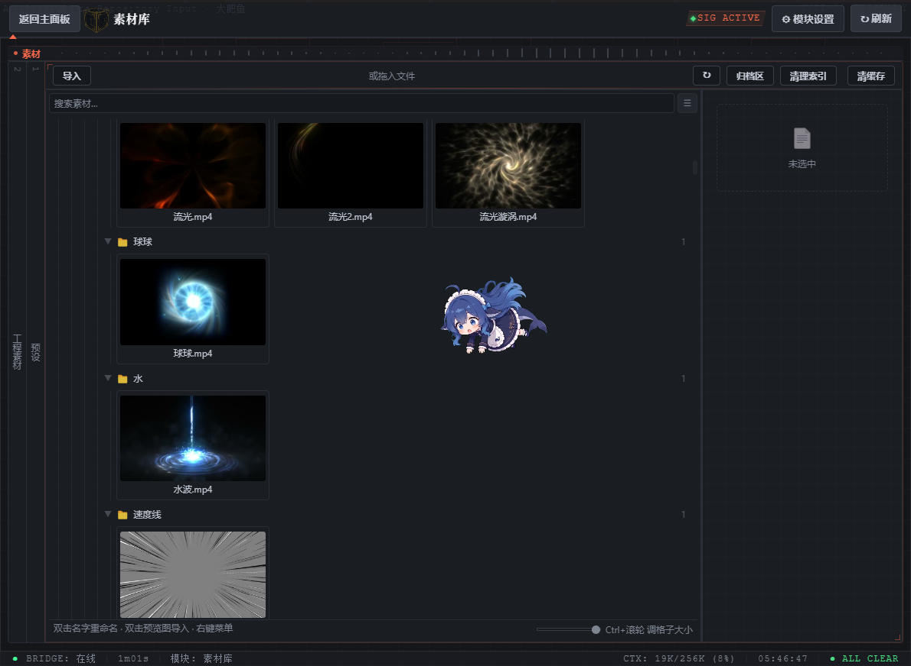

# AS_ExtP — After Effects AI 拡張プラットフォーム

[简体中文](README.md) | [English](README.en.md) | **日本語** | [Deutsch](README.de.md) | [한국어](README.ko.md) | [Français](README.fr.md) | [Русский](README.ru.md)

> After Effects に AI を組み込むマルチモジュール拡張プラットフォーム（CEP）です。
>
> バージョン：v1.0.5

AS_ExtP は After Effects 向けの AI 拡張プラットフォームです——CEP パネルと 2 つのネイティブ AE プラグイン（GLSL エフェクトホストと AE Hotbox）で構成されます。パネルは複数のモジュールから構成されます：**Agent**（大規模言語モデルによる対話的な操作）、**ComfyUI**（AI 画像 / 動画の生成）、**アセットライブラリ**（プロジェクトアセットとプリセットの管理）、そして **MCP / Skill / 記憶 / モデル管理**（機能拡張と設定）です。

中でも **Agent モジュール**が中核です。やりたいことを中国語で一言伝えるだけで、AI が内蔵の AE 自動化ツールを自ら呼び出して操作を実行します——コンポジションの作成、レイヤーの追加、キーフレームの設定、エフェクトの適用、レンダリングと出力まで、コードを手で書く必要はありません。AI に ExtendScript を直接生成・検証させて実行させることも、AE 内でリアルタイムに動作する GLSL / リニア JS のピクセルエフェクトを生成させることもできます。

さらに Agent モジュールの**外部接続モード**では、AE 操作の機能一式を標準の **MCP Server** として外部のエージェントソフトウェアに提供できます——Claude Code / Cursor で「AE にコンポジションを作って」と頼むだけで、拡張パネルに切り替える必要はありません。接続方法は [外部接続モードの接続](#外部接続モードの接続) を参照してください。

---

## 目次

- [コア機能](#コア機能)
- [Agent の 5 つのモード](#agent-の-5-つのモード)
- [外部接続モードの接続](#外部接続モードの接続)
- [ネイティブコンポーネント](#ネイティブコンポーネント)
- [インストールガイド](#インストールガイド)
- [AI プラットフォームの設定](#ai-プラットフォームの設定)
- [開発者向けドキュメント（DEVELOPMENT.md）](docs/DEVELOPMENT.ja.md)
- [セキュリティ上の注意](#セキュリティ上の注意)
- [免責事項](#免責事項)

---

## コア機能

AS_ExtP は 8 つの機能モジュールで構成され、メインパネルのモジュールカードまたは 3D キューブナビゲーションから入ります。


### 1. Agent モジュール

中核となるモジュールで、自然言語で AI と対話しながら AE を操作します。**Script / Agent / Shader / 外部接続 / チーム** の 5 つの作業モードを備えています（詳細は [Agent の 5 つのモード](#agent-の-5-つのモード)）：最初の 4 つは単一エージェントモード、第 5 の「チーム」は 4 つの常駐エージェントを同時に協調させます。「外部接続」モードではツールセットを MCP Server として外部のエージェントソフトウェアに提供できます。複数セッションの管理（セッション切り替えではタイトルで検索できます）、ツール権限の 3 段階（自動 / バランス / 慎重）、タスクプランの追跡、経験の振り返り、推論強度の調整、Agent のペルソナのカスタム記述に対応します。目標の自動続行（トップバーの目標ストリップ、`/goal` コマンド、デフォルトの上限ラウンド数は 25、1～500 で設定可能）にも対応し、ツールの表示範囲はビューごとに絞り込めます（Agent モジュール設定 →「ツール可視性」）。画像や動画をドラッグしてビジョンモデルに画面を解析させること、docx / xlsx / pdf などのドキュメントをテキストに解析してから操作することもできます（Word の表は Markdown の表に変換し、埋め込み画像はデータディレクトリに抽出して本文にパスを示します。重複 / アイコン / 巨大画像は自動でスキップし、必要に応じて `read_image` で表示できます。Excel はシートごとに CSV に変換）。動画の添付ファイルにはホバー時のミュート試聴と全画面プレビューがあります。

### 2. AE ツール

AE 自動化ツールの定義を管理します。ツールは **プロジェクト / コンポジション / レイヤー / アニメーション / エフェクト / レンダリング / ツール**（およびユーザー定義カテゴリ）で分類して整理されます。11 個の AE ツールを同梱しています：プロジェクトパネルとレイヤーの閲覧、コンポジション / レイヤー / フッテージの詳細、レンダーキューとコンポジション横断検索、環境とエフェクトの診断、ExtendScript の実行、フッテージの読み込みと置き換え、プロジェクトの保存、コンポジションのレンダリング、フォルダーの列挙、プレビューフレームのキャプチャ、画像の解析。ほかにパネル側に内蔵された取り消し（`undoLastOperation`）と AE API ドキュメントの照会（`queryAeApi`）があります。その他の AE 操作は、AI が `executeExtendScript` でその場でスクリプトを書いて実行します。ツールはホットリロードに対応し、パネル内での編集が即座に反映されます。AI が `createAETool` で新しいツールを自分で作成することもできます——読み取り専用でない自作ツールはデフォルトで Agent からのみ参照でき、読み取り専用ツールはデフォルトでグローバル（スクリプト / Shader と外部接続モードのいずれからも参照可能）です。読み取り専用でないツールを [外部接続モード](#外部接続モードの接続) からも呼び出せるようにするには、作成時に `external-mcp` を含む scope を明示的に宣言する必要があります。エフェクト一覧のキャッシュ機能があり、エフェクトのプラグインを大量にインストールしている場合は事前にキャッシュを生成すると照会を高速化できます。


### 3. ComfyUI

ローカルまたはクラウドの ComfyUI サービスに接続して AI 画像と動画を生成し、結果はそのまま AE のコンポジションに読み込めます。**フォームモード**での画像生成と、**キャンバスモード**でのノードベースのビジュアルワークフロー編集に対応し、AE の現在のフレームを入力として取り込めます。バッチ生成と WebSocket によるリアルタイムの進捗表示にも対応します。


テンプレートについては、**13 セットの手動調整済みワークフロー**を内蔵しています（テキストから画像、画像から画像、GPT Image、Nano Banana、Seedream、Hailuo、Kling、HappyHorse、Seedance など。画像から動画 / 参照画像から動画 / 開始・終了フレームによる生成 / オールインワン参照など、さまざまな動画生成に対応）。さらに **ComfyUI 公式テンプレートライブラリ（600 セット以上）**にも接続します：AI は必要に応じて公式テンプレートを検索し、サブグラフを自動で展開して実行可能なワークフローに変換できます。モデルのドロップダウン項目はサーバー側のノードの変化に応じて動的に列挙され、テンプレートの索引はローカルディスクにキャッシュされます（オフラインでもフォールバック可能）。カスタムワークフローは、ComfyUI エディターで保存した **UI 形式**と **API 形式**の読み込みに対応します（UI 形式は自動変換。テンプレートが本機に未インストールの**インターフェース制御ノード**——たとえば rgthree の Fast Groups Bypasser——を参照している場合は、そのスイッチノードのみをスキップして通知し、ワークフロー全体を拒否することはありません）。ワークフローのディレクトリは `<データディレクトリ>\comfyui\workflows` に固定されています——.json をこのディレクトリに置き、パネルを開き直すと自動で読み込まれます。セキュリティ上の理由から、サービスアドレスは本機 / イントラネットのみ許可されます。

### 4. アセットライブラリ

AE プロジェクトでよく使うアセットを一元管理し、カードを積み重ねた形で 3 つのセクションに分けて表示します：

- **アセット**：通常のアセット（画像 / 動画など）への仮想的な参照で、実体ファイルはコピーしません
- **プロジェクトアセット**：`.aep` プロジェクトファイルで、現在のプロジェクトにそのまま読み込めます
- **プリセット**：`.ffx` プリセットファイルで、選択中のレイヤーまたは指定したレイヤーに適用できます

一括読み込みに対応し、フォルダーの階層を自動で再現します。動画アセットには解像度（480p / 720p / 1080p / 元のサイズ）を選べるトランスコードキャッシュがあり、アセットライブラリのモジュール設定で自動トランスコードをオフにできます（アセットライブラリのプレビューのみを制御）。グリッドのサムネイルはホバーでミュート試聴でき、項目をクリックすると右側のプレビュー領域で自動的にミュートのループ再生が始まります（動画はループ再生、連番画像は 1 フレームずつループ再生）。プレビューをクリックすると全画面になります。「キャッシュをクリア」の確認ダイアログには削除できるファイル数と合計サイズが表示されます（設定ページには現在の使用量が表示されます）。個別のアセット参照、プロジェクトアセット、プリセットもクイック実行バーから直接呼び出せます。



### 5. MCP 管理

外部の MCP（Model Context Protocol）サーバーを管理し、AI が使えるツールを拡張します：stdio、HTTP、SSE の 3 つの転送方式に対応し、サーバーの起動 / 停止 / 状態の監視、ツールの自動検出と AI への登録ができます。（向きが逆である点に注意：このモジュールは外部の MCP サーバーを**取り込んで**パネル内の AI に使わせるもので、[外部接続モード](#外部接続モードの接続) はパネルのツールを**外へ出して**外部のエージェントに使わせるものです。）

### 6. Skill 管理

分野知識のスキルパッケージを管理し、AI が必要に応じて読み込んで専門的な指針を得られるようにします。カスタムスキルの作成に対応し、AI に自分の作業規範に従わせることができます。

### 7. メモリ管理

AI の永続メモリシステムで、会話をまたいで経験を保持します：記憶の種類は **経験 / プロジェクト記録 / 好み** の 3 つに絞られ、スコープ（Agent / Script / Shader モード）を指定できます。`[[wikiリンク]]` による相互リンク、全文検索、複数選択での一括削除に対応します。モードごとに管理するユーザールール（Agent / Script / Shader に各 1 件）は AI のシステムプロンプトに自動で注入され、それ以外の記憶は AI が必要に応じて検索します（`memory_search`）。

### 8. モデル管理

すべての AI プラットフォームとモデルの設定を管理します：プラットフォームとモデルの表示 / 追加 / 編集 / 削除、デフォルトの選択、モデルの自動検出、接続テスト、モデルのビジョン・ツール呼び出し・JSON モードなどの能力の指定ができます。プラットフォームエディターは**カスタムリクエストヘッダー**に対応し（1 行に `名前: 値`）、内蔵プリセットはプラットフォームに**セッションヘッダー**を宣言できます（例：OpenCode Go の `x-opencode-session`）。リクエスト時に現在のセッション ID を自動で注入するため、追加の認証やルーティング用ヘッダーを必要とするサードパーティのゲートウェイにも適合します。`opencode-go` 系のプリセットを内蔵しています。

### その他の機能

- **外部接続の認可インジケーター**：外部接続モードの認可が有効な間は、パネルの四辺に呼吸するエッジライトと最前面の通知バーが常時表示され、現在のレベルと外部公開ツール数を示します。外部のエージェントが実行を許可されたツール呼び出しのたびにツール名がスクロール表示されるため、現在外部に開放されている状態かどうかを確認できます
- **クイック実行バー**：パネル上部のグローバルショートカットバー（固定オーバーレイ）で、モジュールに入らずにスクリプトの実行、プリセットの適用、プロジェクトアセットの読み込み、アセットの参照ができます。検索フィルターと一括操作に対応します
- **多言語インターフェイス**：After Effects のインターフェイス言語に追従するか、簡体字中国語 / English / 日本語 / Deutsch / 한국어 / Français / Русский を手動で切り替えられます
- **ふとっちょフィッシュ**：AI デスクトップペット（クジラを擬人化したキャラクター、AI 生成）を有効にできます。待機中の散歩、クリックでの跳ね、ドラッグへの追従、居眠り、寝言などの動作があり、会話、定時アナウンス、自発的な返信、ウェブ検索に対応します
- **診断ログ**：グローバル設定から**診断パッケージを書き出せます**（パネル / Bridge / ホスト / ネイティブコンポーネントの各プロセスのログ + 環境情報。まとめてマスク処理され、直近 5 件のみ保持）——問題を報告する際にこのファイルを添付してください
- **テーマとパーソナライズ**：複数のテーマプリセットとカスタム配色の**スキームライブラリ**（スキームの保存 / 適用 / 名前変更 / 削除が可能。編集できる色は 26 項目（コアカラー 20 項目 + セマンティックなステータス色 6 項目。`panel_theme` ツールが 26 項目すべてを読み書き）、派生色は自動計算）；パネル内の Agent はテーマ色の読み取りと変更、スキームの管理を直接行えます（ツール `panel_theme`、Agent モードのみで、外部接続モードには非対応）。背景オーバーレイ、効果音システム
- **3D キューブナビゲーション**：ドラッグでの回転、慣性スクロール、面へのフォーカス遷移
- **下部のステータスバー**：Bridge サービスの状態、AI コンテキスト使用量、アクティブなモジュール、時計をリアルタイムに表示

---

## Agent の 5 つのモード

Agent モジュールのモードスイッチは 5 段階です：最初の 4 段階は単一エージェントモード——**Script / Agent / Shader / 外部接続**——で、「コードのみ」から「対話のみ」、さらに「機能の外部提供」までの連続した範囲をカバーします。第 5 段階の**チーム**は、4 つの常駐エージェントを並行して協調させます。切り替えはトップバーのモードスイッチから行います：

### スクリプトモード

正確な制御や共有・再利用が必要な場面に向いています。AI が ExtendScript のコードを生成し、構文検証と安全性の審査を経たうえで、プレビュー領域で編集してから実行できます。生成したスクリプトはローカルに保存でき、スクリプトツリーは読み込みとプロジェクト管理に対応します。プレビュー領域には「編集 / 成果物」の 2 列の対比表示があり、ブロックや実行エラーが発生した場合は該当行をハイライトし、構造化されたエラーカードを表示します。

### Agent モード

AI が AE の自動化ツールをすべて自分で呼び出して操作を実行します。たとえば「1920×1080 のコンポジションを作成し、赤い平面レイヤーを追加して、2 秒間の不透明度キーフレームを設定して」と伝えるだけです。変更を伴う操作は毎回 AE の取り消しスタックに取り消しグループを残すため、`Ctrl+Z` で元に戻せます。複数ターンの対話でコンテキストを保持し、画像やドキュメントをドラッグしてから操作することもできます。多段階のタスクプランを追跡し、対話の中で権限ポリシーに従って危険な操作を確認します。長時間のタスクは**セッション単位の目標**（`/goal`）として設定でき、上限ラウンド数の範囲で自動的に続行され、ストリーミングの一時的な失敗からも自動で再開します。

### Shader エフェクトモード

AE 内で **GLSL / リニア JS のピクセルエフェクトをリアルタイムに実行**します。AI が生成した GLSL はまずコンパイル検証を通り、プレビュー領域に書き込まれます。JS エフェクトはまず静的な危険コードの事前チェックを受け、デフォルトではさらに LLM による二次審査を経たうえで、パネル側のサンドボックスで `buildShader(params)` のオーケストレーションロジックを実行し、GLSL を生成してホストのレンダリングを再利用します。確定後はエフェクトライブラリに保存でき、ネイティブの [GLSL エフェクトホスト](#ネイティブコンポーネント) がコンパイルして実行し、ホットリロードで画面をリアルタイムに更新します。組み込みパラメーター（uniform）からはスライダー / カラーピッカーのコントロールが自動生成され、コンパイルエラーは LLM に返されて自己修正されます。エフェクトライブラリの保存 / 読み込み / 適用に対応します。


### 外部接続モード

パネルのツールセットを標準の **MCP Server** として外部に提供し、外部のエージェントソフトウェア（Claude Code / Claude Desktop / Cursor / Trae / VS Code Copilot など）から AE を直接操作できるようにします。「外部接続」のレベルに切り替えたうえで、管理コンソールのステータスカードで「外部アクセス認可」のマスタースイッチをオンにしない限り外部には開放されません。スイッチはユーザーが明示的に操作するもので、モードを切り替えても自動でオン / オフになることはありません。

このモードのパネルは 6 つの機能領域を同時に表示するレイアウトになります：左列がスクリプトツリー + エフェクトライブラリ、中列が GLSL プレビュー画像 + 管理コンソール、右列がスクリプトと GLSL のコードプレビューです。管理コンソールには **呼び出しログ / レビューキュー / 設定** の 3 つのタブがあり、ステータスカードは常に最上段に表示されます（マスタースイッチ、Bridge の状態、外部公開ツール数、右端は権限レベルのホイール——他のモードの「権限」ホイールと同じで、クリックするごとに切り替わります）。外部のエージェントによる呼び出しはすべて呼び出しログに記録され、送信されたスクリプトとエフェクトはさらにレビューキューに記録を残します。外部からスクリプトライブラリ / エフェクトライブラリに書き込まれたファイルは、対応する一覧の項目に「外部」のバッジが付きます。


接続設定は次の節を参照してください。

### チームモード

モードスイッチの第 5 段階です。有効にすると 4 つの常駐エージェントが同時にオンラインになります：**ディレクター**（企画案と企画書）、**AE 実行**（AE 操作の実行と書き出し）、**Shader 実行**（GLSL / JS エフェクト）、**アート実行**（画像 / 動画アセットの生成）。4 つのエージェントはそれぞれ独立した対話ビューとタスクプランを持ちます。モデル（所属プラットフォームを含む）と思考レベルは、Agent モジュール設定の「チームモード」セクションで 1 件ずつ設定します——モデルを空欄にするとグローバルなデフォルトに従い、思考レベルは必須のレベルです（デフォルトは high）。サブエージェントの同時実行上限（デフォルト 3）とキープアライブ時間（デフォルト 10 分）もこのセクションで設定します。左のドロワーには「プラン / チームタスク」の 2 つのタブがあります：プランは各エージェント自身の未対応項目、チームタスクは 4 つが共有する協働リストです。各エージェントは必要に応じてサブエージェントを派生できます（サブエージェントはさらに派生できません）。各エージェントはメッセージ送信ツールで互いにメッセージを送り、チームワークスペースのファイル（企画書 `brief.md`、テキスト絵コンテ `storyboard.md` など）で成果物を引き継ぎます。


---

## 外部接続モードの接続

### 前提条件（すべて必須）

1. **After Effects が起動している**こと、および AS_ExtP 拡張パネルが開いていること（ローカルの Bridge プロセスはパネルとともに自動で起動し、`127.0.0.1:9877` を待ち受けます。使用中の場合は 9886 まで順に移ります）
2. **パネル内で外部アクセスが認可されている**こと：Agent モジュール → モードスイッチを第 4 段階の「外部接続」にし、管理コンソールのステータスカードで「**外部アクセス認可**」のマスタースイッチを**手動でオン**にします（**モードに入っただけでは認可されません**。認可を取り消すときは同じスイッチをオフにします。オフにすると**ツール実行**はすべて `EXTERNAL_MODE_OFF` を返し、ツール一覧は引き続き取得できます）
3. **Node ランタイムがある**こと（stdio 転送のみ必要）：拡張機能は `vendor\node\node.exe`（v22）を同梱しているため、**Node.js を別途インストールする必要はありません**——Release 完全パッケージには同梱済みで、ソースをクローンした場合は `tools\check-env.bat` を 1 回実行すれば自動でダウンロードして補完します

未認可のときは**ツール実行**がすべて `EXTERNAL_MODE_OFF` を返します（ツール一覧は引き続き取得できます）。パネルが開いていないが Bridge は動作している場合は `PANEL_OFFLINE`、Bridge 自体が起動していない場合（AE 未起動 / パネルを一度も開いていない）は `BRIDGE_OFFLINE` を返します。

### 転送方式の選択

| 転送 | 接続方式 | 対象 | 説明 |
| --- | --- | --- | --- |
| **stdio**（推奨） | クライアントが設定に従って `ext-mcp-server.js` を起動 | すべてのクライアント | プロセスのライフサイクルはクライアントが管理。確認のやり取りに対応 |
| **Streamable HTTP** | クライアントが `http://127.0.0.1:<ポート>/mcp` に接続 | Claude Code / Cursor など remote 接続に対応したクライアント | 新しいプロセスは不要。Bridge にエンドポイントを内蔵 |

HTTP のポートは `/health` での疎通確認を基準にします（9877～9886 の順に移行）。まず `curl http://127.0.0.1:9877/health` を実行し（失敗したらポートを +1 して再試行）、ポートを確認してから URL を入力してください。

### クライアント設定

AS_ExtP のインストールパスは固定です（`tools\install.bat` と `tools\deploy.bat` はどちらもここに配置します）：

```
C:\Program Files (x86)\Common Files\Adobe\CEP\extensions\AS_ExtP
```

MCP に対応したクライアントなら、**stdio サーバー**の設定を 1 つ追加するだけで、内容は次の 2 項目のみです：

- `command`：拡張機能に同梱された Node `<拡張パス>\vendor\node\node.exe`（システムに Node ≥ 20.18 がインストールされ PATH が通っている場合は `node` でも可）
- `args`：`<拡張パス>\client\shared\ext-mcp-server.js`。末尾に `--name <識別名>` を付けられます。これは確認ダイアログの送信元表示と Bridge のログに使われ、省略できます（デフォルトは `unknown`）——パネルの呼び出しログには自動生成されたクライアント ID（`ext-<pid>-<ts>` の形式）が表示されます

パスは絶対パスで指定してください——MCP クライアントの作業ディレクトリは拡張機能のディレクトリではありません。クライアントごとに異なるのは設定ファイルの場所とコンテナのキー名（`mcpServers` / `servers` / `mcp_servers` など）だけで、フィールドは上記の 2 項目です。

### 権限レベルと確認の仕様

パネルの外部接続ステータスカード右端の「権限」ホイールは 2 段階です（Agent / Shader モードのツールバーにある権限ホイールと同じコントロールですが、外部接続では 2 段階のみです：クリックするごとに切り替わり、マウスを重ねると意味の説明が表示されます）：

| レベル | 動作 |
| --- | --- |
| **バランス**（デフォルト） | 7 つの高リスク操作グループは**使用中のエージェントソフトウェアの UI 内**で確認を求め（MCP elicitation 経由）、それ以外はそのまま実行 |
| **自動** | 外部からの呼び出しはすべてそのまま実行し、呼び出しログに記録するのみ |

確認が必要な 7 つの高リスク操作グループ：AE ツールの作成 / 上書き、メモリの書き込み（4 件）、アセットフォルダーの削除、エフェクトライブラリの削除、スキルの書き込み、スクリプトライブラリへの登録書き込み、MCP サーバーの設定変更と実行制御（読み取り操作では確認を求めません）。

クライアントが**確認のやり取りに対応していない**場合（Claude Desktop、Cline、または HTTP エンドポイント経由など）、これらの高リスク操作は**そのまま拒否**され、`CONFIRM_REQUIRED` を返します。確認なしで実行されることはありません。許可したい場合は確認に対応したクライアントに変更するか、パネルでレベルを「自動」に切り替えてください（すべてを許可することを明示したのと同じになります）。

| クライアント | 確認のやり取り |
| --- | --- |
| Claude Code / Cursor / VS Code Copilot | ✅ エージェントソフトウェア内で確認を表示（60 秒応答がない場合は拒否として処理） |
| Claude Desktop / Cline | ❌ 高リスク操作は拒否（`CONFIRM_REQUIRED`） |
| HTTP エンドポイント | ❌ 同上（SSE チャネルがなく、確認を送れない） |

### ツール一覧と動的な変化

外部公開ツール数はデフォルトで 42 個です（固定ツールリスト 46 件のうち、記憶の書き込み 4 件はデフォルトでオフ。ゲートウェイとカスタムツールは含まず、登録されていない一部の内蔵ツールは通知なくスキップされます）。設定ページで **12 のモジュールグループ**ごとにオン / オフでき（AE プロジェクトデータ / AE メタツール / カスタム AE ツール / Agent エンジン / スクリプトモード / Shader モード / 記憶 / ComfyUI 生成 / アセットライブラリ / Skill / 外部接続タスク / ゲートウェイ）、グループ内ではツール単位でも切り替えられます。うち「ゲートウェイ」グループはデフォルトでオフです——パネルに接続済みのサードパーティ MCP サーバーもまとめて外部に提供するためリスクが最も大きく、必要に応じて有効にしてください。`tools/list_changed` に対応したクライアント（Claude Code / VS Code）は切り替えの変更後に一覧を自動で更新し、Claude Desktop / Cursor はクライアントの再接続が必要です。

### トラブルシューティング

| 症状 / エラーコード | 原因と対処 |
| --- | --- |
| `PANEL_OFFLINE` | Bridge は動作しているがパネルとの接続が切れている——AS_ExtP パネルを開いてください |
| `BRIDGE_OFFLINE` | Bridge が起動していない（AE 未起動 / パネルを一度も開いていない）——まずパネルを開いてホストから Bridge を起動するか、手動で `node client/shared/ae-bridge.js` を実行してください |
| `EXTERNAL_MODE_OFF` | 「外部アクセス認可」のマスタースイッチがオンになっていない（外部接続のレベルに切り替えただけでは認可されません。ステータスカードで手動でオンにする必要があります）。ブロックされるのはツール実行のみで、ツール一覧は引き続き取得できます |
| `CONFIRM_REQUIRED` | この操作には確認が必要ですが、現在のクライアントは確認のやり取りに対応していません——クライアントを変更するか、「自動」レベルに切り替えてください |
| `CONFIRM_TIMEOUT` | 確認ダイアログに 60 秒以内の応答がなく、今回は実行されていません |
| `ACCESS_DENIED` | ツールがモジュールグループ / ツール単位のスイッチで無効になっている、外部公開の許可リストにない、ツールドロワーで「外部接続」にチェックが入っていない、またはゲートウェイサーバーが個別に有効化されていない |
| AE ツールの待ち行列がタイムアウト（…秒）、今回の呼び出しは送信されていません | パネルの AE エンジンが使用中です（パネル内の Agent / チームレーン / 別の外部接続呼び出し / 実行中のレンダリングや長いスクリプト）。パネル内の AE 呼び出しは 1 本の FIFO キューを共有します（キューパネルは常時表示）。タイムアウトした場合は今回が実行されていないことが保証されるため、使用中が終わってから再試行してください |
| `QUEUE_FULL` | 待ち行列の上限は 32 です。しばらくしてから再試行してください |
| `RELAY_TIMEOUT` / `EXT_TIMEOUT` | パネルからの応答がタイムアウト——相対ゲートは 90 秒（stdio 側は 100 秒）で、パネルの `ext_progress` ハートビートが継続的に延長します。呼び出しがまだ実行中の可能性があるため、まず呼び出しログを確認してから再試行するか判断してください |
| `EXT_TASK_PENDING` | パネルでの実行が 30 分を超えています（固定上限で、ハートビートでも延長されません）——エラーテキストに `taskId` が含まれます。基盤の呼び出しは実行を続けているため、`ext_task_get` で `taskId` を指定して結果を照会してください（パネルを再読み込みするとタスクテーブルはクリアされます） |
| HTTP エンドポイントが 503 を返す | Bridge にそのエンドポイントがマウントされていません——Bridge がパネル（または `node client/shared/ae-bridge.js`）から起動されたことを確認してください |
| 9877 に接続できない | ポートが使用中で順に移っています——`http://127.0.0.1:9877-9886/health` を 1 つずつ確認してください |

---

## ネイティブコンポーネント

CEP パネルのほかに、このプロジェクトには 2 つのネイティブな AE コンポーネントがあります（C++、`native/` 配下）：

### GLSL エフェクトホスト（AS_Effect Host、`native/glsl-host/`）

汎用的なピクセルエフェクト用 `.aex` ホストプラグインです。エフェクトのロジックは外部の `.glsl`、または JS のオーケストレーションで生成した GLSL ファイルに置かれ、ファイルを変更するとホットリロードでリアルタイムに反映されます。エフェクトごとにプラグインを再コンパイルする必要はありません。8bit / 16bit / 32bit（浮動小数点）深度、GPU レンダリング、オンデマンドの uniform 登録（浮動小数点 / ベクトルのパラメーターはパネルのコントロールに自動でマッピング：スライダーまたはカラーピッカー）に対応し、コンパイルに失敗してもクラッシュせず、エラーログを書き出して返します。これが Shader エフェクトモードの実行基盤です。


3D と画像入力の機能：

- **3D カメラ連動**：コンポジションのカメラを読み取り、カメラの行列、位置、視野角（`uCamFov`）を内蔵 uniform に注入します。GLSL のパースペクティブが AE のカメラと一致するため、実際の空間に合わせた配置ができます
- **AE ライト連動**：コンポジションのライトを列挙し（種類 / 位置 / 向き / 色 × 強度 / コーンの減衰、最大 8 灯）、`uLight*` 系の uniform に注入します。エフェクトは AE のライトにリアルタイムに反応できます
- **レイヤーマップ入力**：`iChannel1/2/3` を宣言すると対応するレイヤー行が有効になります（宣言していない場合、その 3 行は常に表示されたままグレーアウトします——ホストの LAYER 行は非表示にできません）。他のレイヤーをテクスチャ入力として使えます（`iChannel0` は内蔵の「このレイヤー」）
- **パラメータースロット**：エフェクトコントロールには自前で描くキャンバスが 1 枚だけあり、「パラメーター」グループ内に現在の shader の uniform ごとに 1 行ずつ描きます。スカラーはスライダー 1 本、vec2 / vec3 は点コントロールを成分ごとに行を分けて表示し、vec4 と色を表すベクトルはカラーピッカーとして表示します。行名と値は毎フレーム現在のファイルから読み直すため、レイヤーのコピー、shader の切り替え、プロジェクトの復元後も最初の表示から正しくなります。スクリプトと AI は、ホストが保存するパラメーターマップ（`propertyIndex`）またはパラメーターの matchName でスロットを指定します。選択中のファイルのインデックスは隠しパラメーター 141 です（以前は 140）。表示レンジと有効な入力範囲は別々に設定します
- **エフェクトライブラリの索引**：ホストが正式な番号を書き出し、パネルとホストのエフェクトライブラリの認識が自動で同期します。選択したファイルが消失した場合は、黙って別の shader に切り替えるのではなく、そのまま渡します


### AE Hotbox（AS_Hotbox、`native/hotbox/`）

ネイティブな AEGP のグローバル Hotbox プラグインで、CEP パネルとは独立して動作します。AE のどこでもホットキー（デフォルトは `Alt+Q`、パネルのグローバル設定で記録して変更できます）を押すと、マウスの位置にフローティングウィンドウが現れます。ホットキーを押したままにすると**リングジェスチャーモード**（弧の区画へ向かって動かすと実行）、中央の円をクリックすると**検索モード**（横長の検索バー + リニアな結果一覧 + 種類フィルター）になります。検索結果は**ピンインの頭文字と完全なピンイン**で一致します（例：`gsmh` → ガウスブラー）。ジェスチャーモードでウィンドウが表示されているときにもう一度ホットキーを押すと閉じます（トグル動作）。検索モードではそのキーは検索ボックスの文字入力になります。ホットキーを離したあと任意の英字を押すと、その文字を入力済みの状態で検索に入れます。

データは AE のすべてのエフェクト、`agent/scripts` のスクリプト、プリセット（アセットライブラリのプリセット、AE のユーザープリセット、AE 付属のプリセットの 3 系統を統合して重複を除いたもの）から取得します。プラグインは AEGP として AE と同じプロセスで動作し、ローカルファイルを直接読み取るため、Bridge を経由せず、拡張パネルが開いている必要もありません。コンポジション関連の花びらメニューには**3 つのスクリーンショット操作**があります（クリップボードへコピー（PNG、アルファチャンネル付き） / PNG として保存 / JPG として保存）。

#### クイックスタート

1. `Alt+Q`（または記録したホットキー）を押す → マウスの位置にリング状のフローティングウィンドウが表示されます
2. マウスをいずれかの弧の区画へ動かす → その区画がハイライトされます（金色の枠線）
3. 区画の上でマウスを離す → その区画に割り当てられた機能が実行されます
4. または：中央の円をクリック → 検索モードに切り替え → キーワードを入力 → `↑`/`↓` で選択 → `Enter` で実行

#### ジェスチャーモード（ホットキーを押したまま）

| 方位 | 区画 | 説明 |
| --- | --- | --- |
| 真上 | スクリーンショット | ホバーで 3 つの花びらのサブメニューが展開します（PNG / クリップボード / JPG）。スロットの割り当ては持ちません |
| 右上 / 右下 / 左下 / 左上 | 割り当て可能な 4 つのスロット | 固定の機能（エフェクト / スクリプト / プリセット）を割り当てられます。未割り当ての場合は動的スロット（最近使用した項目にフォールバック）になります。検索ボックスが空のときは最近使用した項目を直接一覧表示します。設定パネルの 4 つのスロット行は 左上 / 左下 / 右上 / 右下 の順に並びます（次の節を参照） |
| 真下 | 設定 | クリックすると設定パネルに入ります。**ここで離しても実行されず**、マウスでのクリックが必要です |

- 離した位置の判定：弧の区画の上（その角度方向のリング帯の外側にある透明領域を含む）なら実行します。中央の円の上では実行しません（誤操作の防止のため、検索に入るにはクリックが必要です）。リング内の空洞と区画の隙間ではウィンドウを閉じ、何も実行しません。
- ウィンドウが表示されているときに**ホットキーをもう一度押すと閉じます**（トグル動作。検索モードを除く）。ホットキーを離したあと任意の英字を押すと、その文字を入力済みの状態で検索に入ります。
- **離した後の待機**（設定パネルで切り替え可能、デフォルトはオフ）：オンにすると、離しても実行も閉じることもせず、マウスのクリックで区画を選ぶ方式になります——弧の区画をクリックすると実行、中央の円をクリックすると検索に入ります。抜ける方法は `Esc`、ホットキーの再押下、ウィンドウの外側のクリック、リング内の空白部分のクリックです。設定は `<データディレクトリ>\hotbox\config.json` の `releaseStay` に書き込まれ、AE を再起動しても維持されます。

#### 検索モード（中央をクリック）

| キー / 操作 | 動作 |
| --- | --- |
| 検索ボックスが空 | 最近使用した項目を一覧表示（現在の種類でフィルター、新しい順）。先頭行がデフォルトで選択され、記録がない場合は入力のヒントを表示 |
| 文字を入力 | リアルタイムのあいまいフィルター（部分列の一致、大文字と小文字を区別しない） |
| `[全部 ▾]` をクリック | フィルター：すべて / エフェクト / スクリプト / プリセット |
| `↑` / `↓`、ホイール | 選択行を 1 行ずつ移動（先頭 / 末尾で折り返し、ホイールと `↑`/`↓` は同じ動き） |
| `Enter` / リスト項目をクリック | 選択項目を実行（FXConsole 風：シングルクリックで適用） |
| `Esc` | Hotbox を閉じる（設定パネルから入った割り当ての流れなら設定パネルに戻る） |

検索モードは**閉じずに残ります**（ホットキーは離して両手で入力できます）。実行 / `Esc` / 外部のクリックまで継続します。

**並び順：最近使用したものを優先**——一致した結果のうち使用済みのものを前方に置きます：「最近使用」リスト（`recent.json`）にある項目は先頭へ移動し、グループ内は最近使用した順（新しい順）に、それ以外の項目は元の順序を保ちます。入力が変わると選択行は先頭に戻るため、「入力してそのまま Enter」で実行されるのは直近に使った項目です。検索ボックスが空のときは結果一覧に最近使用した項目をそのまま表示します（種類でフィルター、新しい順、先頭行をデフォルトで選択、`Enter` / クリックで直接実行または割り当て）。設定パネルから割り当ての流れに入った場合も同様に最近使用した項目を一覧表示します（割り当てのみで実行はしません）。プリセットの適用は 20 レイヤー未満なら 1 回で完了し、1 回の取り消しで全体を戻せます。20 レイヤー以上の場合はブロック単位で適用し、取り消しもブロックごとに進みます。「使用済み」の判定は同じ種類 + 同じ `key`（エフェクト = matchName、スクリプト / プリセット = ファイルの絶対パス）で行い、`key` が一致しない場合は同じ名前でフォールバックします。リストの容量は 100 件（ソースの定数 `kRecentMax`）で、それより古い項目は先頭へ移動せず、空のクエリの一覧にもジェスチャーリングにも表示されません。無効になった古い記録は引き続き一覧に表示され、実行時に失敗を通知し、割り当ては拒否されます。

#### 設定パネル

4 つのスロット行はジェスチャーリングの方位（左上 / 左下 / 右上 / 右下）に並び、スロットごとにエフェクト / スクリプト / プリセットを割り当てます。ホットキーは記録して変更でき、「離して実行」「離した後の待機」の 2 つのスイッチがあります。設定は `<データディレクトリ>\hotbox\config.json`（データディレクトリのデフォルトは `%APPDATA%\Adobe\CEP\extensions\AS_ExtP`）に保存され、最近使用のリストは `<データディレクトリ>\hotbox\recent.json` にあります。

> ビルド、配置、トラブルシューティング、実装の詳細は [DEVELOPMENT.md](docs/DEVELOPMENT.ja.md) を参照してください。

---

## インストールガイド

### 動作環境

- **After Effects**：**AE 2023（AEFT 23.0）以降**が必要です（CEP 11 / CSXS.11、CEF は Chrome 88）。GLSL エフェクトホスト / Hotbox のネイティブコンポーネントも同様に AE 2023+ が必要です。AE 2023 より前のバージョンは非対応で、`tools\install.bat` はそれをスキップし、集計で通知します。
- **Windows** オペレーティングシステム
- **Node.js ≥ 20.18**（ソースをクローンした場合のみ）：ローカルの Bridge と stdio MCP サーバーのランタイムです。Release 完全パッケージには `vendor\node` を同梱済みで、ソースをクローンした場合は `tools\check-env.bat` を 1 回実行すれば自動でダウンロードして補完します

### ファイルの入手（いずれか一方）

| 方法 | 対象 | 内容 | 手順 |
| --- | --- | --- | --- |
| **Release 完全パッケージ**（推奨、**すぐに使える**） | 一般ユーザー | ソース + ビルド済みの `.aex` + 同梱の Node ランタイムと依存関係 | [Releases](../../releases/latest) から zip をダウンロードして展開し（**Node のインストール、`npm ci`、ビルドは不要**）、パッケージ内の `tools\install.bat` をダブルクリック |
| **ソースのクローン** | コードを読みたい / 自分でビルドしたい | ソースのみ | `git clone` → `npm ci` → `tools\check-env.bat` をダブルクリック（`vendor\node`、ffmpeg、PlayerDebugMode を補完）→ `tools\deploy.bat` をダブルクリックしてファイルを拡張機能ディレクトリに配置 |

> 2 つのスクリプトの役割分担：`install.bat` はインストーラーです（AE の検出、Node と ffmpeg のダウンロード、PlayerDebugMode の書き込み、拡張機能ディレクトリへの配置までを一括で行います）。`deploy.bat` は開発期の更新デプロイスクリプトで（`host` / `client` / `CSXS` や `vendor` の内容を変更したあと、最新のファイルをインストール済みの拡張機能ディレクトリへ配置し直します。ネイティブの `.aex` は拡張機能ディレクトリにないため、引き続き `install.bat` か手動で AE の `Plug-ins` にコピーします）、ダウンロードとレジストリ設定は行いません。初めて使う前に `check-env.bat` か `install.bat` を実行して `vendor\` を用意しておく必要があります。

> 2 つの方法の役割分担：**Release 完全パッケージはすぐに使えます**（ソース + ビルド済みの `.aex` + 同梱の Node と依存関係。展開して `install.bat` をダブルクリックするだけで、Node のインストール、`npm ci`、ビルドは不要です）。一方、**ソースリポジトリには**これらのビルド済みファイルと依存関係が**含まれません**（サイズと配布の制約によります。[アセットとビルド済みファイル](#アセットとビルド済みファイル) を参照）ため、`npm ci` / `check-env.bat` で補完する必要があります。ネイティブコンポーネントを自分でビルドするには Visual Studio と Adobe AE SDK が必要です——SDK はそのライセンスによりリポジトリに同梱されません。`install.bat` をソースディレクトリ内で実行した場合、`deploy\Plug-ins\*.aex` があれば自動で配置し、なければスキップして通知します。`deploy.bat` は `vendor\` ディレクトリが存在することが前提で（`check-env.bat` / `install.bat` が作成）、見つからない場合は先に `check-env.bat` を実行するよう通知します。ルートの `node_modules` は配置時に `vendor\node_modules` へ自動でコピーされます。

### CEP 拡張機能のインストール

1. プロジェクトフォルダー全体を AE の拡張機能ディレクトリに置きます。**フォルダー名は `AS_ExtP` でなければなりません**（以下の設定例はすべてこの名前を前提にしています）：
   ```
   C:\Program Files (x86)\Common Files\Adobe\CEP\extensions
   ```
   または `tools\install.bat`（Release パッケージ内 / ソースディレクトリ内のどちらでも実行可）を使って自動で配置します。

   > 注意：このディレクトリは **After Effects のインストールディレクトリの中ではありません**。AE 自身のインストールディレクトリ（例：`E:\Adobe\Adobe After Effects 2023\`）に `CEP` フォルダーはありません——AE はパネルを同梱しておらず、拡張機能はこの共通ディレクトリから一律に読み込まれます（他の Adobe アプリケーションのインストールディレクトリにある `<アプリ>\CEP\extensions` は、そのアプリ自身の内蔵パネルだけを置く場所です）。インストール後の拡張機能のルートは `...\CEP\extensions\AS_ExtP` で、[外部接続モード](#外部接続モードの接続) の JSON 設定で使うのはこのパスです。
2. 署名なし拡張機能のデバッグモードを有効にします（必須）：
   - `Win+R` → `regedit` と入力してレジストリエディターを開く
   - `HKEY_CURRENT_USER\SOFTWARE\Adobe\CSXS.11`（AE 2023 / 2024）または `CSXS.12`（AE 2025+）へ移動——インストーラーは AE 23/24 の両方のキーに書き込みます
   - 文字列値 `PlayerDebugMode` を新規作成し、値のデータを `1` に設定
3. AE のスクリプトによるファイルの書き込みとネットワークアクセスを許可します：`編集／環境設定／スクリプトとエクスプレッション` で該当する項目にチェックを入れます
4. After Effects を再起動し、メニューの `ウィンドウ／拡張機能／AS_ExtP` からパネルを開きます

> この拡張機能は複数の AE インスタンスでの同時使用に対応していません（Bridge は単一インスタンスです。複数起動している場合は他の AE でパネルを閉じてください）。

### アセットとビルド済みファイル

**Release 完全パッケージはすぐに使えますが、ソースリポジトリはそうではありません**：以下の内容は Release 完全パッケージに同梱されています（展開して `tools\install.bat` をダブルクリックすれば使えます。Node のインストール、`npm ci`、ビルドは不要）。**ソースリポジトリには**これらのファイルが**含まれない**ため、クローン後は「ソースのクローン」の行に従って自分で補完してください。FFmpeg はどちらの方法にも含まれず、スクリプトがダウンロードします：

| 内容 | サイズ | 不足時の影響 / 代替 |
| --- | --- | --- |
| ビルド済みネイティブコンポーネント `deploy/Plug-ins/*.aex` | 約 2MB | Release パッケージには同梱済みで、`install.bat` が検出すると自動で配置します。ソースのクローンには含まれず、不足すると GLSL エフェクトホストと Hotbox が使えないため、自分でビルドする必要があります |
| Node ランタイム `vendor/node/` | 約 84MB | Release パッケージには同梱済み。ソースのクローンでは `tools\check-env.bat` が nodejs.org から固定バージョンをダウンロードし、SHA-256 を検証します |
| 依存パッケージ `vendor/node_modules/` | 約 16MB | Release パッケージには同梱済み。ソースのクローンでは `npm ci` を実行し、`deploy.bat` / `install.bat` がルートの `node_modules` からコピーして補完します |
| FFmpeg `vendor/ffmpeg/` | 約 200MB | **本プロジェクトは配布しません**：`tools\check-env.bat` / `tools\install.bat` が上流の固定バージョンをダウンロードし、SHA-256 を検証します（ライセンスと入手元は [THIRD-PARTY-NOTICES.md](docs/THIRD-PARTY-NOTICES.md) を参照） |

> デスクトップペットのアート `client/features/deepseekPet/sprites/`（PNG 16 個 + WebM 1 個、約 110.5 MB）と README 用スクリーンショット `assets/readme/`（PNG 9 枚、約 3 MB、うち数枚にキャラクターが写っています）は**いずれもソースツリーとともに配布**され、この表以外で唯一の非テキストアセットです。キャラクターの入手元と権利の状態は「免責事項」と [THIRD-PARTY-NOTICES.md](docs/THIRD-PARTY-NOTICES.md) の第 5 節を参照してください。

### ネイティブコンポーネントの配置

`install.bat` でインストールすると `.aex` が各 AE の `Support Files\Plug-ins\` へ自動でコピーされます。手動でインストールする場合は `deploy\Plug-ins\` 配下の `.aex` をそこへコピーし、**AE を完全に終了して再起動**すると有効になります。

---

## AI プラットフォームの設定

パネルを開いて「モデル管理」モジュールへ進み、対応プラットフォームの API キーを入力すれば使い始められます。プラットフォームのプリセットを 10 個内蔵しています——以下の 8 つの主要プラットフォームに加え、OpenCode Go / OpenCode Go (Anthropic) の 2 つのゲートウェイプリセットがあります（各プラットフォームで利用できるモデルはドロップダウンメニューに動的に表示され、ビジョンに対応するものにはバッジが付き、画像入力を受け取れます）：

- **DeepSeek** — platform.deepseek.com
- **OpenAI** — platform.openai.com/api-keys
- **OpenRouter**（複数モデルのゲートウェイ）— openrouter.ai/keys
- **SiliconFlow**（シリコンフロー）— cloud.siliconflow.cn
- **Kimi**（Moonshot）— platform.moonshot.cn
- **Zhipu GLM** — open.bigmodel.cn/usercenter/apikeys
- **Volcengine Ark**（Doubao シリーズ）— console.volcengine.com/ark/region:cn-beijing/apikey
- **Anthropic** — console.anthropic.com

内蔵のプラットフォームのほかに、**カスタム LLM プラットフォーム**を追加できます：OpenAI 互換プロトコルと Anthropic プロトコルの任意のエンドポイントに対応し、プラットフォームの API から利用可能なモデル一覧を自動で取得でき、ローカルに配置したモデル（Ollama など）にも対応します。プラットフォームエディターでは**カスタムリクエストヘッダー**も設定できます（1 行に `名前: 値`、追加の認証ヘッダーが必要なゲートウェイ向け）。セッションヘッダーは内蔵プリセットが宣言します（現在のセッション ID をリクエストヘッダーとして自動で注入。例：OpenCode Go の `x-opencode-session`）。API キーを保護するため、**カスタムプラットフォームの `http://` ベース URL** は本機 / ローカルエリアネットワークのみ許可されます（`https://` は制限なく、OpenRouter などの公開プラットフォームはそのまま利用できます）。

---

## 技術アーキテクチャ

[DEVELOPMENT.md](docs/DEVELOPMENT.ja.md) を参照してください：CEP パネル + ローカル Node Bridge のアーキテクチャ図、AEFS のマルチチャネルフォールバックとパス検証、AST コンパイルゲート、データディレクトリ、プロンプトバス、診断ログ。

---

## 開発

[DEVELOPMENT.md](docs/DEVELOPMENT.ja.md) を参照してください：環境の準備（Node ≥ 20.18、`npm ci` または `tools\check-env.bat`）、`lint` と 2 つの監査、`tools\deploy.bat` による配置、ネイティブコンポーネントのビルド。

---

## セキュリティ上の注意

AS_ExtP は AI に AE を自律的に操作させ、スクリプトを実行させるため、高権限の自動化機能に当たります。使用する際は次の点に注意してください：

- **危険な機能はデフォルトでオフ**：スクリプトの「システムコマンドの実行 / ネットワーク接続 / ファイルの読み書き / メニューのクリック」の 4 種類の機能はデフォルトですべてオフです（「Agent モジュール設定 → AST ゲートの権限設定」で有効にします）。「スクリプトを確認なしで実行」も同様にデフォルトでオフです
- **スクリプト実行のサンドボックス**：AI が生成したスクリプトはデフォルトで安全なサンドボックス内で実行され、ファイルの読み書きやシステムコマンドの呼び出しなどの危険な操作はブロックされます。実行前には静的な安全検証（AST コンパイルゲート）も行われ、既知の回避手法をブロックします
- **Shader / JS エフェクトの事前チェック**：JS エフェクトのコード（`submit_js_effect` とエフェクトライブラリへの `.js` 書き込み）は、書き込み / 実行の前に静的な危険コードの事前チェックが必須で、デフォルトでは LLM による二次審査も受けます。GLSL シェーダーの送信時は先にコンパイル検証を行います
- **外部接続モードの認可**：認可は管理コンソールの「外部アクセス認可」マスタースイッチで明示的に制御され、モードを切り替えても自動でオン / オフになることはありません。認可中はパネルに常時のエッジライトと通知バーが表示され、いつでもマスタースイッチをオフにして外部アクセスを中止できます。高リスク操作はレベルに応じて確認され、クライアントが確認のやり取りに対応していない場合は許可せず**デフォルトで拒否**します。外部からの呼び出しはすべて呼び出しログに記録されます
- **ファイル操作のパス保護**：すべてのファイル操作は安全なディレクトリの範囲内に限定され、システムディレクトリは自動で拒否されるため、システムファイルの誤削除を防げます
- **使用上の推奨**：スクリプトを実行する前にバックアップを取ってください。出所の不明な Skill や MCP サーバーのインストールは慎重に行ってください（その内容は AI のコンテキストに入ります）。信頼できる ComfyUI サービスにのみ接続してください

---

## 免責事項

この拡張機能とそのコード全体は AI の支援を受けて生成されたもので、未知の不具合や不安定な動作が含まれる可能性があります：

- AI が生成した操作を実行すると、**プロジェクトデータの消失やプロジェクトの破損**を引き起こす可能性があります。実行前に必ずバックアップを取ってください
- AI が生成したスクリプトには、ファイルの読み書きやシステムコールなどの操作が含まれる場合があります。内容を確認してから実行してください
- 明示的・黙示的な保証は一切行いません。本拡張機能の使用により生じた損失は**利用者自身の負担**となります
- 無人での本番運用には使用しないでください
- バックアップを取っていない商用プロジェクトで、AI が生成したスクリプトをそのまま使用しないでください

さらに：「ふとっちょフィッシュ」のキャラクターイメージは、DeepSeek のブランドイメージに基づくコミュニティの二次創作スタイルで AI が生成したコンテンツです（イースターエッグの全画面アニメーション `appear.webm` には、AI が生成した中国語の音声も含まれます）。**非公式の作品**であり、DeepSeek 公式とはいかなる関係も認可関係もありません。このイメージについて権利者から異議があった場合は、速やかに削除または差し替えます。

本プロジェクトは独立開発のサードパーティ拡張機能で、Adobe Inc. との提携、スポンサー、認可の関係はありません。Adobe、After Effects などの名称はそれぞれの権利者の商標であり、本プロジェクトでは説明目的でのみ使用しています。

---

## ライセンス

MIT License

サードパーティコンポーネントのライセンス説明（ソースツリー内のサードパーティライブラリと Adobe CEP 契約の原文、Release 完全パッケージとともに配布される Node.js と npm の依存関係、本プロジェクトが配布しない FFmpeg、ビルド時に依存する AE SDK、および `.aex` のビルド成果物に含まれる Adobe のコンテンツ）は [THIRD-PARTY-NOTICES.md](docs/THIRD-PARTY-NOTICES.md) を参照してください。

デスクトップペットの素材（`client/features/deepseekPet/sprites/`）はソースとともに MIT で提供されますが、DeepSeek のブランドイメージに関わる部分は本プロジェクトがライセンスできる範囲に含まれません。関連するリスクは利用者が負担します。
