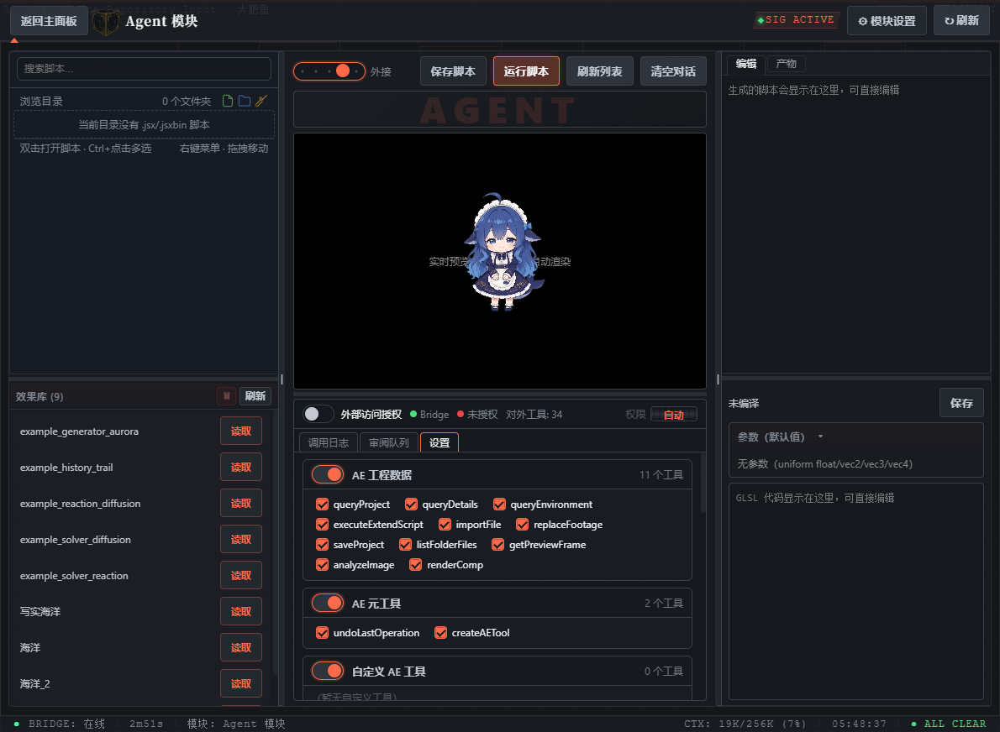

# AS_ExtP — After Effects AI 확장 플랫폼

[简体中文](README.md) | [English](README.en.md) | [日本語](README.ja.md) | [Deutsch](README.de.md) | **한국어** | [Français](README.fr.md) | [Русский](README.ru.md)

> After Effects에 AI를 연결하는 다중 모듈 확장 플랫폼(CEP).
>
> 버전: v1.0.1

AS_ExtP는 After Effects용 AI 확장 플랫폼입니다 — CEP 패널과 두 개의 네이티브 AE 플러그인(GLSL 효과 호스트와 AE 핫박스)으로 구성됩니다. 패널은 여러 모듈로 구성됩니다: **에이전트**(대규모 언어 모델 기반 대화형 조작), **ComfyUI**(AI 이미지 / 영상 생성), **에셋 라이브러리**(프로젝트 에셋과 사전 설정 관리), **MCP / Skill / 메모리 / 모델 관리**(기능 확장과 구성).

이 중 **에이전트 모듈**이 핵심입니다: 요구 사항을 중국어 한 문장으로 설명하면 AI가 내장 AE 자동화 도구를 스스로 호출해 컴포지션 생성, 레이어 추가, 키프레임 설정, 효과 적용, 렌더링 출력까지 코드를 직접 작성하지 않고 수행합니다. AI가 ExtendScript 스크립트를 직접 생성·검증해 실행하도록 할 수 있고, AE에서 실시간으로 실행되는 GLSL / 선형 JS 픽셀 효과까지 생성할 수 있습니다.

또한 에이전트 모듈의 **외부 모드**는 AE 조작 기능 전체를 표준 **MCP Server** 형태로 외부 에이전트 소프트웨어에 제공해 호출하게 합니다. Claude Code / Cursor에서 'AE에 컴포지션 하나 만들어 줘'라고 말하면 확장 패널로 전환할 필요가 없습니다. 연결 방법은 [외부 모드 연결](#외부-모드-연결)을 참조하십시오.

---

## 목차

- [핵심 기능](#핵심-기능)
- [에이전트 5가지 모드](#에이전트-5가지-모드)
- [외부 모드 연결](#외부-모드-연결)
- [네이티브 컴포넌트](#네이티브-컴포넌트)
- [설치 안내](#설치-안내)
- [AI 플랫폼 구성](#ai-플랫폼-구성)
- [개발자 문서(DEVELOPMENT.md)](docs/DEVELOPMENT.ko.md)
- [보안 주의 사항](#보안-주의-사항)
- [면책 조항](#면책-조항)

---

## 핵심 기능

AS_ExtP는 8개의 기능 모듈로 구성되며, 메인 패널의 모듈 카드나 3D 큐브 내비게이션으로 진입합니다.


### 1. 에이전트 모듈

핵심 모듈로, 자연어로 AI와 대화하며 AE를 구동합니다. **스크립트 / 에이전트 / Shader / 외부 / 팀** 5가지 작업 모드를 내장하며(자세한 내용은 [에이전트 5가지 모드](#에이전트-5가지-모드) 참조), 앞의 네 단계는 단일 에이전트 모드이고 다섯 번째 단계인 '팀'은 상주 에이전트 네 개를 동시에 운용해 협업시킵니다. '외부' 모드는 도구 집합을 MCP Server로 외부 에이전트 소프트웨어에 제공할 수 있습니다. 다중 세션 관리(세션 전환기에서 제목으로 검색 가능), 도구 권한 3단계(자동 / 균형 / 보수), 작업 계획 추적, 경험 회고, 추론 강도 조절, 사용자 정의 에이전트 페르소나 설명을 지원하며, 목표 자동 연속 라운드(상단 바 목표 표시줄, `/goal` 명령, 기본 라운드 상한 25, 1–500 설정 가능)와 뷰별 도구 범위 축소(에이전트 모듈 설정 → **도구 표시 범위**)를 지원합니다. 이미지·영상을 끌어다 놓아 비전 모델이 화면을 분석하게 할 수 있고, docx / xlsx / pdf 등 문서를 텍스트로 파싱한 뒤 조작할 수도 있습니다(Word 표는 Markdown 표로 변환, 내장 이미지는 데이터 폴더로 추출해 본문에 경로를 표시하며 중복 / 아이콘 / 초대형 이미지는 자동으로 건너뛰고 필요할 때 `read_image`로 확인; Excel의 각 시트는 CSV로 변환). 영상 첨부 파일은 마우스를 올리면 음소거 시험 재생과 전체 화면 미리 보기를 제공합니다.

### 2. AE 도구

AE 자동화 도구의 정의를 관리합니다. 도구는 **프로젝트 / 컴포지션 / 레이어 / 애니메이션 / 효과 / 렌더링 / 도구**(사용자 정의 카테고리 추가 가능)로 분류해 구성됩니다. 패키지에는 AE 도구 11개가 내장되어 있습니다: 프로젝트 패널과 레이어 탐색, 컴포지션 / 레이어 / 푸티지 상세 정보, 렌더링 대기열과 컴포지션 간 검색, 환경과 효과 진단, ExtendScript 실행, 푸티지 가져오기와 교체, 프로젝트 저장, 컴포지션 렌더링, 폴더 나열, 미리 보기 프레임 캡처, 이미지 분석. 이 외에 패널 측 내장 실행 취소(`undoLastOperation`)와 AE API 문서 조회(`queryAeApi`)가 있습니다. 나머지 AE 작업은 AI가 `executeExtendScript`로 그 자리에서 스크립트를 작성해 수행합니다. 도구는 핫 리로드를 지원해 패널에서 편집하면 즉시 적용되며, AI가 `createAETool`로 새 도구를 직접 만들 수도 있습니다. 비읽기 전용 자체 제작 도구는 기본적으로 에이전트에만 보이고 읽기 전용 도구는 기본적으로 전역(스크립트 / Shader와 외부 모드 모두)에 노출됩니다. 비읽기 전용 도구도 [외부 모드 연결](#외부-모드-연결)에서 호출되게 하려면 생성 시 `external-mcp`를 포함한 scope를 명시해야 합니다. 효과 목록 캐시 기능도 제공하므로 효과 플러그인을 많이 설치한 환경에서는 캐시를 미리 생성해 조회 속도를 높일 수 있습니다.


### 3. ComfyUI

로컬 또는 클라우드 ComfyUI 서비스에 연결해 AI 이미지와 영상을 생성하고, 결과를 AE 컴포지션으로 바로 가져올 수 있습니다. **폼 모드** 이미지 생성과 **캔버스 모드** 노드 기반 시각적 워크플로우 편집을 지원하며, AE 현재 프레임을 입력으로 캡처할 수 있고 일괄 생성과 WebSocket 실시간 진행률 표시도 지원합니다.


템플릿의 경우 **직접 조정한 워크플로우 13종**을 내장했습니다(텍스트→이미지, 이미지→이미지, GPT Image, Nano Banana, Seedream, Hailuo, Kling, HappyHorse, Seedance 등, 이미지→영상 / 참조 이미지→영상 / 시작·끝 프레임 생성 / 올인원 참조 등 다양한 영상 기능 포함). **ComfyUI 공식 템플릿 라이브러리(600여 종)**도 연동되어 있어 AI가 필요에 따라 공식 템플릿을 검색하고 하위 그래프를 자동으로 전개해 실행 가능한 워크플로우로 변환합니다. 모델 드롭다운 항목은 서버 노드 변화에 따라 동적으로 열거되며, 템플릿 인덱스는 로컬 디스크에 캐시됩니다(네트워크가 끊겨도 대체 가능). 사용자 정의 워크플로우는 ComfyUI 편집기에서 저장한 **UI 형식**과 **API 형식** 가져오기를 모두 지원합니다(UI 형식은 자동 변환; 템플릿이 이 컴퓨터에 설치되지 않은 **인터페이스 제어 노드**(예: rgthree의 Fast Groups Bypasser)를 참조하는 경우 해당 스위치 노드만 건너뛰고 안내하며, 워크플로우 전체를 거부하지 않습니다). 워크플로우 디렉터리는 `<데이터 폴더>\comfyui\workflows`로 고정되며, .json을 이 디렉터리에 넣고 패널을 다시 열면 자동으로 로드됩니다. 보안상 서비스 주소는 로컬 / 내부 네트워크만 허용됩니다.

### 4. 에셋 라이브러리

AE 프로젝트에서 자주 쓰는 에셋을 통합 관리하며, 카드 스택 방식으로 세 구역에 나누어 표시합니다:

- **에셋**: 일반 에셋(이미지 / 영상 등)에 대한 가상 참조로, 실제 파일을 복사하지 않습니다
- **프로젝트 에셋**: `.aep` 프로젝트 파일로, 현재 프로젝트로 바로 가져올 수 있습니다
- **사전 설정**: `.ffx` 사전 설정 파일로, 선택한 레이어나 지정한 레이어에 적용할 수 있습니다

일괄 가져오기 시 폴더 계층이 자동으로 재현되며, 영상 에셋에는 선택 가능한 해상도(480p / 720p / 1080p / 원본 크기)의 트랜스코딩 캐시를 제공합니다. 에셋 라이브러리 모듈 설정에서 자동 트랜스코딩을 끌 수 있습니다(에셋 라이브러리 미리 보기에만 적용). 그리드 썸네일에 마우스를 올리면 음소거 시험 재생이 되고, 항목을 클릭하면 오른쪽 미리 보기 영역에서 자동으로 음소거 반복 재생됩니다(영상은 반복 재생, 시퀀스 프레임은 프레임별 반복 재생). 미리 보기를 클릭하면 전체 화면으로 전환됩니다. **캐시 지우기** 확인 대화 상자에는 정리 가능한 파일 수와 총 크기가 표시됩니다(설정 페이지에는 현재 사용량 표시). 개별 에셋 참조, 프로젝트 에셋, 사전 설정은 빠른 실행 막대에서도 바로 호출할 수 있습니다.


### 5. MCP 관리

외부 MCP(Model Context Protocol) 서버를 관리해 AI가 사용할 수 있는 도구를 확장합니다: stdio, HTTP, SSE 세 가지 전송을 지원하고, 서버 시작 / 중지 / 상태 모니터링, 도구 자동 검색 및 AI 호출용 등록을 제공합니다. (방향이 반대라는 점에 주의하십시오: 이 모듈은 외부 MCP 서버를 패널 내 AI가 쓰도록 **안으로** 들여오고, [외부 모드 연결](#외부-모드-연결)은 패널 도구를 외부 에이전트가 쓰도록 **밖으로** 내보냅니다.)

### 6. 스킬 관리

도메인 지식 스킬 팩을 관리하며, AI가 필요할 때 적재해 전문 지도를 얻습니다. 사용자 정의 스킬을 만들어 AI가 사용자의 작업 규범을 따르게 할 수 있습니다.

### 7. 메모리 관리

AI의 영구 메모리 시스템으로 대화를 넘어 경험을 보존합니다: 메모리 유형은 **경험 교훈 / 프로젝트 기록 / 환경 설정** 세 가지로 정리되었고, 범위(에이전트 / 스크립트 / Shader 모드)를 지정할 수 있으며, `[[위키 링크]]` 상호 연결, 전체 텍스트 검색, 다중 선택 일괄 삭제를 지원합니다. 모드별로 유지되는 사용자 규칙(에이전트 / 스크립트 / Shader 각 하나)은 AI 시스템 프롬프트에 자동으로 주입되고, 나머지 메모리는 AI가 필요에 따라 검색합니다(`memory_search`).

### 8. 모델 관리

모든 AI 플랫폼과 모델 구성을 관리합니다: 플랫폼과 모델 보기 / 추가 / 편집 / 삭제, 기본 선택 지정, 모델 자동 검색, 연결 테스트, 모델의 비전·도구 호출·JSON 모드 등 기능 표시. 플랫폼 편집기는 **사용자 정의 요청 헤더**(줄마다 `이름: 값`)를 지원하며, 내장 사전 설정으로 플랫폼에 **세션 헤더**(예: OpenCode Go의 `x-opencode-session`)를 선언할 수 있어 요청 시 현재 세션 ID가 자동으로 주입됩니다. 추가 인증이나 라우팅 헤더가 필요한 서드파티 게이트웨이에 적합하며, `opencode-go` 계열 사전 설정이 내장되어 있습니다.

### 기타 기능

- **외부 접근 권한 표시기**: 외부 모드 권한이 켜져 있는 동안 패널 네 면에 브리딩 테두리 발광과 상단 고정 알림 막대가 상시 표시되어 현재 등급과 외부 노출 도구 수를 보여 주고, 외부 에이전트의 도구 호출이 승인되어 실행될 때마다 도구 이름이 스크롤 표시되어 현재 외부에 열려 있는 상태인지 쉽게 확인할 수 있습니다
- **빠른 실행 막대**: 패널 상단의 전역 단축 막대(고정 오버레이)로, 모듈에 들어가지 않고도 스크립트 실행, 사전 설정 적용, 프로젝트 에셋 가져오기, 에셋 참조가 가능하며 검색 필터와 일괄 작업을 지원합니다
- **다국어 인터페이스**: After Effects 인터페이스 언어를 따르거나 简体中文 / English / 日本語 / Deutsch / 한국어 / Français / Русский 중에서 직접 전환할 수 있습니다
- **데스크톱 펫**: AI 데스크톱 펫(고래 의인화 캐릭터, AI 생성)을 켤 수 있으며, 대기 시 배회, 클릭 시 점프, 드래그 추종, 졸기, 잠꼬대 등의 동작과 대화, 정기 브리핑, 능동 응답, 웹 검색을 지원합니다
- **진단 로그**: 전역 설정에서 **진단 패키지 내보내기**가 가능합니다(패널 / Bridge / 호스트 / 네이티브 컴포넌트 각 프로세스 로그 + 환경 정보, 일괄 마스킹, 최근 5개만 보관). 문제를 보고할 때 이 파일을 첨부하면 됩니다
- **테마와 개인화**: 여러 프리셋 테마와 사용자 정의 색상 **테마 라이브러리**(테마 저장 / 적용 / 이름 변경 / 삭제 가능, 편집 가능한 색상 26개(핵심 색상 20개 + 시맨틱 상태 색상 6개, `panel_theme` 도구로 26개 전체 읽기·쓰기), 파생 색상 자동 계산). 패널 내 에이전트가 테마 색상을 직접 읽고 변경하며 테마를 관리할 수 있습니다(도구 `panel_theme`, 에이전트 모드에서만 사용 가능, 외부 모드에는 연결되지 않음). 배경 오버레이 레이어, 사운드 시스템
- **3D 큐브 내비게이션**: 드래그로 회전, 관성 스크롤, 면 포커스 전환
- **하단 상태 표시줄**: Bridge 서비스 상태, AI 컨텍스트 사용량, 활성 모듈, 시계를 실시간 표시

---

## 에이전트 5가지 모드

에이전트 모듈의 모드 스위치는 5단계입니다: 앞의 네 단계는 단일 에이전트 모드인 **스크립트 / 에이전트 / Shader / 외부**로, '순수 코드'에서 '순수 대화'를 거쳐 '기능 외부 제공'까지 이어지는 전체 스펙트럼을 포괄합니다. 다섯 번째 단계인 **팀**은 상주 에이전트 네 개가 병렬로 협업하게 합니다. 상단 바의 모드 스위치로 전환합니다:

### 스크립트 모드

정밀한 제어나 공유·재사용이 필요한 상황을 위한 모드입니다. AI가 ExtendScript 스크립트 코드를 생성하고, 구문 검증과 보안 검토를 거친 뒤 미리 보기 영역에서 편집해 실행할 수 있습니다. 생성된 스크립트는 로컬에 저장할 수 있으며 스크립트 트리에서 불러오기와 프로젝트 관리를 지원합니다. 미리 보기 영역은 **편집** / **출력** 2열 대조를 제공하며, 차단되거나 실행 오류가 발생하면 해당 줄을 강조하고 구조화된 오류 카드를 표시합니다.

### 에이전트 모드

AI가 모든 AE 자동화 도구를 스스로 호출해 작업을 완료합니다. 예를 들어 '1920×1080 컴포지션을 만들고 빨간 단색 레이어를 추가한 뒤 2초 길이의 불투명도 키프레임을 지정해 줘'라고 설명하면 됩니다. 수정 작업마다 AE 실행 취소 스택에 실행 취소 그룹이 남아 `Ctrl+Z`로 되돌릴 수 있으며, 다중 라운드 대화로 컨텍스트를 유지하고 이미지와 문서를 끌어다 놓은 뒤 작업할 수 있습니다. 다단계 작업 계획을 추적하고 대화 중에 권한 정책에 따라 위험 작업을 확인하며, 장기 작업은 **세션 수준 목표**(`/goal`)로 설정해 라운드 상한 내에서 자동으로 라운드를 이어가고 스트리밍 일시 실패 시에도 자동으로 재개합니다.

### Shader 효과 모드

AE에서 **GLSL / 선형 JS 픽셀 효과를 실시간 실행**합니다. AI가 생성한 GLSL은 먼저 컴파일 검증을 거쳐 미리 보기 영역에 기록되고, JS 효과는 정적 위험 코드 사전 검사와 기본적으로 LLM 2차 검토를 거친 뒤 패널 측 샌드박스에서 `buildShader(params)` 편성 로직을 실행해 GLSL을 산출하고 호스트 렌더링을 재사용합니다. 확정 후에는 효과 라이브러리에 저장할 수 있으며, [GLSL 효과 호스트](#네이티브-컴포넌트)가 이를 컴파일·실행하고 핫 리로드로 화면을 실시간 갱신합니다. 내장 매개 변수(uniform)는 슬라이더 / 색상 선택기 컨트롤을 자동 생성하고, 컴파일 오류는 LLM에 반환되어 자체 수정되며, 효과 라이브러리 저장 / 불러오기 / 적용을 지원합니다.


### 외부 모드

패널의 도구 집합을 표준 **MCP Server**로 외부에 제공해 외부 에이전트 소프트웨어(Claude Code / Claude Desktop / Cursor / Trae / VS Code Copilot 등)가 사용자의 AE를 직접 조작하게 합니다. **외부** 등급으로 전환한 뒤 관리 콘솔 상태 카드에서 **외부 접근 권한** 총 스위치를 켜야 외부에 허용됩니다. 스위치는 사용자가 명시적으로 제어하며, 모드 전환으로 자동으로 켜지거나 꺼지지 않습니다.

이 모드에서 패널은 6개 기능 영역 동시 표시 레이아웃이 됩니다: 왼쪽 열은 스크립트 트리 + 효과 라이브러리, 가운데 열은 GLSL 미리 보기 이미지 + 관리 콘솔, 오른쪽 열은 스크립트와 GLSL 코드 미리 보기입니다. 관리 콘솔에는 **호출 로그 / 검토 대기열 / 설정** 세 개 탭이 있고, 상태 카드는 맨 윗줄에 상시 표시됩니다(총 스위치, Bridge 상태, 외부 노출 도구 수, 오른쪽 끝은 권한 등급 휠로 다른 모드의 **권한** 휠과 같은 종류이며 한 번 클릭하면 순환 전환됩니다). 외부 에이전트의 모든 호출은 호출 로그에 남고, 제출된 스크립트와 효과는 검토 대기열에 별도 기록을 남깁니다. 외부를 통해 스크립트 라이브러리 / 효과 라이브러리에 기록된 파일은 해당 목록의 항목에 '외' 배지가 붙습니다.



접속 구성은 다음 절을 참조하십시오.

### 팀 모드

모드 스위치의 다섯 번째 단계입니다. 켜면 상주 에이전트 네 개가 동시에 온라인 상태가 됩니다: **감독**(크리에이티브 안과 기획서), **AE 실행**(AE 작업 수행과 결과물 출력), **Shader 실행**(GLSL / JS 효과), **아트 실행**(이미지 / 영상 에셋 생성). 네 에이전트는 각각 독립된 대화 뷰와 작업 계획을 가지며, 모델(소속 플랫폼 포함)과 사고 수준은 에이전트 모듈 설정의 **팀 모드** 구역에서 항목별로 구성합니다. 모델을 비워 두면 전역 기본값을 따르고, 사고 수준은 필수 등급(기본 high)이며, 하위 에이전트 동시 실행 상한(기본 3)과 연결 유지 기간(기본 10분)도 이 구역에서 설정합니다. 왼쪽 드로어는 **계획** / **팀 작업** 두 개 탭을 제공합니다: 계획은 각 에이전트의 자체 할 일이고, 팀 작업은 네 에이전트가 공유하는 협업 목록입니다. 각 에이전트는 필요에 따라 하위 에이전트를 파생시킬 수 있고(하위 에이전트는 다시 파생 불가), 메시지 전송 도구로 서로 메시지를 주고받으며 팀 작업 영역 파일(기획서 `brief.md`, 텍스트 스토리보드 `storyboard.md` 등)로 산출물을 인계합니다.


---

## 외부 모드 연결

### 사전 조건(모두 충족해야 함)

1. **After Effects가 실행 중**이고 AS_ExtP 확장 패널이 열려 있어야 합니다(로컬 Bridge 프로세스는 패널과 함께 자동으로 기동되어 `127.0.0.1:9877`을 수신하고, 포트가 사용 중이면 9886까지 순차적으로 이동합니다)
2. **패널 내부에서 외부 접근이 승인되어 있어야 합니다**: 에이전트 모듈 → 모드 스위치를 네 번째 등급인 **외부**로 돌린 다음, 관리 콘솔 상태 카드에서 **외부 접근 권한** 총 스위치를 **직접 켜야** 합니다(**모드에 진입한다고 자동 승인되지 않습니다**; 승인 취소는 같은 스위치에서 끄면 되며, 끄면 모든 **도구 실행**이 `EXTERNAL_MODE_OFF`를 반환하고 도구 목록은 계속 나열됩니다)
3. **Node 런타임이 있어야 합니다**(stdio 전송에만 필요): 확장에 `vendor\node\node.exe`(v22)가 포함되어 있어 **Node.js를 따로 설치할 필요가 없습니다**. Release 전체 패키지에 내장되어 있으며, 소스 클론에서는 `tools\check-env.bat`를 한 번 실행하면 자동으로 내려받아 채웁니다

승인되지 않은 상태에서는 모든 **도구 실행**이 `EXTERNAL_MODE_OFF`를 반환합니다(도구 목록은 계속 나열됨). 패널은 열려 있지 않지만 Bridge가 살아 있으면 `PANEL_OFFLINE`, Bridge 자체가 기동되지 않았으면(AE 미실행 / 패널을 한 번도 열지 않음) `BRIDGE_OFFLINE`을 반환합니다.

### 전송 방식 선택

| 전송 | 접속 방식 | 적용 대상 | 설명 |
| --- | --- | --- | --- |
| **stdio**(권장) | 클라이언트가 구성에 따라 `ext-mcp-server.js`를 기동 | 모든 클라이언트 | 클라이언트가 프로세스 수명 주기를 전담 관리하며 확인 상호작용을 지원 |
| **Streamable HTTP** | 클라이언트가 `http://127.0.0.1:<포트>/mcp`에 연결 | Claude Code / Cursor 등 remote 접속을 지원하는 클라이언트 | 새 프로세스 없음, Bridge에 내장된 엔드포인트 |

HTTP 포트는 `/health` 탐지 결과를 기준으로 합니다(9877–9886 순차 이동). 먼저 `curl http://127.0.0.1:9877/health`(실패하면 포트 +1로 재시도)로 포트를 확인한 뒤 URL을 입력하십시오.

### 클라이언트 구성

AS_ExtP의 설치 경로는 고정입니다(`tools\install.bat`과 `tools\deploy.bat` 모두 여기에 배포합니다):

```
C:\Program Files (x86)\Common Files\Adobe\CEP\extensions\AS_ExtP
```

MCP를 지원하는 클라이언트는 **stdio 서버** 구성 한 항목만 추가하면 되며, 내용은 두 항목뿐입니다:

- `command`: 확장에 포함된 Node `<확장 경로>\vendor\node\node.exe`(시스템에 Node ≥ 20.18이 설치되어 있고 PATH에 있으면 `node`로 써도 됩니다)
- `args`: `<확장 경로>\client\shared\ext-mcp-server.js`; 끝에 `--name <식별자>`를 붙일 수 있으며 확인 대화 상자의 출처 표기와 Bridge 로그에 사용됩니다. 생략 가능(기본 `unknown`)하며, 패널 호출 로그에는 자동 생성된 클라이언트 ID(`ext-<pid>-<ts>` 형태)가 표시됩니다

경로는 반드시 절대 경로로 써야 합니다. MCP 클라이언트의 작업 디렉터리는 확장 디렉터리가 아닙니다. 클라이언트 간에는 구성 파일 위치와 컨테이너 키 이름(예: `mcpServers` / `servers` / `mcp_servers`)만 다르고, 필드는 위의 두 항목 그대로입니다.

### 권한 등급과 확인 의미

패널 외부 상태 카드 오른쪽 끝의 **권한** 휠은 두 등급입니다(에이전트 / Shader 모드 도구 모음의 권한 휠과 같은 컨트롤이지만 외부 모드는 두 등급만 유지합니다: 한 번 클릭하면 순환 전환되고 마우스를 올리면 의미 설명이 표시됩니다):

| 등급 | 동작 |
| --- | --- |
| **균형**(기본) | 7개 그룹의 고위험 작업이 **사용 중인 에이전트 소프트웨어 화면 안에서** 확인을 요청하며(MCP elicitation 사용), 나머지는 바로 실행 |
| **자동** | 모든 외부 호출을 바로 실행하고 호출 로그에만 기록 |

확인이 필요한 7개 그룹의 고위험 작업: AE 도구 생성 / 덮어쓰기, 메모리 쓰기(4건), 에셋 폴더 삭제, 효과 라이브러리 삭제, 스킬 쓰기, 스크립트 라이브러리 쓰기, MCP 서버 구성 변경과 실행 제어(읽기 작업은 확인을 띄우지 않습니다).

클라이언트가 **확인 상호작용을 지원하지 않으면**(Claude Desktop, Cline 또는 HTTP 엔드포인트 사용 시) 해당 고위험 작업은 **바로 거부**되고 `CONFIRM_REQUIRED`를 반환하며, 확인 없이 실행되지 않습니다. 허용하려면 확인을 지원하는 클라이언트로 바꾸거나 패널에서 등급을 **자동**으로 전환하십시오(모두 허용을 명시적으로 승인하는 것과 같습니다).

| 클라이언트 | 확인 상호작용 |
| --- | --- |
| Claude Code / Cursor / VS Code Copilot | ✅ 에이전트 소프트웨어 안에서 확인을 띄움(60초 무응답 시 거부로 처리) |
| Claude Desktop / Cline | ❌ 고위험 작업 거부(`CONFIRM_REQUIRED`) |
| HTTP 엔드포인트 | ❌ 위와 같음(SSE 채널이 없어 확인을 전달할 수 없음) |

### 도구 목록과 동적 변경

기본 외부 노출 도구 수는 42개입니다(고정 도구 목록 46개 중 메모리 쓰기 4개는 기본적으로 꺼져 있으며, 게이트웨이와 사용자 정의 도구는 포함되지 않고 일부 등록되지 않은 내장 도구는 조용히 건너뜁니다). 설정 페이지에서 **모듈 그룹 12개** 단위로 각각 켜고 끌 수 있으며(AE 프로젝트 데이터 / AE 메타 도구 / 사용자 정의 AE 도구 / 에이전트 엔진 / 스크립트 모드 / Shader 모드 / 메모리 / ComfyUI 생성 / 에셋 라이브러리 / Skill / 외부 작업 / 게이트웨이), 그룹 안에서 도구별로도 켜고 끌 수 있습니다. 이 중 '게이트웨이' 그룹은 기본적으로 꺼져 있습니다. 패널에 연결된 서드파티 MCP 서버까지 함께 외부에 제공하므로 위험 범위가 가장 크며, 필요할 때만 켜십시오. `tools/list_changed`를 지원하는 클라이언트(Claude Code / VS Code)는 스위치가 바뀌면 목록을 자동으로 새로 고치고, Claude Desktop / Cursor는 클라이언트를 다시 연결해야 합니다.

### 문제 해결

| 증상 / 오류 코드 | 원인과 처리 |
| --- | --- |
| `PANEL_OFFLINE` | Bridge는 실행 중이지만 패널 연결이 끊겼습니다. AS_ExtP 패널을 여십시오 |
| `BRIDGE_OFFLINE` | Bridge가 기동되지 않았습니다(AE 미실행 / 패널을 한 번도 열지 않음). 먼저 패널을 열어 호스트가 Bridge를 기동하게 하거나 `node client/shared/ae-bridge.js`를 직접 실행하십시오 |
| `EXTERNAL_MODE_OFF` | **외부 접근 권한** 총 스위치가 꺼져 있습니다(외부 등급으로 전환했다고 승인된 것이 아니며 상태 카드에서 직접 켜야 합니다). 도구 실행만 막고 도구 목록은 계속 나열됩니다 |
| `CONFIRM_REQUIRED` | 확인이 필요한 작업인데 현재 클라이언트가 확인 상호작용을 지원하지 않습니다. 클라이언트를 바꾸거나 **자동** 등급으로 전환하십시오 |
| `CONFIRM_TIMEOUT` | 확인 대화 상자에 60초 안에 응답이 없어 이번 호출은 실행되지 않았습니다 |
| `ACCESS_DENIED` | 도구가 모듈 그룹 / per-tool 스위치로 꺼졌거나, 외부 화이트리스트에 없거나, 도구 드로어에서 **외부**가 선택되지 않았거나, 게이트웨이 서버가 개별적으로 켜지지 않았습니다 |
| AE 도구 대기 시간 초과(…초), 이번 호출은 전달되지 않음 | 패널 AE 엔진이 사용 중입니다(패널 내 에이전트 / 팀 lane / 다른 외부 호출 / 실행 중인 렌더링 또는 긴 스크립트). 패널 내 AE 호출은 FIFO 대기열 하나를 공유하며(대기열 패널 상시 열람 가능), 대기 시간 초과는 이번 호출이 실행되지 않았음을 보장합니다. 점유가 끝난 뒤 재시도하십시오 |
| `QUEUE_FULL` | 대기 상한은 32이며, 잠시 후 재시도하십시오 |
| `RELAY_TIMEOUT` / `EXT_TIMEOUT` | 패널 응답 시간 초과입니다. 상대 게이트 90초(stdio 측 100초)이며 패널의 `ext_progress` 하트비트가 계속 연장합니다. 호출이 아직 실행 중일 수 있으니 먼저 호출 로그를 확인한 뒤 재시도 여부를 결정하십시오 |
| `EXT_TASK_PENDING` | 패널 실행이 30분을 넘었습니다(고정 상한, 하트비트로 연장되지 않음). 응답 오류 텍스트에 `taskId`가 포함되며 하위 호출은 계속 실행됩니다. `ext_task_get`으로 `taskId`를 조회해 결과를 확인하십시오(패널을 다시 로드하면 작업 표가 비워집니다) |
| HTTP 엔드포인트가 503 반환 | Bridge에 해당 엔드포인트가 마운트되지 않았습니다. Bridge가 패널(또는 `node client/shared/ae-bridge.js`)에 의해 기동되었는지 확인하십시오 |
| 9877에 연결할 수 없음 | 포트가 사용 중이라 이미 순차 이동했습니다. `http://127.0.0.1:9877-9886/health`를 하나씩 탐지하십시오 |

---

## 네이티브 컴포넌트

CEP 패널 외에 프로젝트에는 네이티브 AE 컴포넌트 두 개(C++, `native/` 아래)가 포함되어 있습니다:

### GLSL 효과 호스트(AS_Effect Host, `native/glsl-host/`)

범용 픽셀 효과 `.aex` 호스트 플러그인입니다. 효과 로직은 외부 `.glsl` 파일이나 JS가 편성해 생성한 GLSL 파일에 있으며, 파일을 고치면 핫 리로드로 즉시 적용되므로 효과마다 플러그인을 다시 컴파일할 필요가 없습니다. 8bit / 16bit / 32bit(부동 소수점) 심도, GPU 렌더링, 필요 시 uniform 등록(부동 소수점 / 벡터 매개 변수는 자동으로 패널 컨트롤인 슬라이더 또는 색상 선택기로 매핑)을 지원하며, 컴파일 실패 시 중단되지 않고 오류 로그를 기록해 반환합니다. Shader 효과 모드의 런타임 기반입니다.


3D 및 이미지 입력 기능:

- **3D 카메라 연동**: 컴포지션 카메라를 읽어 카메라 행렬, 위치, 화각(`uCamFov`)을 내장 uniform에 주입하므로 GLSL의 원근이 AE 카메라와 일치하고 실제 공간 정렬이 가능합니다
- **AE 조명 연동**: 컴포지션 조명(유형 / 위치 / 방향 / 색상 × 강도 / 원뿔 감쇠, 최대 8개)을 열거해 `uLight*` 계열 uniform에 주입하므로 효과가 AE 조명에 실시간 반응할 수 있습니다
- **매핑 레이어 입력**: `iChannel1/2/3`을 선언하면 해당 레이어 행이 활성화됩니다(선언하지 않으면 세 행이 계속 표시되지만 비활성 상태입니다. 호스트의 LAYER 행은 숨길 수 없습니다). 다른 레이어를 텍스처 입력으로 쓸 수 있습니다(`iChannel0`은 내장된 이 레이어)
- **매개 변수 슬롯**: 스칼라 하나는 슬라이더 하나, vec2 / vec3의 각 성분은 행 하나씩, vec4와 색상 의미 벡터는 색상 선택기로 렌더링합니다. 성분 주소 지정에서 성분 0은 uniform 원래 이름을 쓰고 나머지는 `.y/.z/.w`를 씁니다(색상 의미는 `.g/.b/.a`를 쓰며 `.r`은 없습니다). 표시 범위와 유효 입력 범위는 따로 설정합니다
- **효과 라이브러리 인덱스**: 호스트가 권위 있는 순번을 내보내 패널과 호스트의 효과 라이브러리 인식이 자동으로 동기화되며, 선택된 파일이 사라지면 조용히 다른 shader로 바꾸지 않고 그대로 전달합니다


### AE 핫박스(AS_Hotbox, `native/hotbox/`)

CEP 패널과 독립적으로 실행되는 네이티브 AEGP 전역 핫박스 플러그인입니다. AE 어디에서든 단축키(기본 `Alt+Q`, 패널 전역 설정에서 녹화해 변경 가능)를 누르면 마우스 위치에 플로팅 창이 나타납니다: 단축키를 누르고 있으면 **링 제스처 모드**(호를 향해 그으면 실행)가 되고, 중심 원을 클릭하면 **검색 모드**(가로로 긴 검색 바 + 선형 결과 + 유형 필터)로 들어갑니다. 검색 결과는 **병음 첫 글자와 전체 병음** 일치를 지원합니다(예: `gsmh` → 가우시안 블러). 제스처 모드에서 플로팅 창이 떠 있는 상태로 단축키를 다시 누르면 닫힙니다(토글 의미). 검색 모드에서는 이 키가 검색 상자에 문자로 입력됩니다. 단축키에서 손을 뗀 뒤 아무 글자나 누르면 검색으로 바로 들어가 해당 문자가 미리 채워집니다.

데이터는 모든 AE 효과, `agent/scripts` 스크립트와 사전 설정(에셋 라이브러리 사전 설정, AE 사용자 사전 설정, AE 기본 제공 사전 설정 세 소스를 병합·중복 제거)에서 가져옵니다. 플러그인은 AEGP로 AE와 같은 프로세스에서 실행되어 로컬 파일을 직접 읽으며, Bridge를 거치지 않고 확장 패널이 열려 있을 필요도 없습니다. 컴포지션 관련 꽃잎 메뉴는 **스크린샷 3가지 동작**(클립보드로 복사, 알파 채널이 있는 PNG / PNG 저장 / JPG 저장)을 제공합니다.

#### 빠른 시작

1. `Alt+Q`(또는 녹화한 단축키)를 누르면 마우스 위치에 링 플로팅 창이 나타납니다
2. 마우스를 특정 호 쪽으로 그으면 해당 호가 강조됩니다(금색 테두리)
3. 호 위에서 마우스를 놓으면 그 호에 바인딩된 기능이 실행됩니다
4. 또는: 중심 원을 클릭 → 검색 모드로 전환 → 키워드 입력 → `↑`/`↓`로 선택 → `Enter`로 실행

#### 제스처 모드(단축키 누르기)

| 방위 | 호 | 설명 |
| --- | --- | --- |
| 정위 | 스크린샷 | 마우스를 올리면 세 갈래 하위 메뉴(PNG / 클립보드 / JPG)가 펼쳐지며, 슬롯 바인딩은 담당하지 않습니다 |
| 우상 / 우하 / 좌하 / 좌상 | 바인딩 가능한 슬롯 4개 | 고정 기능(효과 / 스크립트 / 사전 설정)을 바인딩할 수 있고, 바인딩하지 않으면 동적 슬롯(최근 사용 항목으로 대체)이 됩니다. 검색 상자가 비어 있으면 최근 사용 항목을 바로 나열하며, 설정 패널의 슬롯 행 4개는 좌상 / 좌하 / 우상 / 우하 순서로 배치됩니다(다음 절 참조) |
| 정하 | 설정 | 클릭하면 설정 패널로 들어가며, **여기서 손을 떼면 실행되지 않습니다**. 마우스 클릭으로 확인해야 합니다 |

- 손 뗀 위치 판정: 호 위(해당 각도 방향의 고리 띠 바깥 투명 영역 포함)에서 놓으면 실행되고, 중심 원 위에서 놓으면 실행되지 않습니다(오작동 방지, 검색으로 들어가려면 클릭 필요). 링 안쪽 빈 공간과 호 사이 틈에서 놓으면 창이 닫히고 실행되지 않습니다.
- 플로팅 창이 떠 있을 때 **단축키를 다시 누르면 닫힙니다**(토글 의미, 검색 모드 제외). 단축키에서 손을 뗀 뒤 아무 글자나 누르면 검색으로 바로 들어가 해당 문자가 미리 채워집니다.
- **손 떼고 대기**(설정 패널에서 전환 가능, 기본 꺼짐): 켜면 손을 떼도 실행되지 않고 창도 닫히지 않으며, 마우스 클릭으로 호를 선택합니다. 호를 클릭하면 실행, 중심 원을 클릭하면 검색으로 들어갑니다. 종료 방법: `Esc`, 단축키 다시 누르기, 플로팅 창 바깥 클릭, 링 안쪽 빈 곳 클릭. 설정은 `<데이터 폴더>\hotbox\config.json`의 `releaseStay`에 기록되며 AE를 다시 시작해도 유지됩니다.

#### 검색 모드(중심 클릭)

| 키 / 조작 | 동작 |
| --- | --- |
| 검색 상자가 비어 있음 | 최근 사용 항목을 바로 나열(현재 유형으로 필터링, 최신순), 첫 행이 기본 선택됨, 기록이 없으면 입력 안내 표시 |
| 텍스트 입력 | 실시간 퍼지 필터(부분 시퀀스 일치, 대소문자 구분 없음) |
| `[全部 ▾]` 클릭 | 필터: 전체 / 효과 / 스크립트 / 사전 설정 |
| `↑` / `↓`, 휠 | 선택 행을 한 줄씩 이동(첫/마지막 행 순환 포함, 휠과 `↑`/`↓`는 동일 기준) |
| `Enter` / 목록 항목 클릭 | 선택 항목 실행(FXConsole 스타일: 한 번 클릭으로 적용) |
| `Esc` | 핫박스 닫기(설정 패널에서 들어온 바인딩 흐름이면 설정 패널로 복귀) |

검색 모드는 실행 / `Esc` / 바깥 클릭 전까지 **계속 열려 있습니다**(단축키에서 손을 떼고 양손으로 입력할 수 있음).

**정렬: 최근 사용 우선** — 일치 결과 중 사용한 적 있는 항목이 앞으로 이동합니다: '최근 사용' 목록(`recent.json`)에 있는 항목은 맨 앞으로 옮기고 그룹 안에서는 최근 사용 순서(최신순)를 따르며, 나머지 항목은 원래 순서를 유지합니다. 입력이 바뀌면 선택 행이 첫 행으로 돌아가므로 '입력 후 바로 Enter'하면 방금 전에 사용한 항목이 실행됩니다. 검색 상자가 비어 있으면 결과 목록에 최근 사용 항목이 바로 표시됩니다(유형별 필터, 최신순, 첫 행 기본 선택, `Enter`/클릭으로 바로 실행하거나 바인딩 가능). 설정 패널에서 바인딩 흐름으로 들어온 경우에도 최근 사용 항목이 나열됩니다(바인딩만 되고 실행되지 않음). 사전 설정을 실행할 때 20개 미만 레이어는 한 번에 완료되고 한 번의 실행 취소로 전체가 되돌아가며, 20개 이상은 블록 단위로 적용하고 실행 취소도 블록별로 진행됩니다. '사용함' 판정은 같은 유형 + 같은 `key`(효과 = matchName, 스크립트 / 사전 설정 = 파일 절대 경로)이며, `key`가 맞지 않으면 같은 이름으로 대체 판정합니다. 목록 용량은 100개(소스 상수 `kRecentMax`)로, 더 오래전에 사용한 항목은 앞으로 이동하지 않고 빈 검색 목록과 제스처 링에도 더 이상 나타나지 않습니다. 무효가 된 이전 기록은 계속 나열되지만 실행 시 실패를 안내하고 바인딩은 거부됩니다.

#### 설정 패널

슬롯 행 4개는 제스처 링 방위(좌상 / 좌하 / 우상 / 우하) 순서로 배치되어 슬롯마다 효과 / 스크립트 / 사전 설정을 바인딩하며, 단축키를 녹화해 변경할 수 있습니다. **손 떼면 실행**과 **손 떼고 대기** 두 개의 스위치가 있습니다. 구성은 `<데이터 폴더>\hotbox\config.json`에 저장되고(데이터 폴더 기본값 `%APPDATA%\Adobe\CEP\extensions\AS_ExtP`), 최근 사용 목록은 `<데이터 폴더>\hotbox\recent.json`에 있습니다.

> 빌드, 배포, 문제 해결과 구현 세부 사항은 [DEVELOPMENT.md](docs/DEVELOPMENT.ko.md)를 참조하십시오.

---

## 설치 안내

### 환경 요구 사항

- **After Effects**: **AE 2023(AEFT 23.0) 이상** 필요(CEP 11 / CSXS.11, CEF는 Chrome 88). GLSL 효과 호스트 / 핫박스 네이티브 컴포넌트도 AE 2023+를 요구합니다. AE 2023 미만 버전은 지원하지 않으며 `tools\install.bat`이 이를 건너뛰고 요약에서 안내합니다.
- **Windows** 운영 체제
- **Node.js ≥ 20.18**(소스 클론에만 해당): 로컬 Bridge와 stdio MCP 서버의 런타임입니다. Release 전체 패키지에는 `vendor\node`가 내장되어 있고, 소스 클론에서는 `tools\check-env.bat`를 한 번 실행하면 자동으로 내려받아 채웁니다

### 파일 받기(둘 중 하나)

| 방식 | 적용 대상 | 포함 내용 | 방법 |
| --- | --- | --- | --- |
| **Release 전체 패키지**(권장, **바로 사용 가능**) | 일반 사용자 | 소스 + 미리 빌드한 `.aex` + 내장 Node 런타임과 종속성 | [Releases](../../releases/latest)에서 zip을 받아 압축을 풀고(**Node 설치, `npm ci`, 빌드 모두 불필요**), 패키지 안의 `tools\install.bat`을 더블클릭 |
| **소스 클론** | 코드를 읽거나 직접 빌드하려는 경우 | 소스만 | `git clone` → `npm ci` → `tools\check-env.bat` 더블클릭(`vendor\node`, ffmpeg, PlayerDebugMode 보완) → `tools\deploy.bat` 더블클릭으로 파일을 확장 디렉터리에 배치 |

> 두 스크립트의 역할 분담: `install.bat`은 설치 프로그램입니다(한 번에 끝내는 구성: AE 탐지, Node와 ffmpeg 다운로드, PlayerDebugMode 기록, 확장 디렉터리로 배포). `deploy.bat`은 개발 기간의 업데이트 배포 스크립트로, `host` / `client` / `CSXS` 또는 `vendor` 내용을 바꾼 뒤 최신 파일을 설치된 확장 디렉터리에 다시 배치합니다(네이티브 `.aex`는 확장 디렉터리에 없으므로 `install.bat` 또는 AE의 `Plug-ins`로 직접 복사). 다운로드와 레지스트리 설정은 담당하지 않으며, 처음 사용하기 전에 `check-env.bat` 또는 `install.bat`을 먼저 실행해 `vendor\`를 준비해야 합니다.

> 두 방식의 분담: **Release 전체 패키지는 바로 사용 가능**(소스 + 미리 컴파일한 `.aex` + 내장 Node와 종속성, 압축을 풀고 `install.bat`을 더블클릭하면 끝이며 Node 설치, `npm ci`, 컴파일 모두 불필요); **소스 저장소에는 포함되지 않습니다** — 이 미리 컴파일한 파일과 종속성은 용량과 배포 제한 때문에 빠져 있으며([에셋과 사전 빌드 파일](#에셋과-사전-빌드-파일) 참조), `npm ci` / `check-env.bat`로 채워야 합니다. 네이티브 컴포넌트를 직접 컴파일하려면 Visual Studio와 Adobe AE SDK가 필요하며, SDK는 라이선스에 따라 저장소에 함께 배포되지 않습니다. 소스 디렉터리에서 `install.bat`을 실행하면 `deploy\Plug-ins\*.aex`가 있을 때 자동 배포하고 없으면 건너뛰고 안내합니다. `deploy.bat`은 `vendor\` 디렉터리가 준비되어 있어야 하며(`check-env.bat` / `install.bat`이 생성), 없으면 `check-env.bat`을 먼저 실행하라고 안내합니다. 루트 `node_modules`는 배포 시 자동으로 `vendor\node_modules`에 복사됩니다.

### CEP 확장 설치

1. 프로젝트 폴더 전체를 AE 확장 디렉터리에 넣습니다. **폴더 이름은 반드시 `AS_ExtP`여야 합니다**(아래 모든 구성 예시가 이 이름을 기준으로 작성됨):
   ```
   C:\Program Files (x86)\Common Files\Adobe\CEP\extensions
   ```
   또는 `tools\install.bat`을 사용해(Release 패키지 내부 / 소스 디렉터리 모두 가능) 자동 배포합니다.

   > 참고: 이 디렉터리는 **After Effects 설치 디렉터리 안에 있지 않습니다**. AE 자체 설치 디렉터리(예: `E:\Adobe\Adobe After Effects 2023\`)에는 `CEP` 폴더가 없습니다. AE에는 기본 제공 패널이 없고 확장은 모두 이 공용 디렉터리에서 로드됩니다(일부 다른 Adobe 애플리케이션 설치 디렉터리의 `<앱>\CEP\extensions`에는 해당 앱의 내장 패널만 들어 있습니다). 설치 후 확장 루트는 `...\CEP\extensions\AS_ExtP`이며, [외부 모드 연결](#외부-모드-연결)의 JSON 구성에서 쓰는 경로가 바로 이것입니다.
2. 서명되지 않은 확장 디버그 모드 활성화(필수):
   - `Win+R` → `regedit`를 입력해 레지스트리 편집기 열기
   - `HKEY_CURRENT_USER\SOFTWARE\Adobe\CSXS.11`(AE 2023 / 2024) 또는 `CSXS.12`(AE 2025+)로 이동 — 설치 프로그램은 AE 23/24 두 키에 모두 기록합니다
   - 문자열 값 `PlayerDebugMode`를 새로 만들고 값을 `1`로 설정
3. AE 스크립트의 파일 쓰기와 네트워크 접근 허용: `편집 > 환경 설정 > 스크립팅 및 표현식`에서 해당 옵션을 체크
4. After Effects를 다시 시작하고 메뉴 `창 > 확장 > AS_ExtP`로 패널을 엽니다

> 이 확장은 여러 AE 인스턴스를 동시에 사용하는 것을 지원하지 않습니다(bridge는 단일 인스턴스이므로 다른 AE에서는 패널을 닫아 주십시오).

### 에셋과 사전 빌드 파일

**Release 전체 패키지는 바로 사용 가능하지만 소스 저장소는 그렇지 않습니다**: 아래 내용은 Release 전체 패키지에 이미 내장되어 있습니다(압축을 풀고 `tools\install.bat`을 더블클릭하면 사용 가능하며 Node 설치, `npm ci`, 컴파일 불필요). **소스 저장소에는 포함되지 않으므로** 클론 후에는 **소스 클론** 행에 따라 직접 채워야 합니다. FFmpeg는 두 경로 모두 포함되지 않으며 스크립트가 다운로드합니다:

| 내용 | 크기 | 누락 시 영향 / 대체 |
| --- | --- | --- |
| 미리 컴파일한 네이티브 컴포넌트 `deploy/Plug-ins/*.aex` | ~2MB | Release 패키지에 내장되어 있고 `install.bat`이 감지하면 자동 배포합니다. 소스 클론에는 없어 누락 시 GLSL 효과 호스트와 핫박스를 사용할 수 없으며 직접 컴파일해야 합니다 |
| Node 런타임 `vendor/node/` | ~84MB | Release 패키지에 내장되어 있습니다. 소스 클론은 `tools\check-env.bat`이 nodejs.org에서 고정 버전을 내려받고 SHA-256을 검증합니다 |
| 종속성 패키지 `vendor/node_modules/` | ~16MB | Release 패키지에 내장되어 있습니다. 소스 클론은 `npm ci`를 실행하고 `deploy.bat` / `install.bat`이 루트 `node_modules`에서 복사해 채웁니다 |
| FFmpeg `vendor/ffmpeg/` | ~200MB | **이 프로젝트는 배포하지 않습니다**: `tools\check-env.bat` / `tools\install.bat`이 업스트림 고정 버전을 내려받고 SHA-256을 검증합니다(라이선스와 출처는 [THIRD-PARTY-NOTICES.md](docs/THIRD-PARTY-NOTICES.md)) |

> 데스크톱 펫 아트 `client/features/deepseekPet/sprites/`(PNG 16개 + WebM 1개, 약 110.5MB)와 README 스크린샷 `assets/readme/`(PNG 9장, 약 3MB, 일부에 캐릭터가 나옵니다)는 **모두 소스 트리와 함께 배포**되며, 이 표 밖에서 유일한 비텍스트 자산입니다. 캐릭터의 출처와 권리 상태는 '면책 조항'과 [THIRD-PARTY-NOTICES.md](docs/THIRD-PARTY-NOTICES.md) 제5절을 참조하십시오.

### 네이티브 컴포넌트 배포

`install.bat`으로 설치하면 `.aex`가 각 AE의 `Support Files\Plug-ins\`로 자동 복사되며, 수동 설치 시에는 `deploy\Plug-ins\` 아래의 `.aex`를 직접 복사한 뒤 **AE를 완전히 종료하고 다시 시작해야** 적용됩니다.

---

## AI 플랫폼 구성

패널을 열고 **모델 관리** 모듈로 들어가 지원 플랫폼 중 하나의 API Key를 입력하면 시작할 수 있습니다. 10개의 플랫폼 사전 설정이 내장되어 있습니다. 아래 8개 주류 플랫폼 외에 OpenCode Go / OpenCode Go (Anthropic) 두 게이트웨이 사전 설정이 포함됩니다(플랫폼별 사용 가능 모델은 드롭다운 메뉴에 동적으로 표시되고, 비전 기능 지원 여부는 배지로 표시되며 이미지 입력을 받을 수 있습니다):

- **DeepSeek** — platform.deepseek.com
- **OpenAI** — platform.openai.com/api-keys
- **OpenRouter**(다중 모델 게이트웨이) — openrouter.ai/keys
- **SiliconFlow**(실리콘플로우) — cloud.siliconflow.cn
- **Kimi**(Moonshot) — platform.moonshot.cn
- **Zhipu GLM** — open.bigmodel.cn/usercenter/apikeys
- **Volcengine Ark**(Doubao 시리즈) — console.volcengine.com/ark/region:cn-beijing/apikey
- **Anthropic** — console.anthropic.com

내장 플랫폼 외에 **사용자 정의 LLM 플랫폼**을 추가할 수 있습니다: OpenAI 호환 프로토콜과 Anthropic 프로토콜을 쓰는 모든 인터페이스를 지원하고, 플랫폼 인터페이스에서 사용 가능한 모델 목록을 자동으로 가져오며, 로컬 배포 모델(예: Ollama)을 지원합니다. 플랫폼 편집기에서는 **사용자 정의 요청 헤더**(줄마다 `이름: 값`, 추가 인증 헤더가 필요한 게이트웨이에 적합)도 구성할 수 있고, 세션 헤더는 내장 사전 설정이 선언합니다(현재 세션 ID를 요청 헤더로 자동 주입, 예: OpenCode Go의 `x-opencode-session`). API Key 보호를 위해 **사용자 정의 플랫폼의 `http://` 기반 주소**는 로컬 / LAN만 허용합니다(`https://`는 제한 없음, OpenRouter 등 공용 플랫폼은 그대로 사용 가능).

---

## 기술 아키텍처

[DEVELOPMENT.md](docs/DEVELOPMENT.ko.md)를 참조하십시오: CEP 패널 + 로컬 Node Bridge 아키텍처 다이어그램, AEFS 다중 채널 폴백과 경로 검증, AST 컴파일 게이트, 데이터 폴더, 프롬프트 버스, 진단 로그.

---

## 개발

[DEVELOPMENT.md](docs/DEVELOPMENT.ko.md)를 참조하십시오: 환경 준비(Node ≥ 20.18, `npm ci` 또는 `tools\check-env.bat`), `lint`와 두 가지 감사, `tools\deploy.bat` 배포, 네이티브 컴포넌트 컴파일.

---

## 보안 주의 사항

AS_ExtP는 AI가 AE를 스스로 조작하고 스크립트를 실행하게 하는 고권한 자동화 기능입니다. 사용할 때 다음 사항에 주의하십시오:

- **위험 기능은 기본적으로 꺼짐**: 스크립트의 '시스템 명령 실행 / 네트워크 접속 / 파일 읽기·쓰기 / 메뉴 클릭' 네 가지 기능은 기본적으로 모두 꺼져 있습니다(**에이전트 모듈 설정 → AST 게이트 기능 구성**에서 켤 수 있음). '확인 없이 스크립트 실행'도 기본적으로 꺼져 있습니다
- **스크립트 실행 샌드박스**: AI가 생성한 스크립트는 기본적으로 안전 샌드박스 안에서 실행되어 파일 읽기·쓰기, 시스템 명령 호출 등 위험한 작업이 차단됩니다. 실행 전에 정적 보안 검증(AST 컴파일 게이트)을 거쳐 알려진 탈출 수단을 차단합니다
- **Shader / JS 효과 사전 검사**: JS 효과 코드(`submit_js_effect`와 효과 라이브러리 `.js` 쓰기)는 쓰기 / 실행 전에 정적 위험 코드 사전 검사를 강제하고 기본적으로 LLM 2차 검토를 거칩니다. GLSL 셰이더는 제출 시 먼저 컴파일 검증을 통과해야 합니다
- **외부 모드 권한**: 권한은 관리 콘솔의 **외부 접근 권한** 총 스위치로 명시적으로 제어되며, 모드 전환으로 자동으로 켜지거나 꺼지지 않습니다. 승인된 동안 패널에는 상시 테두리 발광과 알림 막대가 표시되고, 언제든지 총 스위치를 꺼서 외부 접근을 중단할 수 있습니다. 고위험 작업은 등급에 따라 확인하며, 클라이언트가 확인 상호작용을 지원하지 않으면 허용이 아니라 **기본적으로 거부**합니다. 모든 외부 호출은 호출 로그에 기록됩니다
- **파일 작업 경로 보호**: 모든 파일 작업은 안전한 디렉터리 범위로 제한되며 시스템 디렉터리는 자동으로 거부되어 시스템 파일을 실수로 삭제하지 않습니다
- **사용 권장 사항**: 스크립트를 실행하기 전에 백업하십시오. 출처가 불분명한 Skill과 MCP 서버(내용이 AI 컨텍스트에 들어갑니다)는 신중히 설치하고, 신뢰할 수 있는 ComfyUI 서비스에만 연결하십시오

---

## 면책 조항

이 확장과 그 모든 코드는 AI의 도움을 받아 생성되었으며, 알려지지 않은 결함이나 불안정한 동작이 있을 수 있습니다:

- AI가 생성한 작업을 실행하면 **프로젝트 데이터가 유실되거나 프로젝트가 손상될 수 있으므로** 실행 전에 백업하십시오
- AI가 생성한 스크립트에는 파일 읽기·쓰기, 시스템 호출 등의 작업이 포함될 수 있으니 내용을 확인한 뒤 실행하십시오
- 명시적이든 묵시적이든 어떠한 보증도 제공하지 않으며, 이 확장을 사용해 발생한 손실은 **사용자가 직접 부담**합니다
- 무인 자동화 생산 공정에 사용하지 마십시오
- 백업하지 않은 상업 프로젝트에서 AI가 생성한 스크립트를 바로 사용하지 마십시오

또한 '데스크톱 펫'의 캐릭터 이미지는 DeepSeek 브랜드 이미지를 바탕으로 한 커뮤니티 2차 창작 스타일의 AI 생성 콘텐츠이며(이스터 에그 전체 화면 애니메이션 `appear.webm`에는 AI가 생성한 중국어 음성도 포함), **비공식 작품**으로 DeepSeek 공식과 아무런 제휴나 승인 관계가 없습니다. 이 이미지에 대해 권리자가 이의를 제기하면 지체 없이 제거하거나 교체합니다.

이 프로젝트는 독립적으로 개발된 서드파티 확장으로 Adobe Inc.와 소속·후원·승인 관계가 없습니다. Adobe, After Effects 등의 이름은 해당 권리자의 상표이며 이 프로젝트에서는 설명 목적으로만 사용합니다.

---

## 라이선스

MIT License

서드파티 컴포넌트의 라이선스 설명(소스 트리 내 서드파티 라이브러리와 Adobe CEP 계약 원문, Release 전체 패키지에 포함되어 배포되는 Node.js와 npm 종속성, 이 프로젝트가 배포하지 않는 FFmpeg, 빌드 시 의존하는 AE SDK, `.aex` 컴파일 산출물에 포함된 Adobe 콘텐츠)은 [THIRD-PARTY-NOTICES.md](docs/THIRD-PARTY-NOTICES.md)를 참조하십시오.

데스크톱 펫 에셋(`client/features/deepseekPet/sprites/`)은 소스와 함께 MIT로 제공되지만, DeepSeek 브랜드 이미지와 관련된 부분은 이 프로젝트가 라이선스를 부여할 수 있는 범위 밖이며 관련 위험은 사용자가 직접 부담합니다.
