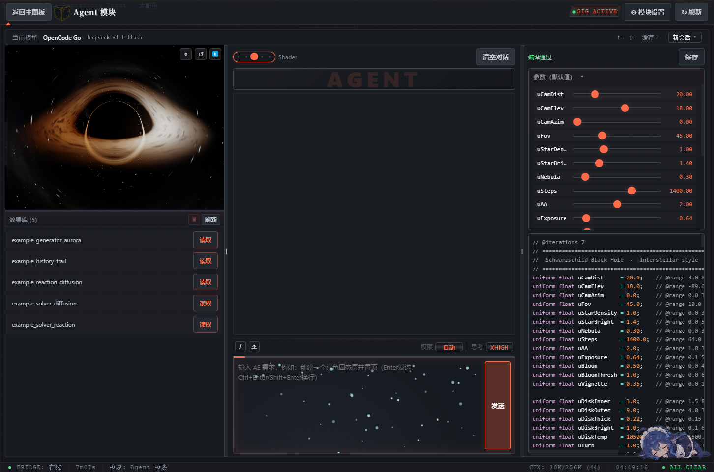
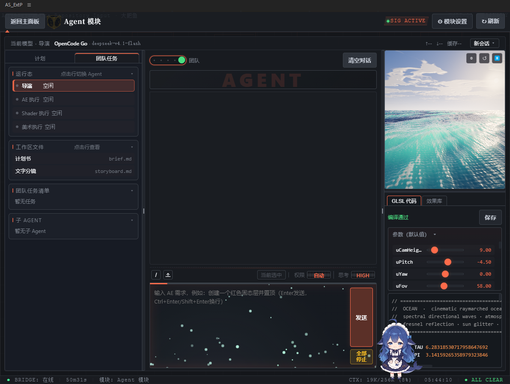

# AS_ExtP — платформа AI-расширения для After Effects

[简体中文](README.md) | [English](README.en.md) | [日本語](README.ja.md) | [Deutsch](README.de.md) | [한국어](README.ko.md) | [Français](README.fr.md) | **Русский**

> Многомодульная платформа расширения (CEP), подключающая ИИ к After Effects.
>
> Версия: v1.0.0

AS_ExtP — это платформа AI-расширения для After Effects: панель CEP плюс два нативных плагина AE (хост GLSL-эффектов и AE Hotbox). Панель состоит из нескольких модулей: **Agent** (диалоговое управление на основе больших языковых моделей), **ComfyUI** (генерация изображений и видео с помощью ИИ), **Библиотека ассетов** (управление ассетами проекта и предустановками), а также **MCP / Skill / память / управление моделями** (расширение возможностей и конфигурация).

**Модуль Agent** — ядро системы: достаточно одной фразы на китайском языке, и ИИ сам вызовет встроенные инструменты автоматизации AE — создаст композицию, добавит слои, поставит ключевые кадры, применит эффекты, выполнит рендеринг — без единой строки кода, написанной вручную. ИИ также может сам создавать, проверять и выполнять скрипты ExtendScript и даже генерировать пиксельные эффекты GLSL / линейного JS, работающие в AE в реальном времени.

Кроме того, **внешний режим** модуля Agent отдаёт весь набор операций AE внешнему агентскому ПО в виде стандартного **MCP Server** — скажите прямо в Claude Code / Cursor «создай мне композицию в AE», и переключаться на панель расширения не нужно. Способ подключения описан в разделе [Подключение внешнего режима](#подключение-внешнего-режима).

---

## Содержание

- [Основные возможности](#основные-возможности)
- [Пять режимов Agent](#пять-режимов-agent)
- [Подключение внешнего режима](#подключение-внешнего-режима)
- [Нативные компоненты](#нативные-компоненты)
- [Установка](#установка)
- [Настройка платформ ИИ](#настройка-платформ-ии)
- [Документация для разработчиков (DEVELOPMENT.md)](docs/DEVELOPMENT.ru.md)
- [Примечания по безопасности](#примечания-по-безопасности)
- [Отказ от ответственности](#отказ-от-ответственности)

---

## Основные возможности

AS_ExtP состоит из 8 функциональных модулей, доступных с карточек модулей на главной панели или через 3D-навигацию по кубу.


### 1. Модуль Agent

Основной модуль: диалог с ИИ на естественном языке и управление AE. Встроены пять рабочих режимов — **Script / Agent / Shader / внешний / команда** (подробнее в разделе [Пять режимов Agent](#пять-режимов-agent)): первые четыре являются одноагентными режимами, пятый, «команда», одновременно задействует четыре постоянных агента; режим «внешний» отдаёт набор инструментов внешнему агентскому ПО как MCP Server. Поддерживаются несколько сеансов (переключатель сеансов ищет по заголовку), три уровня прав на инструменты (авто / баланс / строго), отслеживание плана задач, рефлексия опыта, регулировка интенсивности рассуждений и собственное описание персоны агента; цель может автоматически продлеваться по раундам (полоса цели в верхней панели, команда `/goal`, лимит раундов по умолчанию 25, настраивается от 1 до 500); набор инструментов можно сузить по представлениям (views) (настройки модуля Agent → «Видимость инструментов»). Изображения и видео можно перетащить, чтобы визуальная модель проанализировала кадры, а документы docx / xlsx / pdf сначала разбираются в текст (таблицы Word становятся таблицами Markdown, встроенные изображения извлекаются в каталог данных с указанием пути в тексте, повторы / значки / слишком крупные изображения пропускаются, при необходимости их можно открыть через `read_image`; каждый лист Excel становится CSV); для видео-вложений доступны предпросмотр без звука при наведении и полноэкранный просмотр.

### 2. Инструменты AE

Управляет определениями инструментов автоматизации AE. Инструменты сгруппированы по категориям **проект / композиция / слой / анимация / эффекты / рендеринг / инструменты** (плюс пользовательские категории). В комплект входят 11 инструментов AE: обзор панели проекта и слоёв, сведения о композиции / слое / видеоряде, очередь рендеринга и поиск по композициям, диагностика окружения и эффектов, выполнение ExtendScript, импорт и замена видеоряда, сохранение проекта, рендеринг композиции, перечисление папок, снимок кадра предпросмотра, анализ изображений; кроме того, на стороне панели встроены отмена (`undoLastOperation`) и справка по API AE (`queryAeApi`). Остальные операции AE ИИ выполняет, написав скрипт на месте через `executeExtendScript`. Инструменты поддерживают горячую перезагрузку: правки в панели вступают в силу сразу. ИИ может создавать новые инструменты сам через `createAETool` — самодельный инструмент, не являющийся только для чтения, по умолчанию виден только агенту, а инструменты только для чтения по умолчанию глобальны (видны в режимах скрипта / Shader и во внешнем режиме); чтобы инструмент не только для чтения можно было вызывать из [внешнего режима](#подключение-внешнего-режима), при создании нужно явно указать область действия (scope), включающую `external-mcp`. Есть кэш списка эффектов: при большом числе установленных подключаемых модулей эффектов кэш можно создать заранее и ускорить запросы.


### 3. ComfyUI

Подключение к локальному или облачному сервису ComfyUI для генерации изображений и видео с помощью ИИ; результат можно сразу импортировать в композицию AE. Поддерживаются **режим формы** для генерации изображений и **режим холста** — визуальное редактирование узловых рабочих процессов; можно захватить текущий кадр AE как входные данные, а также доступны пакетная генерация и отображение прогресса в реальном времени по WebSocket.


Что касается шаблонов, встроены **13 вручную настроенных рабочих процессов** (текст в изображение, изображение в изображение, GPT Image, Nano Banana, Seedream, Hailuo, Kling, HappyHorse, Seedance и другие, включая видео из изображения, видео по референсному изображению, генерацию по начальному и конечному кадрам, универсальные референсы и другие видеовозможности). Дополнительно подключена **официальная библиотека шаблонов ComfyUI (600+ наборов)**: ИИ по запросу ищет официальные шаблоны, автоматически разворачивает подграфы и преобразует их в исполняемые рабочие процессы; список моделей в раскрывающемся меню динамически перечисляется по узлам сервера, а индекс шаблонов кэшируется на локальном диске (без сети есть резервный вариант). Пользовательские рабочие процессы поддерживают импорт **UI-формата** и **API-формата**, сохранённых редактором ComfyUI (UI-формат преобразуется автоматически; если шаблон ссылается на неустановленный на этой машине **узел управления интерфейсом** — например, Fast Groups Bypasser от rgthree — пропускается только этот узел-переключатель с уведомлением, а не отклоняется весь рабочий процесс). Каталог рабочих процессов фиксирован: `<каталог данных>\comfyui\workflows` — положите туда .json и снова откройте панель, чтобы он загрузился автоматически. Из соображений безопасности адрес сервиса разрешён только локальный / в локальной сети.

### 4. Библиотека ассетов

Единое управление ассетами, часто используемыми в проектах AE; в виде стопок карточек отображаются три раздела:

- **Ассеты**: виртуальные ссылки на обычные ассеты (изображения / видео и т. п.), сами файлы не копируются
- **Ассеты проекта**: файлы проектов `.aep`, которые можно импортировать в текущий проект
- **Предустановки**: файлы предустановок `.ffx`, которые можно применить к выбранному или указанному слою

Поддерживается пакетный импорт с автоматическим воспроизведением структуры папок; для видеоассетов доступен кэш транскодирования с выбором разрешения (480p / 720p / 1080p / исходный размер), автоматическое транскодирование можно отключить в настройках модуля библиотеки ассетов (влияет только на предпросмотр в библиотеке). Миниатюры в сетке воспроизводятся при наведении без звука; после щелчка по элементу область предпросмотра справа автоматически запускает беззвучное циклическое воспроизведение (видео зацикливается, последовательность кадров проигрывается покадрово по кругу), щелчок по предпросмотру открывает полноэкранный режим; диалог «Очистить кэш» показывает число файлов и общий размер к удалению (страница настроек показывает текущий объём). Отдельные ссылки на ассеты, ассеты проекта и предустановки можно также вызывать напрямую из панели быстрого доступа.


### 5. Управление MCP

Управление внешними серверами MCP (Model Context Protocol), расширяющими набор инструментов ИИ: поддерживаются транспорты stdio, HTTP и SSE, запуск / остановка / мониторинг состояния сервера, автоматическое обнаружение инструментов и их регистрация для вызова ИИ. (Обратите внимание на направление: модуль подключает внешние серверы MCP **внутрь** для ИИ панели, а [внешний режим](#подключение-внешнего-режима) отдаёт инструменты панели **наружу** внешним агентам.)

### 6. Управление навыками

Управление пакетами навыков с предметными знаниями: ИИ загружает их по мере необходимости и получает специализированные указания. Можно создавать собственные навыки, чтобы ИИ следовал вашим рабочим правилам.

### 7. Управление памятью

Система постоянной памяти ИИ, сохраняющая опыт между диалогами: типы памяти сведены к трём — **извлечённые уроки / записи проекта / предпочтения**; можно указать область действия (режимы Agent / Script / Shader), поддерживаются перекрёстные ссылки `[[вики-ссылки]]`, полнотекстовый поиск и пакетное удаление нескольких записей; пользовательские правила по режимам (по одному для Agent / Script / Shader) автоматически добавляются в системный промпт ИИ, остальные записи ИИ ищет по необходимости (`memory_search`).

### 8. Управление моделями

Управление конфигурацией всех платформ ИИ и моделей: просмотр / добавление / редактирование / удаление платформ и моделей, выбор по умолчанию, автоматическое обнаружение моделей, проверка соединения и отметка возможностей модели — визуального ввода, вызова инструментов, режима JSON и других. Редактор платформы поддерживает **пользовательские заголовки запросов** (по одному `Имя: значение` в строке); встроенные предустановки могут объявлять для платформы **заголовок сеанса** (например, `x-opencode-session` у OpenCode Go), который автоматически подставляет ID текущего сеанса в запрос — это подходит для сторонних шлюзов, требующих дополнительной аутентификации или заголовков маршрутизации; серия предустановок `opencode-go` встроена.

### Прочие возможности

- **Индикатор внешней авторизации**: пока авторизация внешнего режима включена, по четырём краям панели постоянно пульсирует подсветка и закреплена строка-подсказка с текущим уровнем и числом отданных наружу инструментов; каждый разрешённый к выполнению вызов инструмента внешнего агента прокручивает его имя, чтобы было видно, открыт ли сейчас внешний доступ
- **Панель быстрого доступа**: глобальная панель быстрых действий в верхней части панели (фиксированный оверлей); позволяет выполнять скрипты, применять предустановки, импортировать ассеты проекта и ссылаться на ассеты, не заходя в модуль; поддерживает поиск с фильтрацией и пакетные операции
- **Многоязычный интерфейс**: можно следовать языку интерфейса After Effects или переключаться вручную: 简体中文 / English / 日本語 / Deutsch / 한국어 / Français / Русский
- **Питомец «Большая жирная рыба»**: можно включить настольного питомца с ИИ (антропоморфный кит, сгенерирован ИИ); поведение включает бесцельную прогулку, подпрыгивание при щелчке, следование за перетаскиванием, дремоту и разговоры во сне, а также диалог, объявления по расписанию, проактивные ответы и веб-поиск
- **Журнал диагностики**: в общих настройках можно **экспортировать диагностический пакет** (журналы процессов панели / Bridge / хоста / нативных компонентов плюс сведения об окружении, с единым обезличиванием, хранятся только последние 5 файлов) — при сообщении о проблеме просто приложите этот файл
- **Темы и персонализация**: несколько готовых тем и **библиотека схем** пользовательских цветов (схемы можно сохранять / применять / переименовывать / удалять; 26 редактируемых цветов (20 основных + 6 семантических цветов состояния; инструмент `panel_theme` читает и записывает все 26), производные цвета вычисляются автоматически); агент внутри панели может читать и менять цвета темы и управлять схемами (инструмент `panel_theme`, доступен только в режиме Agent и не отдаётся во внешний режим); фоновое наложение и система звуковых эффектов
- **3D-навигация по кубу**: вращение перетаскиванием, инерционная прокрутка, переходы с фокусировкой на грани
- **Нижняя строка состояния**: в реальном времени показывает состояние службы Bridge, использование контекста ИИ, активный модуль и часы

---

## Пять режимов Agent

Переключатель режима модуля Agent имеет 5 позиций: первые четыре — одноагентные режимы **Script / Agent / Shader / внешний**, охватывающие весь спектр от «чистого кода» до «чистого диалога» и до «отдачи возможностей наружу»; 5-я позиция, **команда**, включает параллельную работу четырёх постоянных агентов. Переключение выполняется переключателем режима в верхней панели:

### Режим Script

Для задач, требующих точного контроля или повторного использования кода. ИИ создаёт код ExtendScript, который после проверки синтаксиса и аудита безопасности можно отредактировать в области предпросмотра и выполнить; созданные скрипты можно сохранить локально, а дерево скриптов поддерживает загрузку и управление проектом. В области предпросмотра есть двухколоночный режим «Редактор / Результат»; при блокировке или ошибке выполнения соответствующая строка подсвечивается и выводится структурная карточка ошибки.

### Режим Agent

ИИ самостоятельно вызывает весь набор инструментов автоматизации AE. Например, достаточно описать: «создай композицию 1920×1080, добавь красный сплошной слой и поставь ключевые кадры непрозрачности на 2 секунды». Каждая изменяющая операция оставляет в стеке отмены AE группу отмены, и `Ctrl+Z` откатывает её; многораундовый диалог сохраняет контекст, изображения и документы можно перетащить перед работой; многошаговый план задач отслеживается, а опасные операции подтверждаются по политике прав; долгую задачу можно сделать **целью уровня сеанса** (`/goal`), и она будет автоматически продлеваться в пределах лимита раундов, включая автоматическое продолжение после кратковременных сбоев потока.

### Режим Shader-эффектов

**Запуск пиксельных эффектов GLSL / линейного JS прямо в AE**. Сгенерированный ИИ GLSL сначала проходит проверку компиляции и попадает в область предпросмотра; JS-эффекты сначала проходят статическую предварительную проверку опасного кода и по умолчанию второй аудит LLM, затем в песочнице на стороне панели выполняется логика компоновки `buildShader(params)`, порождающая GLSL, которая используется хостом для рендеринга. После финализации результат можно сохранить в библиотеку эффектов, где нативный [хост GLSL-эффектов](#нативные-компоненты) компилирует его, запускает и горячо перезагружает, обновляя изображение в реальном времени. Встроенные параметры (uniform) автоматически превращаются в ползунки / палитры цветов, ошибки компиляции возвращаются LLM для самопочинки, поддерживаются сохранение / загрузка / применение в библиотеке эффектов.



### Внешний режим

Набор инструментов панели отдаётся наружу как стандартный **MCP Server**, чтобы внешнее агентское ПО (Claude Code / Claude Desktop / Cursor / Trae / VS Code Copilot и т. п.) могло напрямую управлять вашим AE. После перехода на позицию «Внешний» внешний доступ открывается только тогда, когда на карточке состояния консоли включён главный переключатель «Авторизация внешнего доступа»; им управляет исключительно пользователь, переключение режима не включает и не выключает его автоматически.

В этом режиме панель показывает шесть функциональных областей одновременно: в левой колонке дерево скриптов + библиотека эффектов, в средней — предпросмотр GLSL + консоль, в правой — предпросмотр кода скриптов и GLSL. В консоли три вкладки — **Журнал вызовов / Очередь проверки / Настройки**, а карточка состояния постоянно стоит в верхней строке (главный переключатель, состояние Bridge, число отданных наружу инструментов, справа — колесо уровней прав, такое же, как колесо «Права» в других режимах; щелчок переключает по кругу). Каждый вызов внешнего агента попадает в журнал вызовов, а отправленные скрипты и эффекты дополнительно оставляют запись в очереди проверки; файлы, записанные извне в библиотеку скриптов / библиотеку эффектов, помечены в соответствующих списках значком «извне».


Настройка подключения описана в следующем разделе.

### Режим команды

5-я позиция переключателя режима. После включения четыре постоянных агента работают одновременно: **режиссёр** (творческая концепция и бриф), **исполнитель AE** (практические операции AE и выпуск материала), **исполнитель Shader** (эффекты GLSL / JS), **художник** (генерация изображений / видеоассетов). У каждого агента свой вид диалога и свой план задач; модель (вместе с её платформой) и уровень рассуждений настраиваются построчно в разделе «Режим команды» настроек модуля Agent — если модель не указана, используется глобальная по умолчанию, уровень рассуждений обязателен (по умолчанию high), там же задаются предел параллельных субагентов (по умолчанию 3) и окно поддержания активности (по умолчанию 10 минут). В левой выдвижной панели два раздела — «План / Задачи команды»: план — это собственные задачи каждого агента, задачи команды — общий список для всех четырёх. Любой агент может по необходимости порождать субагентов (субагент порождать дальше не может); агенты обмениваются сообщениями через инструмент отправки сообщений и передают результаты через файлы рабочей области команды (бриф `brief.md`, текстовая раскадровка `storyboard.md` и т. п.).



---

## Подключение внешнего режима

### Предварительные условия (все обязательны)

1. **After Effects запущен** и панель расширения AS_ExtP открыта (локальный процесс Bridge поднимается вместе с панелью и слушает `127.0.0.1:9877`, при занятом порту сдвигается до 9886)
2. **Внутри панели авторизован внешний доступ**: модуль Agent → переключатель режима на четвёртую позицию «Внешний», затем на карточке состояния консоли **вручную включите** главный переключатель «**Авторизация внешнего доступа**» (**переход в режим ничего не авторизует**; для отзыва авторизации достаточно выключить тот же переключатель — после отключения все **выполнения инструментов** возвращают `EXTERNAL_MODE_OFF`, а список инструментов по-прежнему доступен)
3. **Есть среда выполнения Node** (нужна только для транспорта stdio): расширение поставляется с `vendor\node\node.exe` (v22), **отдельно устанавливать Node.js не нужно** — полный пакет Release уже содержит её, а при клонировании исходников достаточно один раз запустить `tools\check-env.bat`, и Node загрузится автоматически

Без авторизации все **выполнения инструментов** возвращают `EXTERNAL_MODE_OFF` (список инструментов по-прежнему доступен); если панель не открыта, но Bridge работает, возвращается `PANEL_OFFLINE`, а если сам Bridge не поднят (AE не запущен / панель никогда не открывалась) — `BRIDGE_OFFLINE`.

### Выбор способа передачи

| Передача | Способ подключения | Применимо | Описание |
| --- | --- | --- | --- |
| **stdio** (рекомендуется) | Клиент запускает `ext-mcp-server.js` по конфигурации | Все клиенты | Клиент полностью управляет жизненным циклом процесса; поддерживаются интерактивные подтверждения |
| **Streamable HTTP** | Клиент подключается к `http://127.0.0.1:<порт>/mcp` | Claude Code / Cursor и другие клиенты с поддержкой удалённого подключения | Без нового процесса, конечная точка встроена в Bridge |

Порт HTTP определяется зондированием `/health` (сдвиг 9877–9886). Сначала проверьте порт командой `curl http://127.0.0.1:9877/health` (при неудаче повторите с портом +1), затем вписывайте URL.

### Настройка клиента

Путь установки AS_ExtP фиксирован (`tools\install.bat` и `tools\deploy.bat` разворачивают файлы именно туда):

```
C:\Program Files (x86)\Common Files\Adobe\CEP\extensions\AS_ExtP
```

Любому клиенту с поддержкой MCP достаточно добавить одну запись **сервера stdio**, в которой всего два поля:

- `command`: Node из комплекта расширения, `<путь к расширению>\vendor\node\node.exe` (если в системе установлен Node ≥ 20.18 и он есть в PATH, можно указать `node`)
- `args`: `<путь к расширению>\client\shared\ext-mcp-server.js`; в конце можно добавить `--name <метка>` — она указывает источник в диалоге подтверждения и в журнале Bridge; параметр необязателен (по умолчанию `unknown`) — в журнале вызовов панели отображается автоматически созданный ID клиента (вида `ext-<pid>-<ts>`)

Пути должны быть абсолютными — рабочий каталог клиента MCP не является каталогом расширения. Клиенты отличаются только расположением файла конфигурации и именем ключа-контейнера (`mcpServers` / `servers` / `mcp_servers`), а поля — те же две строки выше.

### Уровни прав и семантика подтверждения

Колесо «Права» на правом краю карточки состояния внешнего режима имеет два уровня (тот же элемент управления, что и колесо прав на панели инструментов режимов Agent / Shader, но во внешнем режиме оставлено только два уровня: щелчок переключает по кругу, при наведении мыши показывается пояснение):

| Уровень | Поведение |
| --- | --- |
| **Баланс** (по умолчанию) | Семь групп опасных операций запрашивают подтверждение **в интерфейсе вашего агентского ПО** (через MCP elicitation), остальные выполняются сразу |
| **Авто** | Все внешние вызовы выполняются сразу и только фиксируются в журнале вызовов |

Семь групп опасных операций, требующих подтверждения: создание / перезапись инструментов AE, запись в память (четыре операции), удаление папок ассетов, удаление из библиотеки эффектов, запись в навыки, запись в библиотеку скриптов, изменение конфигурации серверов MCP и управление их запуском (операции чтения подтверждения не запрашивают).

Если клиент **не поддерживает интерактивное подтверждение** (например, Claude Desktop, Cline или подключение через конечную точку HTTP), такие опасные операции **сразу отклоняются** с кодом `CONFIRM_REQUIRED` и не выполняются без подтверждения. Чтобы разрешить их, используйте клиент с поддержкой подтверждений или переключите уровень в панели на «Авто» (это равно явной авторизации всего).

| Клиент | Интерактивное подтверждение |
| --- | --- |
| Claude Code / Cursor / VS Code Copilot | ✅ Подтверждение в агентском ПО (без ответа в течение 60 секунд считается отказом) |
| Claude Desktop / Cline | ❌ Опасные операции отклоняются (`CONFIRM_REQUIRED`) |
| Конечная точка HTTP | ❌ То же (нет канала SSE, подтверждение не доставить) |

### Список инструментов и его динамика

По умолчанию наружу отдаются 42 инструмента (в фиксированном списке 46 инструментов, из них 4 операции записи в память по умолчанию отключены; шлюз и пользовательские инструменты не считаются, отдельные незарегистрированные встроенные инструменты молча пропускаются). На странице настроек их можно включать и отключать по **12 группам модулей** (данные проекта AE / метаинструменты AE / пользовательские инструменты AE / движок Agent / режим Script / режим Shader / память / генерация ComfyUI / библиотека ассетов / Skill / внешние задачи / шлюз), а внутри группы — по каждому инструменту. Группа «шлюз» по умолчанию закрыта: она отдаёт наружу подключённые к панели сторонние серверы MCP, а это самая большая поверхность риска, поэтому включайте её по необходимости. Клиенты с поддержкой `tools/list_changed` (Claude Code / VS Code) автоматически обновляют список после изменения переключателей, а Claude Desktop / Cursor требуют переподключения клиента.

### Устранение неисправностей

| Симптом / код ошибки | Причина и действие |
| --- | --- |
| `PANEL_OFFLINE` | Bridge работает, но соединение с панелью разорвано — откройте панель AS_ExtP |
| `BRIDGE_OFFLINE` | Bridge не поднят (AE не запущен / панель никогда не открывалась) — сначала откройте панель, чтобы хост поднял Bridge, или запустите `node client/shared/ae-bridge.js` вручную |
| `EXTERNAL_MODE_OFF` | Главный переключатель «Авторизация внешнего доступа» не включён (переход на позицию «Внешний» не означает авторизацию, нужно вручную включить переключатель на карточке состояния); блокируется только выполнение инструментов, список инструментов по-прежнему доступен |
| `CONFIRM_REQUIRED` | Операция требует подтверждения, но текущий клиент не поддерживает интерактивное подтверждение — смените клиент или переключитесь на уровень «Авто» |
| `CONFIRM_TIMEOUT` | Ответа на диалог подтверждения не было 60 секунд; в этот раз операция не выполнялась |
| `ACCESS_DENIED` | Инструмент отключён переключателем группы модулей / отдельного инструмента, отсутствует во внешнем белом списке, в выдвижной панели этого инструмента не отмечен пункт «внешний», или серверы шлюза включены не по одному |
| Тайм-аут ожидания в очереди инструментов AE (… с), этот вызов не был передан | Движок AE панели занят (Agent в панели / дорожки команды / другой внешний вызов / идущий рендеринг или длинный скрипт). Вызовы AE внутри панели используют одну очередь FIFO (панель очереди всегда доступна); тайм-аут ожидания гарантирует, что вызов не выполнялся — повторите после освобождения |
| `QUEUE_FULL` | Предел очереди 32, повторите позже |
| `RELAY_TIMEOUT` / `EXT_TIMEOUT` | Панель не ответила вовремя — относительное ограничение 90 секунд (на стороне stdio — 100 секунд), heartbeat `ext_progress` панели постоянно продлевает ожидание; вызов может всё ещё выполняться, сначала проверьте журнал вызовов, а затем решайте о повторе |
| `EXT_TASK_PENDING` | Панель выполняет операцию больше 30 минут (жёсткий предел, heartbeat его не продлевает) — в тексте ошибки есть `taskId`; нижележащий вызов продолжается, получите результат по `taskId` через `ext_task_get` (после перезагрузки панели таблица задач очищается) |
| Конечная точка HTTP возвращает 503 | Bridge не смонтировал эту конечную точку — убедитесь, что Bridge поднят панелью (или командой `node client/shared/ae-bridge.js`) |
| Не удаётся подключиться к 9877 | Порт был занят и произошёл сдвиг — проверьте по очереди `http://127.0.0.1:9877-9886/health` |

---

## Нативные компоненты

Помимо панели CEP, в проект входят два нативных компонента AE (C++, в каталоге `native/`):

### Хост GLSL-эффектов (AS_Effect Host, `native/glsl-host/`)

Универсальный плагин-хост пиксельных эффектов `.aex`. Логика эффекта хранится во внешнем файле `.glsl` или в GLSL, порождённом компоновкой JS; изменение файла сразу подхватывается горячей перезагрузкой и действует в реальном времени, и перекомпилировать плагин под каждый эффект не нужно. Поддерживаются глубины 8bit / 16bit / 32bit (с плавающей точкой), рендеринг на GPU, регистрация uniform по требованию (параметры с плавающей точкой / векторы автоматически отображаются на элементы управления панели: ползунок или палитру цветов); при ошибке компиляции плагин не падает, а записывает журнал ошибок и передаёт его обратно. Это основа среды выполнения режима Shader-эффектов.


Возможности трёхмерного ввода и ввода изображений:

- **Связь с 3D-камерой**: читает камеру композиции и внедряет её матрицу, положение и поле зрения (`uCamFov`) во встроенные uniform — перспектива в GLSL совпадает с камерой AE, что позволяет делать настоящее пространственное выравнивание
- **Связь с источниками света AE**: перечисляет источники света композиции (тип / положение / ориентация / цвет × интенсивность / затухание в конусе, до 8 штук) и внедряет их в серию uniform `uLight*`, поэтому эффект может реагировать на свет AE в реальном времени
- **Входы с привязкой к слоям**: объявление `iChannel1/2/3` включает соответствующую строку слоя (без объявления эти три строки всегда видны, но неактивны — строку LAYER хоста скрыть нельзя), так другие слои можно подать как текстуры (`iChannel0` — встроенный «этот слой»)
- **Слоты параметров**: скаляр — один ползунок, каждая компонента vec2 / vec3 занимает отдельную строку, vec4 и векторы с цветовой семантикой отображаются как палитра цветов; при адресации компонент номер 0 использует исходное имя uniform, остальные — `.y/.z/.w` (для цветовой семантики — `.g/.b/.a`, `.r` нет); диапазон отображения и допустимый диапазон ввода задаются отдельно
- **Индекс библиотеки эффектов**: хост экспортирует эталонный индекс, и представления панели и хоста о библиотеке эффектов синхронизируются автоматически; если выбранный файл исчез, это передаётся как есть, а не подменяется другим шейдером молча


### AE Hotbox (AS_Hotbox, `native/hotbox/`)

Нативный плагин глобального Hotbox на AEGP, работающий независимо от панели CEP. Нажмите горячую клавишу в любом месте AE (по умолчанию `Alt+Q`, переназначить можно записью в общих настройках панели) — у мыши появится плавающее окно: удержание клавиши включает **кольцевой режим жестов** (проведите к сегменту дуги, чтобы выполнить его), а щелчок по центральному кругу — **режим поиска** (широкая строка поиска + линейный список результатов + фильтр по типу). Результаты поиска сопоставляются **по первым буквам пиньиня и по полному пиньиню** (например, `gsmh` → Размытие по Гауссу). В режиме жестов повторное нажатие горячей клавиши при уже открытом окне закрывает его (семантика переключателя); в режиме поиска эта клавиша вводится в строку поиска как символ. После отпускания горячей клавиши нажатие любой буквы сразу открывает поиск с подставленным символом.

Данные берутся из всех эффектов AE, скриптов `agent/scripts` и предустановок (три источника — предустановки библиотеки ассетов, пользовательские предустановки AE и заводские предустановки AE — объединяются с удалением дублей); плагин работает как AEGP в одном процессе с AE, читает локальные файлы напрямую, не проходит через Bridge и не требует открытой панели расширения. Лепестковое меню, связанное с композицией, даёт **три действия со снимком экрана** (копировать в буфер обмена PNG с альфа-каналом / сохранить PNG / сохранить JPG).

#### Быстрый старт

1. Нажмите `Alt+Q` (или свою записанную горячую клавишу) → у мыши появится кольцевое плавающее окно
2. Проведите мышью к нужному сегменту дуги → сегмент подсвечивается (золотой контур)
3. Отпустите кнопку мыши на сегменте → выполнится привязанное к нему действие
4. Или: щёлкните по центральному кругу → перейдите в режим поиска → введите ключевое слово → выберите `↑`/`↓` → выполните `Enter`

#### Режим жестов (удерживайте клавишу)

| Направление | Сегмент | Описание |
| --- | --- | --- |
| Сверху | Снимок экрана | При наведении раскрывается подменю из трёх лепестков (PNG / буфер обмена / JPG); привязки к слоту не несёт |
| Справа сверху / справа снизу / слева снизу / слева сверху | 4 привязываемых слота | Можно привязать фиксированное действие (эффект / скрипт / предустановку); непривязанный слот становится динамическим (откатывается к недавним элементам); при пустой строке поиска сразу показываются недавние; 4 строки слотов в панели настроек расположены в порядке слева сверху / слева снизу / справа сверху / справа снизу (см. следующий раздел) |
| Снизу | Настройки | Щелчок открывает панель настроек, **отпускание здесь ничего не выполняет** — нужен именно щелчок мышью |

- Правило отпускания: отпускание на сегменте (включая прозрачную зону кольцевой полосы в этом направлении) выполняет действие; на центральном круге не выполняется (защита от случайных нажатий, для поиска нужен щелчок); в полости внутри кольца и в промежутках между сегментами окно закрывается без выполнения.
- Если плавающее окно уже открыто, **повторное нажатие горячей клавиши = закрытие** (семантика переключателя, кроме режима поиска); после отпускания горячей клавиши нажатие любой буквы сразу открывает поиск с подставленным символом.
- **Задержка после отпускания** (переключается в панели настроек, по умолчанию выключено): когда включено, отпускание не выполняет действие и не закрывает окно, а сегмент выбирается щелчком мыши — щелчок по сегменту выполняет его, щелчок по центральному кругу открывает поиск; выходы: `Esc`, повторное нажатие горячей клавиши, щелчок вне окна, щелчок по пустому месту внутри кольца. Настройка записывается в `releaseStay` файла `<каталог данных>\hotbox\config.json` и сохраняется после перезапуска AE.

#### Режим поиска (щелчок по центру)

| Клавиша / действие | Поведение |
| --- | --- |
| Пустая строка поиска | Сразу показывает недавние (с фильтром по текущему типу, в обратном порядке времени), первая строка выбрана по умолчанию; без записей показывается подсказка ввода |
| Ввод текста | Нечёткая фильтрация в реальном времени (совпадение подпоследовательности, без учёта регистра) |
| Щелчок по `[全部 ▾]` | Фильтр: все / эффекты / скрипты / предустановки |
| `↑` / `↓`, колесо | Перемещение выбора построчно (с переходом через начало и конец, колесо и `↑`/`↓` работают одинаково) |
| `Enter` / щелчок по элементу списка | Выполняет выбранный элемент (в стиле FXConsole: одно нажатие применяет) |
| `Esc` | Закрывает Hotbox (если привязка начата из панели настроек — возвращает в панель настроек) |

Режим поиска **остаётся открытым** (горячую клавишу можно отпустить и печатать двумя руками) до выполнения / нажатия `Esc` / щелчка вне окна.

**Сортировка: сначала недавние** — среди найденных результатов использованные идут вперёд: элементы из списка «Недавние» (`recent.json`) перемещаются в начало, внутри группы — в порядке недавнего использования (по убыванию времени), остальные сохраняют исходный порядок. При изменении ввода выбранная строка возвращается в первую, поэтому «набрал и сразу нажал Enter» выполняет именно последний использованный элемент. Когда строка поиска пуста, список сразу показывает недавние (с фильтром по типу, по убыванию времени, первая строка выбрана по умолчанию, можно сразу выполнить или привязать через `Enter`/щелчок); при входе в процесс привязки из панели настроек недавние также перечисляются (только привязка, без выполнения). При применении предустановки менее чем на 20 слоёв работа выполняется за один проход и отменяется одной группой отмены, а от 20 слоёв применяется блоками с поблочной отменой. «Использование» определяется по тому же типу + тому же `key` (эффекты = matchName, скрипты / предустановки = абсолютный путь к файлу); если `key` не совпадает, сопоставление идёт по имени. Ёмкость списка — 100 записей (константа в исходниках `kRecentMax`); более старые элементы больше не перемещаются вперёд и не появляются в списке пустого запроса и на кольце жестов; устаревшие записи всё ещё показываются, при выполнении сообщают об ошибке, а привязка отклоняется.

#### Панель настроек

4 строки слотов расположены по направлениям кольца жестов (слева сверху / слева снизу / справа сверху / справа снизу), в каждом слоте привязывается эффект / скрипт / предустановка; горячую клавишу можно переназначить записью; два переключателя — «Выполнять при отпускании» и «Задержка после отпускания». Конфигурация хранится в `<каталог данных>\hotbox\config.json` (каталог данных по умолчанию `%APPDATA%\Adobe\CEP\extensions\AS_ExtP`), список недавних — в `<каталог данных>\hotbox\recent.json`.

> Сборка, развёртывание, устранение неисправностей и детали реализации описаны в [DEVELOPMENT.md](docs/DEVELOPMENT.ru.md).

---

## Установка

### Требования

- **After Effects**: требуется **AE 2023 (AEFT 23.0) или новее** (CEP 11 / CSXS.11, CEF — Chrome 88); нативные компоненты хост GLSL-эффектов / Hotbox также требуют AE 2023+. Версии ниже AE 2023 не поддерживаются: `tools\install.bat` пропускает их и сообщает об этом в сводке.
- Операционная система **Windows**
- **Node.js ≥ 20.18** (только для клонирования исходников): среда выполнения локального Bridge и MCP-сервера stdio. Полный пакет Release уже содержит `vendor\node`; при клонировании исходников один раз запустите `tools\check-env.bat`, и Node загрузится автоматически.

### Получение файлов (один из двух способов)

| Способ | Кому | Содержимое | Как сделать |
| --- | --- | --- | --- |
| **Полный пакет Release** (рекомендуется, **работает сразу**) | Обычные пользователи | Исходники + предкомпилированные `.aex` + встроенная среда Node и зависимости | Скачайте zip из [Releases](../../releases/latest), распакуйте (**устанавливать Node, делать `npm ci` и собирать не нужно**) и дважды щёлкните `tools\install.bat` в пакете |
| **Клонирование исходников** | Для чтения кода / самостоятельной сборки | Только исходники | `git clone` → `npm ci` → дважды щёлкните `tools\check-env.bat` (дополняет `vendor\node`, ffmpeg и PlayerDebugMode) → дважды щёлкните `tools\deploy.bat`, чтобы разложить файлы в каталог расширений |

> Разделение обязанностей двух скриптов: `install.bat` — установщик (всё сразу: определяет AE, скачивает Node и ffmpeg, пишет PlayerDebugMode, разворачивает в каталог расширений); `deploy.bat` — скрипт обновляющего развёртывания для периода разработки (после изменений в `host` / `client` / `CSXS` или содержимого `vendor` заново раскладывает свежие файлы в уже установленный каталог расширений; нативные `.aex` лежат вне каталога расширений и по-прежнему разворачиваются через `install.bat` или копируются в `Plug-ins` AE вручную). Он не занимается загрузкой и настройкой реестра, а перед первым использованием нужно запустить `check-env.bat` или `install.bat`, чтобы подготовить `vendor\`.

> Разделение двух способов: **полный пакет Release работает сразу** (исходники + предкомпилированные `.aex` + встроенные Node и зависимости; распакуйте и дважды щёлкните `install.bat` — устанавливать Node, делать `npm ci` или собирать не нужно); **репозиторий исходников не содержит** этих предкомпилированных файлов и зависимостей (ограничения по объёму и распространению, см. [Ассеты и предкомпилированные бинарники](#ассеты-и-предкомпилированные-бинарники)), их нужно дополнить через `npm ci` / `check-env.bat`. Для самостоятельной сборки нативных компонентов нужны Visual Studio и Adobe AE SDK — SDK по своей лицензии не распространяется вместе с репозиторием. Если `install.bat` запущен внутри каталога исходников, при наличии `deploy\Plug-ins\*.aex` он разворачивает их автоматически, а при отсутствии пропускает с уведомлением. `deploy.bat` требует готового каталога `vendor\` (создаётся `check-env.bat` / `install.bat`) и при его отсутствии предлагает сначала запустить `check-env.bat`; корневой `node_modules` при развёртывании автоматически копируется в `vendor\node_modules`.

### Установка расширения CEP

1. Поместите всю папку проекта в каталог расширений AE, **имя папки должно быть `AS_ExtP`** (все примеры конфигурации ниже рассчитаны на это имя):
   ```
   C:\Program Files (x86)\Common Files\Adobe\CEP\extensions
   ```
   Или используйте `tools\install.bat` (запускается и из пакета Release, и из каталога исходников) для автоматического развёртывания.

   > Примечание: этот каталог **не находится в каталоге установки After Effects**. В собственном каталоге установки AE (например, `E:\Adobe\Adobe After Effects 2023\`) папки `CEP` нет — AE не поставляет собственные панели, расширения загружаются из этого общего каталога (каталоги `<приложение>\CEP\extensions` в установке некоторых других приложений Adobe содержат только их собственные встроенные панели). После установки корень расширения — `...\CEP\extensions\AS_ExtP`, именно этот путь используется в конфигурации JSON для [внешнего режима](#подключение-внешнего-режима).
2. Включите режим отладки неподписанных расширений (обязательно):
   - `Win+R` → введите `regedit`, чтобы открыть редактор реестра
   - Перейдите к `HKEY_CURRENT_USER\SOFTWARE\Adobe\CSXS.11` (AE 2023 / 2024) или `CSXS.12` (AE 2025+) — установщик пишет оба ключа для AE 23/24
   - Создайте строковое значение `PlayerDebugMode` и задайте ему данные `1`
3. Разрешите скриптам записывать файлы и обращаться к сети: `Правка → Установки → Сценарии и выражения` — отметьте соответствующий флажок
4. Перезапустите After Effects и откройте панель через меню `Окно > Расширения > AS_ExtP`

> Расширение не поддерживает одновременное использование нескольких экземпляров AE (Bridge работает в одном экземпляре; при нескольких запущенных AE закройте панель в остальных).

### Ассеты и предкомпилированные бинарники

**Полный пакет Release работает сразу, репозиторий исходников — нет**: перечисленное ниже уже входит в полный пакет Release (распакуйте и дважды щёлкните `tools\install.bat` — устанавливать Node, делать `npm ci` или собирать не нужно); **в репозитории исходников этих файлов нет**, после клонирования их нужно дополнить согласно строке «Клонирование исходников». FFmpeg не входит ни в один из двух вариантов — его скачивает скрипт:

| Содержимое | Объём | Влияние при отсутствии / замена |
| --- | --- | --- |
| Предкомпилированные нативные компоненты `deploy/Plug-ins/*.aex` | ~2MB | Есть в пакете Release, `install.bat` при обнаружении разворачивает их автоматически; в клоне исходников отсутствуют — без них хост GLSL-эффектов и Hotbox недоступны, нужна самостоятельная сборка |
| Среда выполнения Node `vendor/node/` | ~84MB | Есть в пакете Release; в клоне исходников `tools\check-env.bat` скачивает фиксированную версию с nodejs.org и проверяет SHA-256 |
| Пакеты зависимостей `vendor/node_modules/` | ~16MB | Есть в пакете Release; в клоне исходников выполняется `npm ci`, а `deploy.bat` / `install.bat` дополняют их копированием из корневого `node_modules` |
| FFmpeg `vendor/ffmpeg/` | ~200MB | **Проект его не распространяет**: `tools\check-env.bat` / `tools\install.bat` скачивают фиксированную версию из апстрима и проверяют SHA-256 (лицензия и источник — в [THIRD-PARTY-NOTICES.md](docs/THIRD-PARTY-NOTICES.md)) |

> Графика питомца `client/features/deepseekPet/sprites/` (16 PNG + 1 WebM, около 110.5 MB) и скриншоты для README `assets/readme/` (9 PNG, около 3 MB; на части из них виден персонаж) **распространяются вместе с деревом исходников** и являются единственными нетекстовыми ресурсами вне этой таблицы; происхождение и правовой статус персонажа — в разделе «Отказ от ответственности» и в пятом разделе [THIRD-PARTY-NOTICES.md](docs/THIRD-PARTY-NOTICES.md).

### Развёртывание нативных компонентов

При установке через `install.bat` файлы `.aex` автоматически копируются в `Support Files\Plug-ins\` каждого AE; при ручной установке скопируйте туда `.aex` из `deploy\Plug-ins\` самостоятельно, после чего **полностью закройте и перезапустите AE** — изменения вступят в силу.

---

## Настройка платформ ИИ

Откройте панель и перейдите в модуль «Управление моделями»: достаточно ввести API Key любой поддерживаемой платформы. Встроены 10 предустановок платформ — 8 основных платформ ниже плюс две предустановки-шлюза OpenCode Go / OpenCode Go (Anthropic) (доступные модели каждой платформы динамически показываются в раскрывающемся меню, поддержка визуального ввода отмечается значком, изображения можно передавать на вход):

- **DeepSeek** — platform.deepseek.com
- **OpenAI** — platform.openai.com/api-keys
- **OpenRouter** (шлюз-агрегатор нескольких моделей) — openrouter.ai/keys
- **SiliconFlow** — cloud.siliconflow.cn
- **Kimi** (Moonshot) — platform.moonshot.cn
- **Zhipu GLM** — open.bigmodel.cn/usercenter/apikeys
- **Volcengine Ark** (серия Doubao) — console.volcengine.com/ark/region:cn-beijing/apikey
- **Anthropic** — console.anthropic.com

Помимо встроенных платформ можно добавлять **пользовательские платформы LLM**: поддерживается любой интерфейс с протоколом, совместимым с OpenAI, и с протоколом Anthropic, список доступных моделей можно автоматически получить из интерфейса платформы, поддерживаются локально развёрнутые модели (например, Ollama). В редакторе платформы также настраиваются **пользовательские заголовки запросов** (по одному `Имя: значение` в строке; подходит для шлюзов, требующих дополнительных заголовков аутентификации); заголовок сеанса объявляется встроенной предустановкой (ID текущего сеанса автоматически подставляется как заголовок запроса, например `x-opencode-session` у OpenCode Go). Для защиты API Key **базовый адрес `http://` пользовательской платформы** разрешён только локальный / в локальной сети (`https://` не ограничен, публичные платформы вроде OpenRouter работают как обычно).

---

## Техническая архитектура

См. [DEVELOPMENT.md](docs/DEVELOPMENT.ru.md): схема архитектуры «панель CEP + локальный Bridge на Node», многоуровневый откат AEFS и проверка путей, шлюз компиляции AST, каталог данных, шина промптов, журналы диагностики.

---

## Разработка

См. [DEVELOPMENT.md](docs/DEVELOPMENT.ru.md): подготовка окружения (Node ≥ 20.18, `npm ci` или `tools\check-env.bat`), `lint` и два аудита, развёртывание через `tools\deploy.bat`, сборка нативных компонентов.

---

## Примечания по безопасности

AS_ExtP позволяет ИИ самостоятельно управлять AE и выполнять скрипты — это возможность автоматизации с высокими правами. При использовании учитывайте:

- **Опасные возможности по умолчанию отключены**: все четыре класса возможностей скриптов — «выполнение системных команд / доступ к сети / чтение и запись файлов / щелчки по меню» — по умолчанию отключены (включаются в «Настройки модуля Agent → Конфигурация возможностей шлюза AST»), «запуск скриптов без подтверждения» также по умолчанию отключён
- **Песочница выполнения скриптов**: скрипты, созданные ИИ, по умолчанию выполняются в безопасной песочнице, где блокируются опасные операции вроде чтения и записи файлов и вызова системных команд; перед выполнением также проводится статическая проверка безопасности (шлюз компиляции AST), отсекающая известные способы побега
- **Предварительная проверка эффектов Shader / JS**: код JS-эффектов (`submit_js_effect` и запись `.js` в библиотеку эффектов) перед записью / выполнением обязательно проходит статическую предварительную проверку опасного кода и по умолчанию второй аудит LLM; GLSL-шейдеры при отправке сначала проходят проверку компиляции
- **Авторизация внешнего режима**: авторизацией явно управляет главный переключатель «Авторизация внешнего доступа» на консоли, переключение режима не включает и не выключает его; пока авторизация действует, в панели постоянно видны подсветка по краям и строка-подсказка, а главный переключатель позволяет в любой момент прервать внешний доступ. Опасные операции подтверждаются согласно уровню прав, а если клиент не поддерживает интерактивное подтверждение, они **по умолчанию отклоняются**, а не разрешаются; все внешние вызовы фиксируются в журнале вызовов
- **Защита путей при файловых операциях**: все файловые операции ограничены безопасными каталогами, системные каталоги автоматически отклоняются, что предотвращает случайное удаление системных файлов
- **Рекомендации**: делайте резервную копию перед запуском скриптов; осторожно устанавливайте навыки Skill и серверы MCP из непроверенных источников (их содержимое попадает в контекст ИИ); подключайтесь только к доверенным сервисам ComfyUI

---

## Отказ от ответственности

Данное расширение и весь его код созданы при участии ИИ и могут содержать неизвестные дефекты или нестабильное поведение:

- Выполнение операций, созданных ИИ, может привести к **потере данных проекта или повреждению проекта** — перед выполнением сделайте резервную копию
- Скрипты, созданные ИИ, могут включать чтение и запись файлов, системные вызовы и другие операции — сначала проверьте содержимое, затем выполняйте
- Никаких гарантий, явных или подразумеваемых, не предоставляется; убытки от использования этого расширения **несёт сам пользователь**
- Не используйте в производственных процессах без присмотра
- Не используйте созданные ИИ скрипты напрямую в коммерческих проектах без резервной копии

Кроме того: образ персонажа «Питомец „Большая жирная рыба“» — это созданный ИИ контент в стиле фанатской переработки на основе бренд-образа DeepSeek (пасхальная полноэкранная анимация `appear.webm` дополнительно содержит сгенерированную ИИ китайскую речь); это **неофициальная работа**, не связанная с DeepSeek и не авторизованная им. Если правообладатель заявит возражения, образ будет своевременно удалён или заменён.

Этот проект — независимо разработанное стороннее расширение, не связанное с Adobe Inc. отношениями подчинения, спонсорства или авторизации; названия Adobe, After Effects и другие являются товарными знаками их правообладателей и используются здесь только в описательных целях.

---

## Лицензия

MIT License

Описания лицензий сторонних компонентов (сторонние библиотеки и текст соглашения Adobe CEP в дереве исходников, среда Node.js и зависимости npm, распространяемые с полным пакетом Release, FFmpeg, который проект не распространяет, AE SDK, используемый при сборке, и содержимое Adobe в скомпилированных файлах `.aex`) приведены в [THIRD-PARTY-NOTICES.md](docs/THIRD-PARTY-NOTICES.md).

Ассеты питомца (`client/features/deepseekPet/sprites/`) предоставляются вместе с исходниками по MIT, но части, связанные с бренд-образом DeepSeek, выходят за пределы того, что проект может лицензировать; связанные риски пользователь несёт сам.
